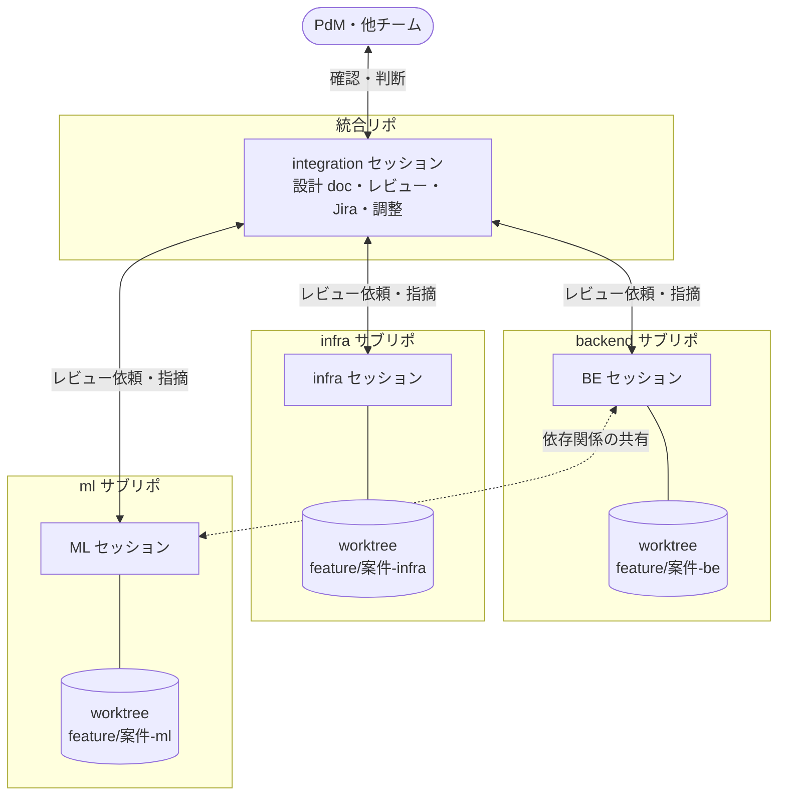
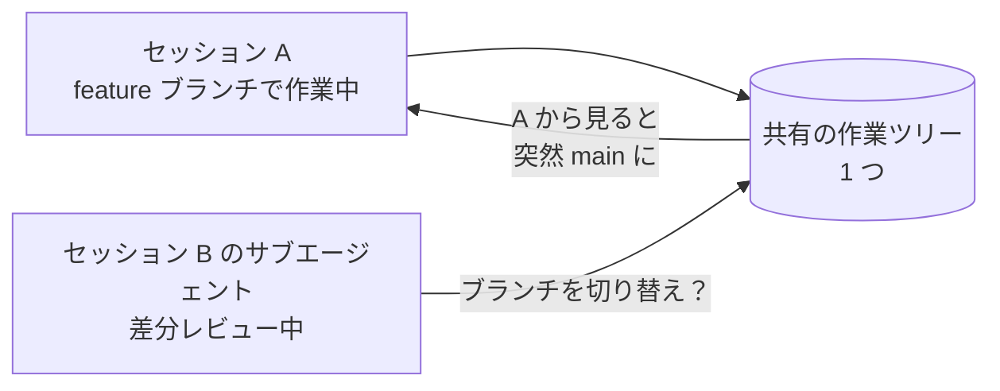
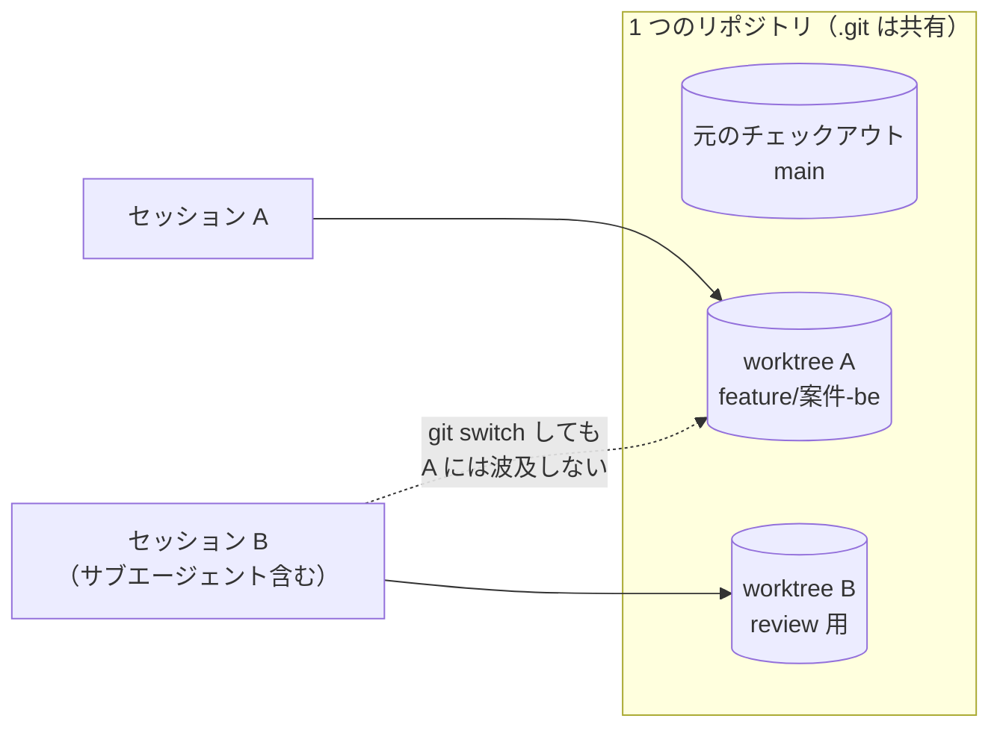

## TL;DR

- 統合リポの下に 5 つのサブリポがある構成で、**案件で触るリポごとに Claude Code のセッションを 1 つずつ並べて**開発しています。たとえば最近の案件では、統合リポと 3 つのサブリポを触ったので 4 セッションでした。インフラ（Terraform）からテスト（E2E）まで、どのリポを触る案件でも同じ形で回せます。herdr を導入した時点では、手元の全プロジェクトで週 62 セッション、9 プロジェクトルートを動かしていました
- 実装はサブリポごとの**専任セッション**に任せます。統合リポのセッションは設計・レビュー・Jira・セッション間の調整に徹し、**自分では実装しません**
- 専任セッション同士はセッション間メッセージで依存関係や未確定事項を共有します。統合セッションは他チームへの確認と判断を引き取ります
- 途中で事故がありました。複数セッションが**同じ作業ツリーを共有**していて、作業中に勝手に main へ切り替わったのです。コミット済みだったので無事でした
- 最初の対策は「サブエージェントにブランチ操作をさせない」という**規律**でした。最終的には **git worktree をセッションごとに分ける仕組み**で防いでいます

## この記事の対象読者

- Claude Code などの AI コーディングエージェントを、**複数セッション同時に**動かしている方
- 複数リポジトリにまたがる機能開発を、AI エージェントとどう分担するか悩んでいる方
- 「エージェント同士の衝突」をルールではなく仕組みで防ぎたい方

## 環境

- Claude Code（複数セッションを同時起動。セッション間メッセージ（cross-session messaging）を利用）
- ターミナル: Ghostty
- ターミナルマルチプレクサ: herdr 0.9.0（AI コーディングエージェント向け）
- git worktree

ターミナルの Ghostty は、GPU で描画し、OS 標準の UI でタブや画面分割を持つターミナルエミュレータです。多数のセッションの出力を同時に流し続ける使い方なので、描画の速さを重視して選びました。その上で、AI コーディングエージェント向けのターミナルマルチプレクサである herdr が、tmux のようにセッションを並べ、セッションごとの worktree を作ります。

## 前提：統合リポ＋サブリポという構成

題材のプロダクトは、1 つの統合リポと 5 つのサブリポで構成しています。サブリポは統合リポのディレクトリの中にクローンし、統合リポ側の git では ignore しています（submodule ではありません）。

**monorepo ではなく、multi-repo（polyrepo）の構成**です。各サブリポは独立した git リポジトリで、履歴も PR も別々です。統合リポは、それらを 1 つの作業ディレクトリにまとめる役割だけを持ちます。

| リポ | 置いているもの |
| --- | --- |
| 統合リポ | 設計ドキュメント、ADR、テストシナリオ、Jira 運用ルール、リポ横断のドキュメント |
| backend | Go の API とバッチ |
| frontend | React + TypeScript + Vite の Web フロントエンド |
| ml | Python の学習・推論 |
| infra | Terraform |
| e2e | E2E テスト |

1 つの機能を作ると、ほぼ必ず複数のサブリポにまたがります。たとえば「テナントごとの実施日に通知を送る」機能は、backend・infra・ml の 3 つのサブリポに手が入ります。

ここで問題になるのが、**どのセッションに何をさせるか**です。

## 1 案件 4 セッションの役割分担

結論から書くと、通知機能の案件ではこう分けました。セッション数は触るサブリポの数で変わり、frontend や e2e が加わる案件ではもっと増えます。

| セッション | 担当 | やらないこと |
| --- | --- | --- |
| 案件名-integration | 統合・PdM との調整・設計 doc・レビュー・Jira・他チームとの確認 | サブリポの実装 |
| 案件名-BE | backend サブリポの実装 | 他リポの実装 |
| 案件名-infra | infra サブリポの実装 | 他リポの実装 |
| 案件名-ML | ml サブリポの実装 | 他リポの実装 |

ある時点では、このプロダクトだけで 11 セッションが並行していました。案件ごとの 4 セッションに加え、指標の集計、別機能との連携、レビュー専用、振り返り（retro）用などのセッションがあります。

### 触るリポが変わっても、分け方は同じ

この分け方は、触るリポの組み合わせが変わってもそのまま使えます。統合セッションは 1 つのまま、触るサブリポの専任セッションを足すだけです。

| 案件 | 触ったサブリポ | 範囲 |
| --- | --- | --- |
| 通知機能（この記事の例） | backend・infra・ml | インフラから API・バッチ、推論まで |
| E2E を GitHub Actions から動かす（[記事](https://qiita.com/zucky-quest/items/615b446b2d93a2214a13)） | e2e・infra | インフラからテストまで |
| 画面に検索項目を足す | frontend・backend・e2e | 画面から API、テストまで |

インフラの変更もテストの変更も、専任セッションに任せる点は変わりません。統合セッションから見れば、相手のリポが Terraform でも E2E のテストでも、依頼とレビューのやり方は同じです。**インフラからテストまでを、同じ形で横断できる**のも、この分け方の利点です。



### なぜ統合セッションに実装させないのか

一番迷ったのはここです。統合リポのセッションは全リポを見渡せるので、そのまま実装させたくなります。

しかし、やらせないと決めました。理由は 2 つです。

1. **文脈が重複する。** サブリポには、そのリポの規約、過去の判断、進行中の作業があります。専任セッションはそれを保持しています。統合セッションが実装に手を出すと、同じ文脈をもう 1 セッション分読み込むことになり、しかも専任セッションほど深くは持てません
2. **作業ツリーが競合する。** 同じサブリポを 2 つのセッションが触ると、後述の事故と同じ構造が生まれます

人間のチームで言えば、テックリードがメンバーのブランチに直接コミットしない、という当たり前のルールです。AI エージェント相手でも同じでした。

## 横断レビューが効いた 2 つの場面

役割を分けて一番効いたのは、**リポの境界にある未確定事項**を拾えるようになったことです。

### 場面 1：他チームから受け取るデータの日付規則が未確定だった

推論処理は、別プロジェクトのチームが毎日置くデータの ZIP を入力にしています。このファイルの日付規則が、推論の側と相手のチームとの間で決まっていませんでした。

- ファイル名の日付は UTC か JST か
- 統計の無い日にも ZIP を作るのか

ML セッションは、実装を進める途中でこの未確定に気づきました。そこで A・B・C の 3 案を整理し、セッション間メッセージで統合セッションに送りました。統合セッションは相手のチームの担当者への確認を引き取り、回答を受けて判断しました。

ここで ML セッションが自分で他チームに確認しに行くと、ML のリポの文脈と他チームとのやり取りが 1 つのセッションに混ざります。**実装の文脈と調整の文脈を分けた**ことで、それぞれのセッションが自分の仕事に集中できました。

### 場面 2：2 つのリポの PR を同時にマージする必要があった

backend の PR を、ml の PR と同時にマージしなければならない、という依存がありました。

ml 側の PR は、予測が 0 件のテナントにも「結果が空のファイル」を出すようにする変更でした。backend は、推論の出力ファイルの契約（JSON Schema）を自分のリポに複製して、取り込み時の検証に使っています。そのため推論処理が新しい形のファイルを出し始めるのと同時に backend の契約も追随しないと、空のファイルが検証で弾かれます。取り込みが失敗し、通知の実施監査が「そのテナントでは推論が実施されなかった」と誤検知してしまいます（実施監査の仕組みは「[『何も起きなかった』をメトリクスの欠損で検知する](https://qiita.com/zucky-quest/items/6f3f02c328480cf9ed5a)」に書きました）。

面白かったのは、この追随が専任セッション同士で受け渡されたことです。ML セッションは PR の説明に「backend 側の契約の追随は BE セッションへ依頼する」と書き、セッション間メッセージで BE セッションに依頼を送りました。自分で backend のリポには手を出していません。依頼を受けた BE セッションが、契約の説明と「空ファイルが検証を通る」テストを追加する PR を作っています。統合セッションを経由しない横の連携で、構成図の「依存関係の共有」の点線はこの動きです。

リポごとに PR を見ているだけでは、気づきにくい種類の依存です。

## セッション間メッセージで役割分担を回す

2 つの場面のやり取りは、どちらも Claude Code のセッション間メッセージ（cross-session messaging）で行いました。同じ端末で動いているセッション同士が、相手のセッションの名前を宛先にして、直接メッセージを送れる機能です。受け取ったセッションは、作業の区切りでそのメッセージを読み、返事を送り返せます。

役割を分けると、セッション同士の連絡が必ず要ります。人が間に入って伝言すると、それがボトルネックになります。セッション間メッセージがあることで、「実装は専任セッション、調整は統合セッション」という分担を、人の伝言なしで回せました。依頼を受けたセッションが作業し、依頼元が一次情報と照らして確認を返す、という往復もできます。

使ってみて、押さえておきたい点が 2 つありました。

- **受け手は、メッセージを使い手の承認とはみなさない。** 受け手は依頼を「同僚からの依頼」として扱い、自分の権限の範囲で動きます。依頼されたからといって、権限の設定を変えたり、使い手の承認が要る操作を代わりに実行したりはしません。セッションごとの権限の境界は、メッセージを通しても保たれます
- **相手のセッションが終わっていると、届かない。** 作業を終えて閉じたセッションには送れません。後から伝えたいことがある場合は、依頼元が開いているうちに返すか、別の手段で残します

## 事故：作業ツリーが勝手に main に戻った

順調に見えた運用で事故が起きました。

当時は、複数のセッションが**同じ作業ツリー**を共有していました。統合リポのチェックアウト 1 つで、サブリポもその中にクローンしてある構成です。あるセッションで差分レビュー用のサブエージェントを動かしている最中に、作業ツリーが main ブランチに切り替わりました。画面上は、push していない作業が消えたように見えました。

作業はコミット済みだったので、ブランチを戻せば無事でした。しかし**未コミットだったら失われていました**。

原因は特定できていません。はっきりしているのは「同じ作業ツリーを複数のエージェントが触れる構造になっていた」ことだけです。



## 対策 1（不十分だった）：規律で防ぐ

最初の対策は、ルールを足すことでした。**サブエージェントに git のブランチ操作を禁じる**というものです。

これは一定の効果はありますが、根本的には弱い対策です。

- 原因を特定できていないので、ブランチ操作を禁じれば防げるという保証がない
- エージェントがルールを守るかどうかは、指示の書き方と状況に左右される
- 新しいセッションやサブエージェントを足すたびに、同じルールを守らせる必要がある

人間のチームでも「気をつけましょう」で再発防止にするのは弱い、と言われます。エージェントでも同じでした。

## 対策 2：git worktree をセッションごとに分ける

2026-09-12 に、AI コーディングエージェント向けのターミナルマルチプレクサ herdr 0.9.0 を導入しました。herdr はワークスペースを作るときに、**独立した git worktree** を一緒に作れます。

```bash
herdr worktree create --branch <ブランチ名> --base main --path <作業ディレクトリ> --focus
```

git worktree を使うと、1 つのリポジトリから作業ディレクトリを複数作れます。ディレクトリごとにチェックアウトしているブランチが独立しているので、**片方で `git switch` しても、もう片方には影響しません**。導入時に、新しい worktree でブランチを切り替えても元のチェックアウトに波及しないことを確かめています。



ここで、危うく見送りかけた話も書いておきます。herdr の導入を検討したとき、事前の調査を Claude Code のセッションに任せました。返ってきた評価は「herdr はセッションを見やすく並べるだけで、事故の対策にはならない」というものでした。

もっともらしい評価だったので、そのまま受け入れて見送る寸前でした。念のため worktree の機能を実際に試したところ、まさに事故を防げる機能だと分かりました。エージェントの評価は誤りだったのです。

**エージェントの調査結果は、結論ではなく仮説として扱う**べきでした。特に「効かない」「できない」という否定の結論は、確かめないまま採用すると選択肢そのものが消えてしまいます。

結果として、事故の対策は「エージェントにルールを守らせる」から「そもそも衝突できない構造にする」へ変わりました。

## 役割分担のルールを明文化した

worktree で物理的な衝突は防げるようになりました。それでも「誰が何をするか」が曖昧なままだと、同じサブリポを 2 つのセッションが触る状況は起こりえます。

そこで 2026-09-14 に、役割分担をルールとして書きました。

- サブリポの実装は、そのリポの専任セッションに任せる
- 統合セッションは、設計 doc・レビュー・Jira・調査・セッション間の調整に徹する
- 統合セッションが実装したくなったら、専任セッションに依頼を送る

worktree が「衝突しても壊れない」を担い、ルールが「そもそも衝突させない」を担う。2 段構えにしています。

## 運用して分かった小ネタ

コマンドの手順は変わりやすいので、つまずいた点だけ残します。

- **herdr のワークスペース ID は、画面上の番号と一致しない。** 削除する前に、一覧を出して ID を確かめる
- **Homebrew で入れた herdr は `brew upgrade` で更新する。** herdr 自身の更新コマンドは使わない
- **Ghostty のキー割り当てが衝突する。** 新規タブと画面分割のショートカット（Cmd+T・Cmd+D）を割り当て直す必要がある

## 規模感

herdr を導入した時点で計測した値です。

| 指標 | 値 |
| --- | --- |
| 1 週間に起動したセッション数（手元の全プロジェクト合計） | 62 |
| プロジェクトルートの数（手元の全プロジェクト合計） | 9 |
| 1 案件のセッション数（通知機能の案件の例） | 4（integration・BE・infra・ML） |
| ある時点で並行していたセッション数（このプロダクトのみ） | 11 |

## まとめ

複数の AI エージェントを並べるときに大事なのは、**道具よりも役割分担の設計**でした。

| 課題 | 対策 | 種類 |
| --- | --- | --- |
| 実装の文脈が混ざる | サブリポごとに専任セッションを置く | 役割の設計 |
| リポ境界の未確定事項が落ちる | 統合セッションがレビューと他チームへの確認を引き取る | 役割の設計 |
| セッション同士の連絡に人が挟まる | セッション間メッセージで直接やり取りする | 仕組み |
| 作業ツリーが競合する | セッションごとに git worktree を分ける | 仕組み |
| 同じリポを 2 セッションが触る | 統合セッションは実装しないとルール化する | 規律 |

学びは 3 つです。

1. **エージェントにも、人間のチームと同じ役割分担が効く。** テックリードがメンバーのブランチに直接コミットしないのと同じで、統合セッションは実装しない
2. **事故対策は規律より仕組み。** 「ブランチ操作をするな」と指示するより、ブランチ操作をしても壊れない構造にする方が確実だった
3. **エージェントの評価は仮説として扱う。** エージェントが「可視化だけ」と評価した道具に、事故を防ぐ機能があった。否定の結論ほど、自分で確かめてから採用する

## 参考

- [git-worktree ドキュメント](https://git-scm.com/docs/git-worktree)
- [Claude Code ドキュメント](https://code.claude.com/docs/en/overview)
- [herdr](https://herdr.dev/)
- [Ghostty](https://ghostty.org/)
- [Ghostty（GitHub）](https://github.com/ghostty-org/ghostty)
