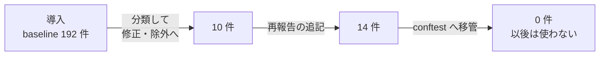
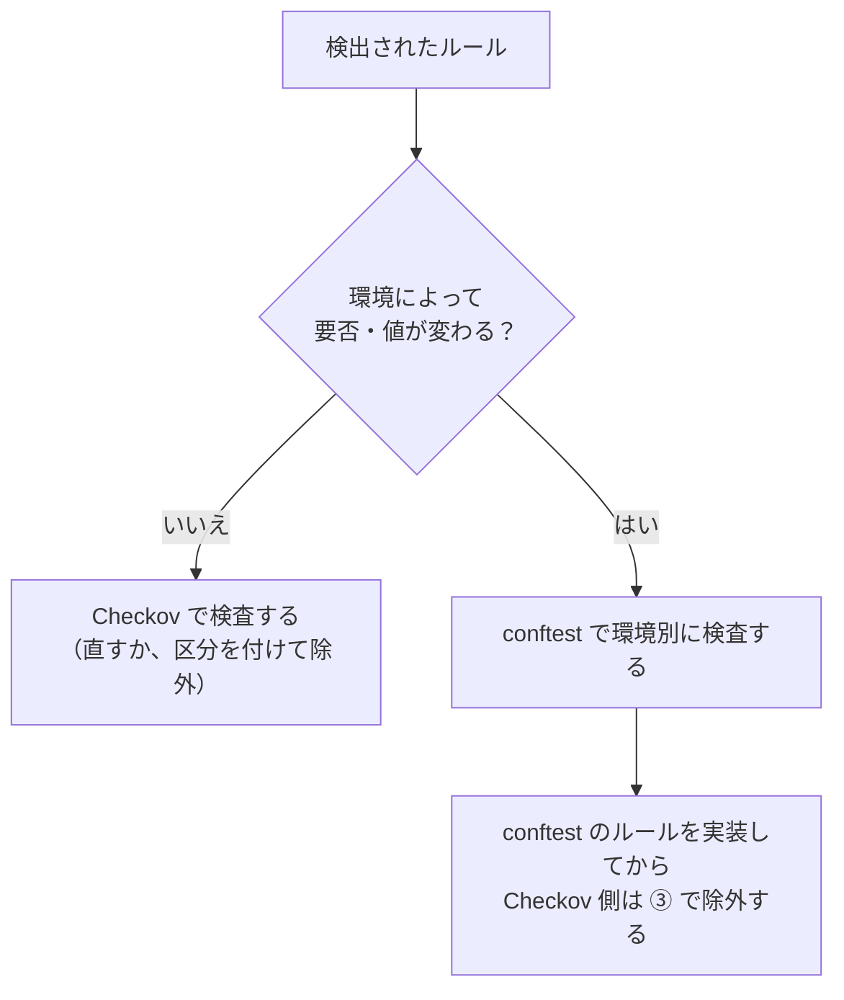

## TL;DR

- Terraform のリポジトリに、IaC のセキュリティ検査ツール **Checkov** を導入しました
- 導入時点の検出は **192 件**でした。すべてを baseline（既存の検出の退避先）に入れ、**新しい検出だけを CI で落とす**ところから始めました
- 約 5 週間で baseline を **0 件**にしました。今は baseline を使わず、新しい除外を足すことも規約で禁じています
- 除外は「**何をするか**（修正・全体許容・個別許容）」と「**なぜ許容するか**（5 区分）」の 2 軸で判断し、台帳に記録します。チケットと期限を必須にしたのは「一時許容」だけです
- 環境によって要否が変わるルールは、Checkov ではなく conftest で環境別に検査しています
- CI では、**失敗が「skip」として素通りする**落とし穴を 2 つ潰しました

## この記事の対象読者

- Terraform に Checkov や tfsec などの検査ツールを入れたものの、例外が増えて形骸化しかけている方
- 「既存の検出が多すぎて、導入したくても CI で落とせない」と悩んでいる方
- GitHub Actions の必須チェックを、ジョブの集約で運用している方

## 環境

- Terraform（AWS）
- Checkov 3.3（pre-commit のフックとして実行）
- conftest（OPA）
- GitHub Actions

## 背景：入れて終わりの検査ツールは、すぐ形骸化する

検査ツールは、入れるだけなら簡単です。難しいのは、その後に「検出ゼロ」を保つことです。

導入した直後に既存の検出が大量に出ると、取れる手は 2 つしかありません。CI で落とさずに警告だけにするか、既存の検出を例外として登録するかです。前者は誰も見なくなり、後者は例外がどんどん増えます。どちらでも、数か月後には「入っているけど効いていない」状態になります。

今回は、これを避けるために 3 つのことを決めました。

1. 既存の検出は一時的に退避し、**新しい検出は最初から CI で落とす**
2. 退避した検出は、**期限を決めずに放置しない**。直すか、理由を書いた除外に移す
3. 除外は**台帳に記録し、判断の基準をそろえる**

## 導入：既存の 192 件は退避し、新しい検出だけを落とす

導入時点の検出は 192 件でした。65 ファイルにまたがり、ルールの種類は 50 です。

これをすぐに全部直すのは現実的ではありません。そこで Checkov の **baseline** 機能を使いました。baseline は、既存の検出をファイルに記録しておき、その分は失敗にしない仕組みです。baseline に無い新しい検出だけが失敗になります。

```yaml
# .pre-commit-config.yaml
- repo: https://github.com/bridgecrewio/checkov
  rev: 3.3.13
  hooks:
    - id: checkov
      verbose: true
      files: \.tf$|^\.github/workflows/.+\.ya?ml$|^\.checkov\.(yaml|baseline)$
      args:
        - --config-file=.checkov.yaml
        - --baseline=.checkov.baseline
```

ポイントは、**ローカルと CI で同じフック・同じ設定・同じ baseline を使う**ことです。CI のジョブも、このフックを pre-commit 経由で呼んでいます。ローカルのコミット時に通ったものが CI で落ちる、あるいはその逆、が起きません。

### 小ネタ：baseline の指定は設定ファイルに書かない

baseline のパスは `.checkov.yaml` ではなく、フックの引数で渡しています。Checkov は作業ディレクトリの `.checkov.yaml` を必ず自動で読み込みます。設定ファイルに baseline を書くと、`--create-baseline` で作り直すときにも既存の baseline が効いてしまい、作り直せなくなるためです。

## baseline を 0 件にするまで

退避した 192 件は、約 5 週間で 0 件にしました。

| 日付 | baseline の検出数 | やったこと |
| --- | ---: | --- |
| 導入日 | 192 | 既存の検出をすべて退避し、新しい検出だけを CI で落とす |
| 約 1 週間後 | 10 | 検出を 1 件ずつ分類し、修正するか、理由を書いた除外に移した |
| 約 3 週間後 | 14 | Checkov 側の都合で、既存の検出が別の識別子として再報告された分を追記した（後述） |
| 約 5 週間後 | 0 | 環境によって要否が変わる 2 ルールを conftest に移し、baseline を空にした |



### 一番効いたのは「分類」

192 件から 10 件への減り方を見ると分かるとおり、ほとんどは修正ではなく**分類**で片付きました。

たとえば、CloudWatch Logs や ECR を CMK（自分で管理する暗号鍵）で暗号化していない、という検出が多数ありました。調べてみると、これは「直すべき問題」ではなく「方針として要らないもの」でした。CMK は個人情報が置かれるストレージにだけ使い、それ以外は AWS 管理の鍵で足りる、と決めているからです。この方針を除外の理由として 1 か所に書けば、関連する何十件もの検出がまとめて片付きます。

逆に、コードを直して解消したものもあります。セキュリティグループのルールに説明が無い、ALB のアクセスログが無効、IAM ポリシーの対象が `*` になっている、などです。こちらは 5 種類 9 件でした。

### baseline に追記してよい、唯一の例外

baseline を空にするまでの間、「baseline に新しい除外を足してはいけない」と規約で決めていました。足してよいと明記した例外は 1 つだけです。

Checkov は、モジュール変数の解決が安定しません。無関係なファイルを足しただけで `for_each` が展開されなくなり、既存の検出が**別の識別子で再報告される**ことがあります。たとえば `...switch["enable"]` だった検出が、`...switch` として新しい検出に化けます。

これは新しい問題ではないので、別表記を baseline に追記してよいことにしました。ただし条件を付けています。同じファイル・同じリソース・同じルールであることを確かめ、経緯を台帳に残すことです。10 件が一時 14 件に増えたのは、この追記の分です。

## 除外の判断は 2 軸で行う

baseline を空にした今、検出が出たらまずコードを直します。除外は例外で、そのときは **2 つの軸**を順に決めます。

### 軸 1：何をするか（記載場所）

| 対応 | 意味 | 書く場所 |
| --- | --- | --- |
| 修正する | コードを直して解消する | — |
| 全体許容 | リポジトリ全体で例外なく許容する | `.checkov.yaml` の `skip-check` |
| 個別許容 | そのリソース固有の事情で許容する | 対象の `resource` ブロック内のインライン skip |

### 軸 2：なぜ許容するか（許容の区分）

| 区分 | 意味 | チケットと期限 |
| --- | --- | --- |
| ① 意図した設計 | ルールの要求と設計方針が恒久的に矛盾する | 不要 |
| ② チェックリスト優先 | 社内の基準が別の値を求めている | 不要 |
| ③ conftest で担保 | Checkov では表せない条件を conftest が見る | 不要 |
| ④ 要件外・誤検知 | 機能として要らない、または Terraform の管理外 | 不要 |
| ⑤ 一時許容 | 直すべきだが今は直せない | **必須** |

同じ「意図した設計」でも、リポジトリ全体で成り立つなら全体許容、そのリソースだけの事情なら個別許容になります。**理由と範囲は別の軸**なので、別々に決めます。

除外には、区分と根拠を必ず書きます。

```hcl
resource "aws_codebuild_project" "build" {
  # checkov:skip=CKV_AWS_316:① Docker イメージのビルドに特権モードが必要
  environment {
    privileged_mode = true
  }
}
```

### チケットと期限を必須にしたのは ⑤ だけ

すべての除外にチケットと期限を求めたくなりますが、そうしませんでした。

①〜④ は恒久的な判断です。必要なのは根拠であって、期限ではありません。意味のないチケット番号を埋めさせると、⑤ のチケット番号が持つ「ここを見れば解消の状況が分かる」という価値が薄まります。

一方、⑤ は追跡先が無いと、恒久的な許容と区別がつかなくなります。だから ⑤ だけは必須にしました。

### 同じ根拠は「パターン ID」で参照する

個別許容では、同じ主張が多くのリソースに繰り返し出てきます。毎回書き直すと、一度書き間違えたときに複数の箇所へ広がります。そこで根拠の型に ID を振り、除外からはその ID を参照しています。

```hcl
resource "aws_s3_bucket" "artifact" {
  # checkov:skip=CKV_AWS_145:④ P-CMK ビルド成果物に個人情報を含まない
```

`P-CMK` の中身（CMK は個人情報が置かれるストレージにだけ使う）と、適用してよい条件・いけない条件は台帳にあります。

### なぜ台帳が要るのか

台帳が無いと、**同じルールを場所ごとにばらばらに扱ってしまう**からです。片方は全体許容、片方は個別許容、残りは baseline のまま、という状態は簡単に生まれます。こうなると「このルールは許容しているのか、していないのか」に誰も答えられません。

台帳には、ルールごとに「何をしたか」と「区分」を記録しています。除外を足したり変えたりする PR では、台帳も同じ PR で更新します。今の除外は、全体許容が 16 ルール、個別許容が 31 ルール・104 か所です。

## Checkov と conftest の役割分担

一番悩んだのは、**環境によって要否が変わるルール**です。

たとえば ALB の削除保護は、社内のチェックリストでは本番と検証環境だけに必須で、開発環境には不要です。ログの保持期間も、本番は 3 年、開発と検証は 90 日と環境で違います。

ところが Checkov の除外は、**モジュールのファイル単位**で効きます。呼び出し元の環境ごとには分かれません。削除保護のルールをモジュールで除外すると、要件を満たしている本番の担保まで消えてしまいます。

さらに、Checkov のモジュール変数の解決は安定しません。ロググループ 27 個はどれも保持期間を変数で渡していますが、Checkov が検出したのは 9 個だけで、残り 18 個は素通りしていました。

そこで、環境で要否が変わるルールは **conftest に移しました**。



conftest は、環境ごとのディレクトリにある `module` ブロックの引数を見ます。そこではリテラルの値が渡されるので、環境を判別して検査できます。Checkov 側は区分 ③ として除外します。

**順番が大事です。** conftest のルールを実装する前に Checkov 側を除外すると、その間は担保がゼロになります。規約では「conftest のルールを同じ PR で実装してから除外する」と決めています。baseline に最後まで残った 2 ルールは、まさにこの 2 つでした。

## CI のハマりどころ

### 1. 変更検出でゲートすると、ワークフローの修正が素通りする

CI では、Terraform の変更があるときだけ後続のジョブを動かす `detect` ジョブを置いています。ところが Checkov のジョブは、**このゲートにかけません**。

Checkov は Terraform だけでなく、**GitHub Actions のワークフロー自体も検査します**。ワークフローだけを直した PR で Checkov が skip されると、その変更は検査されずにマージされます。実行は 10 秒程度なので、毎回動かしています。

### 2. 必須チェックの集約ジョブが、失敗を「skip」で素通りさせる

複数のジョブの結果を 1 つにまとめる集約ジョブを、必須チェックにしています。ここに落とし穴が 2 つありました。

1 つ目は、集約ジョブの `if` に `contains(needs.*.result, 'failure')` のような条件を書くことです。`if` にステータス関数（`always()` など）が含まれないと、暗黙の `success()` が AND されます。依存するジョブが失敗した時点で、**集約ジョブ自体が skip されます**（[actions/runner#491](https://github.com/actions/runner/issues/491)）。

2 つ目は、**skip が必須チェックで成功扱いになる**ことです。1 つ目と合わさると、失敗が素通りします。

対策は、集約ジョブを `always()` で必ず動かし、判定は `run:` の中で行うことです。

```yaml
status-check:
  needs: [detect, fmt-check, tflint, conftest, checkov, validate]
  # !cancelled() ではなく always()。!cancelled() だとキャンセル時にこのジョブが skip され、
  # skip は必須チェックで成功扱いのため素通りする
  if: always()
  steps:
    - name: Verify job results
      env:
        NEEDS: ${{ toJson(needs) }}
      run: |
        # success / skipped 以外（failure / cancelled）を失敗として扱う
        FAILED=$(echo "$NEEDS" | jq -r '
          to_entries[]
          | select(.value.result != "success" and .value.result != "skipped")
          | "\(.key)=\(.value.result)"')
        if [ -n "$FAILED" ]; then
          echo "::error::以下のジョブが成功していません"
          echo "$FAILED"
          exit 1
        fi
```

`!cancelled()` ではなく `always()` を使うのもポイントです。`!cancelled()` だと、ワークフローをキャンセルしたときに集約ジョブ自体が skip され、やはり成功扱いになります。

### 3. ubuntu-slim では動かない

Checkov は pre-commit の Python フックとして動き、仮想環境を作ります。最小構成の `ubuntu-slim` ランナーでは、仮想環境を作れる保証がありません。Checkov のジョブだけは `ubuntu-latest` を使っています。

### 4. inputs 付きの workflow_dispatch は、置き場所を分ける

Checkov には、`workflow_dispatch` に `inputs` を持たせることを検出するルール（CKV_GHA_7）があります。手動実行の入力が、ビルドの成果物に影響しうるためです。

共有のワークフローに `inputs` 付きの `workflow_dispatch` を置くと、このルールに引っかかります。そこで共有のワークフローは `workflow_call` 専用にし、手動実行の入口は別のワークフローに置きました。除外するのではなく、構成で避けた例です。

## AI エージェントにも同じルールを守らせる

このリポジトリでは、AI のコーディングエージェントにも Terraform を書かせています。エージェント向けの指示ファイルにも、同じ運用ルールを書きました。

- Checkov の検出は、原則としてコードを直して解消する
- 除外するなら、許容の区分と根拠を書く。チケットと期限は一時許容のときだけ
- 除外を足したら、台帳を同じ PR で更新する
- baseline に新しい除外を追記してはいけない

エージェントは、検出を黙らせる一番簡単な方法（baseline の作り直しや、根拠の無い skip）を選びがちです。逃げ道を先に塞いでおくことで、人が書いても AI が書いても、除外の質がそろいます。

## まとめ

| やったこと | 理由 |
| --- | --- |
| 既存の 192 件は baseline に退避し、新しい検出だけを落とす | 導入初日から CI で効かせる |
| 分類で 10 件まで減らし、最後は conftest へ移して 0 件にした | 退避を一時しのぎで終わらせない |
| baseline への追記を規約で禁じた（例外は 1 つだけ） | 例外の置き場所を 1 つに保つ |
| 除外は「何をするか」と「なぜ許容するか」の 2 軸で決める | 理由と範囲は別の問題 |
| チケットと期限を必須にするのは一時許容だけ | 恒久的な判断に要るのは期限ではなく根拠 |
| 環境で要否が変わるルールは conftest で担保する | Checkov の除外は環境ごとに分かれない |
| 集約ジョブは `always()` で動かし、判定は `run:` に書く | skip は必須チェックで成功扱いになる |

一番の学びは、**「検出ゼロ」は導入のときではなく、運用で保つもの**だということです。ツールを入れた日に CI で落とし始め、退避した分に終わりを決め、例外には理由を書かせる。この 3 つがそろって、ようやく検査ツールは効き続けます。

## 参考

- [Checkov](https://www.checkov.io/)
- [Checkov: Suppressing and Skipping Policies](https://www.checkov.io/2.Basics/Suppressing%20and%20Skipping%20Policies.html)
- [Checkov: Baseline](https://www.checkov.io/2.Basics/CLI%20Command%20Reference.html)
- [conftest](https://www.conftest.dev/)
- [actions/runner#491](https://github.com/actions/runner/issues/491)
