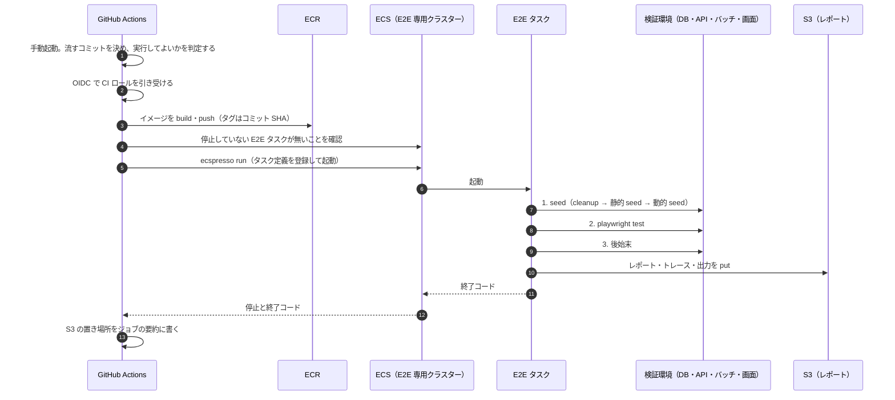

## TL;DR

- Playwright の E2E が、テストの途中で **DB を直接読み、バッチも起動する**作りでした。GitHub のランナーからは VPC 内の DB に届きません
- そこで、**準備（seed）・テスト・後始末の 3 段を、VPC 内で起動する使い捨ての ECS タスク 1 つ**にまとめました。GitHub Actions が担うのは、起動と結果の要約の受け取りだけです
- Step Functions で 3 段に分ける案は採りませんでした。段の間で受け渡す値が無く、分けても後始末の確実さはほとんど変わらないためです
- GitHub の `concurrency` だけでは直列化できません。待機は 1 件までで、**止め損ねたタスクも残ります**。起動前に ECS 側の未停止タスクも確かめる二重構えにしました
- Playwright のエラー文には **cookie や Basic 認証のヘッダーが入ります**。レポートは S3 にだけ置き、GitHub には失敗したテストの名前と置き場所しか渡しません

## この記事の対象読者

- テストが DB やバッチに触る E2E を、CI に載せたい方
- GitHub Actions から、VPC 内のリソースに触る処理を動かしたい方
- E2E のテストデータを共有の環境に置いていて、実行の衝突に悩んでいる方

## 環境

- Playwright（公式のコンテナイメージを土台にする）
- GitHub Actions（OIDC で AWS に入る）
- Amazon ECS（Fargate）と ecspresso
- 対象は検証環境だけ。本番には E2E 用のリソースも信頼関係も作らない

## 背景：spec がテストの途中で DB を引いていた

私たちの E2E は、画面を操作するだけではありません。テストの前に DB へテストデータを入れ（seed）、取り込みバッチを起動してデータを作ります。さらに **spec の中でも DB を直接引いて**、期待値を組み立てています。

「Playwright を GitHub のランナーで動かす」構成はよく紹介されます。しかしランナーは VPC の外にあるので、DB には届きません。

seed と後始末だけを VPC 内の ECS タスクに切り出し、テストはランナーで動かす案も考えました。これでは足りません。テスト中に DB を引く処理を書くたびに、その処理を VPC 内へ切り出すことになります。今後はバッチの結果を DB で確かめるテストも増える予定でした。

**テストがどこのデータに触るかで、実行場所を決める**ことにしました。DB に触るなら、テストごと VPC 内で動かします。

## 構成：使い捨ての ECS タスク 1 つで、3 段を順に実行する



GitHub Actions は、起動のきっかけと結果の要約を受け取るだけです。テストの本体は VPC 内のタスクで動きます。タスクは毎回作り直す使い捨てで、イメージはコミットごとに作り、タグにコミットの SHA を付けます。

タスクのエントリポイントは、3 段をサブコマンドとして持っています。

| 段 | 処理 | 失敗したとき |
| --- | --- | --- |
| 1. seed | cleanup → 静的 seed → 動的 seed（取り込みバッチを起動） | テストを実行せず 3 へ |
| 2. test | `playwright test` | 3 へ |
| 3. 後始末 | cleanup と、古いテスト用ファイルの削除 | 結果を記録して 4 へ |
| 4. レポート | HTML・JSON・トレース・例外文の全文を S3 に put | 結果を記録して終了 |

**データの正しさを保証するのは、1 の先頭の cleanup** です。3 の後始末は補助にすぎません。強制停止などで 3 が走らなくても、次の実行の 1 が消します。

終了コードは段ごとに分け、ログを見なくても原因の当たりが付くようにしました。

| 終了コード | 意味 |
| --- | --- |
| 0 | すべて成功 |
| 1 | テストが失敗した |
| 2 | seed が失敗し、テストを実行していない |
| 3 | テストは成功したが、後始末かレポートの put が失敗した |
| 143 | 中断した（ワークフローのキャンセルなど） |

## Step Functions で 3 段に分けなかった理由

3 段をそれぞれ別のタスクにして、Step Functions でつなぐ案もありました。採らなかった理由は 3 つです。

1. **段の間で受け渡す値が無い。** spec が seed から import するのは定数だけで、分岐も並列もありません
2. **起動とイメージの pull が 3 回になる。** ステートマシンと実行ロールの管理も増えます
3. **後始末の確実さがほとんど変わらない。** ステートマシンの Catch は、実行の停止（StopExecution）では働きません。キャンセルされたときに後始末が走らないのは、1 タスク構成と同じです

テナントを分けたシャーディングや、既存のステートマシンとの連携が必要になったら見直します。3 段をサブコマンドに分けてあるのは、そのときに各ステートへそのまま割り当てるためです。

## GitHub に「何を渡さないか」

一番気を使ったのは、**認証情報が GitHub に漏れない経路**です。

Playwright の API リクエストが失敗したときのログは、リクエストヘッダーをすべて出力します。そこには cookie の認証トークンや、検証環境の Basic 認証のヘッダーが入ります。同じ内容は HTML レポートと JSON レポートのエラー文にも入ります。GitHub の secrets に登録していない値は、Actions のログでマスクされません。

そこで、出力の経路を分けました。

| 出力 | 行き先 |
| --- | --- |
| seed と後始末のログ（件数やキー） | 標準出力 → Actions のログ |
| 段ごとの結果、失敗したテストの名前と件数 | 標準出力 → Actions のログ |
| 例外の種類（API の例外ならメソッド・パス・ステータスまで） | 標準出力 → Actions のログ |
| 例外文の全文、Playwright の出力、HTML・JSON レポート、トレース | **S3 だけ**（7 日で失効） |

Actions の成果物（artifact）も添付しません。成果物は、リポジトリを読める人なら誰でも取得できるからです。レポートを見るときは、検証環境の AWS 権限を持つ人が S3 から取得します。

もう 1 つの落とし穴が、`ecspresso run` の `--overrides` です。ここで渡したコンテナの環境変数は、RunTask のリクエストとして **CloudTrail に平文で記録**され、`DescribeTasks` の応答にも載ります。`--overrides` には秘密でない値（実行 ID など）だけを渡し、DB の資格情報は Secrets Manager からタスク定義で読ませています。

## 直列化は二重構え

E2E のテストデータは、検証環境の**専用テナント**に置いています。2 つの実行が重なると、片方の cleanup がもう片方のデータを消します。実行は必ず 1 つずつにしなければなりません。

### GitHub の concurrency だけでは足りない

まず GitHub Actions の `concurrency` で直列化しました。

```yaml
concurrency:
  group: e2e-staging
  cancel-in-progress: false
```

ところが、これには落とし穴が 2 つありました。

1 つ目は、**待機できるのがグループごとに 1 件だけ**なことです。実行中に 2 件目が来ると待機しますが、さらに 3 件目が来ると、待機中の 2 件目が取り消されます。取り消された実行は成功にならないので、リリース前の確認が黙って通ることはありません。ただ「取り消されたら再実行する」ことは、手順に書いておく必要があります。

2 つ目は、**concurrency が守るのは GitHub 上の実行だけ**なことです。ワークフローをキャンセルしたときにタスクの停止に失敗すると、ECS のタスクだけが残ります。GitHub から見ると実行は終わっているので、次の実行が始まってしまいます。

### 起動前に、ECS 側の未停止タスクも確かめる

そこで、タスクを起動する前に **E2E 専用クラスターに停止していないタスクが無いか**を確かめ、あれば止まるまで待つことにしました。

ここにも細かい落とし穴がありました。`ListTasks` はタスクの「望ましい状態（desiredStatus）」でしか絞れません。停止を指示されたタスクは desiredStatus がすぐ `STOPPED` になりますが、実際には停止までの猶予時間（最大 120 秒）の間、後始末を実行し続けます。desiredStatus だけを見ると、**後始末中のタスクと次の実行の seed が重なります**。

対策として、desiredStatus が `RUNNING` と `STOPPED` の両方を列挙し、`DescribeTasks` の **lastStatus**（実際の状態）が `STOPPED` 以外のものを「停止していない」と判定しています。

### SQS で待ち行列を作らなかった理由

実行を確実に順番待ちさせるなら、SQS などで待ち行列を作る手もあります。採りませんでした。E2E は手動起動だけで、3 件以上が重なることはまれだからです。まれな取り消しは再実行で済み、待ち行列の運用を増やすほどの価値はありませんでした。

## キャンセルされたときの止め方

ワークフローがキャンセルされると、ECS のタスクを止めます。ECS はまず SIGTERM を送るので、タスクは SIGTERM を受けたら実行中の段を止め、後始末を試みてから終わります。止め方は段によって違います。

- **テスト中**：Playwright の子プロセスに **SIGINT** を送ります。Playwright が実行中のテストを止めてレポートを書くのは SIGINT のときで、SIGTERM では即座に終わり、レポートが残らないためです
- **動的 seed 中**：起動済みの取り込みバッチのタスクを止め、停止を待ちます。取り込みの完了を待つと猶予時間を過ぎて強制終了されます。さらに、取り込みが次の実行の seed の後に終わると、前回のデータが専用テナントに入ってしまいます

タイムアウトは、ジョブ全体ではなく**ステップごと**に付けました。ジョブ全体の上限で打ち切られると、タスクを止める後片付けのステップに使える時間が残らないからです。テストのステップの 90 分は、起動と pull（5 分）、cleanup と静的 seed（5 分）、動的 seed（15 分）、テスト（60 分）、後始末とレポート（5 分）の合計です。

## OIDC の信頼は main だけ

CI ロールを引き受けられるのは、`main` ブランチからの実行だけにしました。理由は 2 つあります。

1. **タスク定義の登録を、リソースで絞れない。** `ecs:RegisterTaskDefinition` はクラスターの条件キーを持たず、タスク定義はクラスターに属しません。family の ARN で絞れるかも資料によって扱いが分かれるため、`*` で許可しています。任意のブランチから引き受けられると、任意のタスク定義を登録できてしまいます
2. **タスクは DB の資格情報を読める。** タスクで動くコードは、検証環境の DB に入れます

ただ、これだとマージ前の PR を流せません。そこで PR を流すときも `main` のワークフローを使い、PR 番号を入力として渡すことにしました。**PR を流してよいかは、`main` のワークフローが CI ロールを引き受ける前に判定**します。判定を PR 側のコードで行うと、判定そのものを書き換えられるからです。

流してよいのは、起動した人が maintain か admin の権限を持つときか、PR の最新コミットに作成者以外の Approve があるときだけです。ワークフロー本体とタスク定義は常に `main` のものを使い、PR から取り込むのはテストのコードとイメージの中身だけにしています。

この判定の仕組みと、Approve で自動起動する話は、続編「Team プランの private リポで、PR の Approve を E2E の承認ゲートにする」で詳しく書きます。

### 小ネタ：イメージのタグは PR の最新コミットの SHA にする

最初は、イメージのタグに「起動したコミット（`main`）の SHA」を使っていました。ECR のタグは上書きできない設定（immutable）にしているので、PR を流しても `main` のイメージが再利用され、**PR のテストが流れません**。流すコミット（PR の最新コミット）の SHA をタグにして解決しました。

## ローカル実行と共有テナント

ローカルで E2E を実行すると、踏み台経由のポートフォワードで検証環境の DB に届きます。CI と同じ専用テナントを使うので、**ローカルの実行が CI の実行を壊す**ことがあります。しかもこれは、AWS の権限では塞げません。

対策は 3 段階で考えています。

| 段階 | 対策 | 効き方 |
| --- | --- | --- |
| 1 | ECS の外では cleanup を拒否するガードを入れる | 事故の防止 |
| 2 | 資格情報を Secrets Manager に寄せ、ローカルから使いにくくする | 強制 |
| 3 | テナントを分けるか、ロックを取る | 競合そのものをなくす |

今は、フル実行は CI に任せ、ローカルで実行する前は専用クラスターに動いているタスクが無いかを確かめる、という運用にしています。確認用のコマンドも用意しました。

## これから：バッチの E2E に広げる

今後は、取り込みや通知などのバッチまで E2E を広げる予定です。そのためには 2 つ要ります。

- **対象日・時刻の注入**：バッチは「今日」の分を処理します。テストから「どの日の分として動かすか」を渡せないと、日付をまたいだ挙動を確かめられません
- **単体で起動する手段**：今はステートマシンの一部として動いているバッチを、テストから単体で起動できる入口が要ります

## 成果

| | 時間 |
| --- | --- |
| 1 回の実行にかかる時間（実測） | 約 15 分 |
| テストのステップのタイムアウト（上限） | 90 分 |

1 回の実行は、準備・テスト・後始末を合わせて約 15 分で終わります。タイムアウトの 90 分は、各段階の上限を積み上げた値です。実際の所要時間には十分な余裕があり、取り込みの待ちやテストが長引いても、すぐには打ち切られません。

もう 1 つの成果は、直列化の効果です。以前は、テストデータの不整合が起きていました。実行を必ず 1 つずつにする直列化を仕組みとして入れたことで、この不整合は人の注意に頼らず防げるようになりました。

## まとめ

| 判断 | 理由 |
| --- | --- |
| テストごと VPC 内の ECS タスクで動かす | spec がテスト中に DB を引く。ランナーでは届かない |
| 3 段を 1 タスクにまとめる | 段の間の受け渡しが無く、分けても後始末の確実さは同じ |
| データの正しさは先頭の cleanup で保証する | 後始末は強制停止で走らないことがある |
| レポートは S3 にだけ置く | Playwright のエラー文に cookie や認証ヘッダーが入る |
| concurrency と ECS の未停止タスクの確認で二重に直列化する | 待機は 1 件までで、止め損ねたタスクも残る |
| OIDC の信頼は main だけにし、PR は main 側で判定する | タスク定義の登録を絞れず、タスクは DB の資格情報を読める |

学びは 2 つです。

1. **実行場所は「テストがどこのデータに触るか」で決める。** よく紹介される構成でも、自分たちのテストの作りに合わなければ、毎回の切り出しでコストを払い続けることになります
2. **直列化と後始末は、GitHub 側の仕組みだけでは閉じない。** GitHub から見て終わった実行でも、その先の AWS では動き続けていることがあります。実際の状態を見て判定する必要があります

## 参考

- [Playwright: Docker](https://playwright.dev/docs/docker)
- [GitHub Actions: Using concurrency](https://docs.github.com/en/actions/using-jobs/using-concurrency)
- [Configuring OpenID Connect in Amazon Web Services](https://docs.github.com/en/actions/security-for-github-actions/security-hardening-your-deployments/configuring-openid-connect-in-amazon-web-services)
- [ecspresso](https://github.com/kayac/ecspresso)
- [Step Functions: Handling errors（Catch の対象）](https://docs.aws.amazon.com/step-functions/latest/dg/concepts-error-handling.html)
