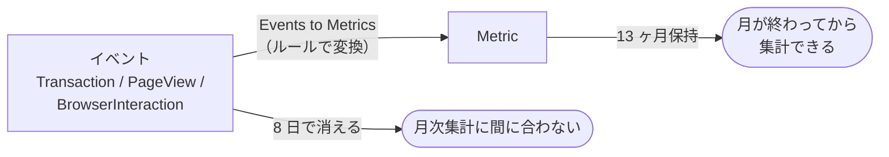
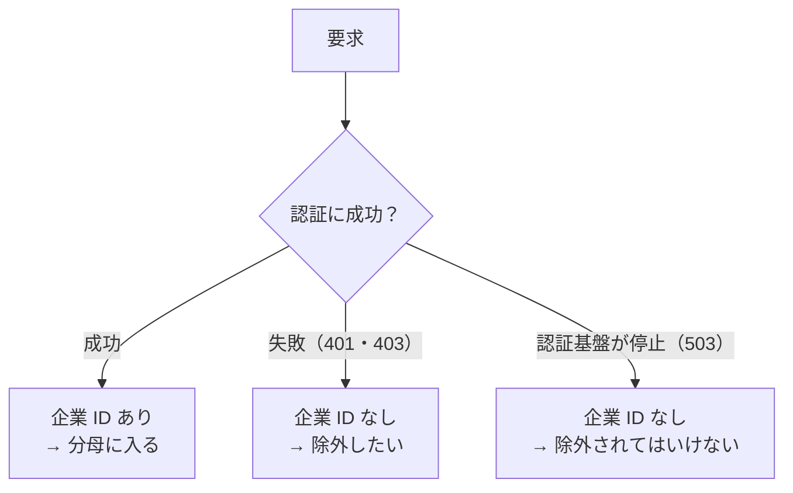

## TL;DR

- 月次の SLI（API の可用性、API と画面の応答時間 p95）と画面の利用指標を、New Relic から出したかった
- ところが、利用しているプランでは `Transaction` や `PageView` などの**イベントが 8 日で消えます**。月が終わってから集計しようとしても、もうデータがありません
- **Events to Metrics（E2M）**でイベントを Metric に変換して残すことにしました。Metric は **13 ヶ月**保持されます
- E2M には制約が多く、特に効いたのは 3 つでした。集計関数は 3 種類だけ。1 メトリクス名に 1 ルール。**ルールは作った時点からしかデータを溜めない**
- 可用性の分母には落とし穴がありました。認証前の 401 を除くつもりの条件のせいで、**認証基盤が全面停止しても可用性が 100% と出る**設計になりかけました
- ルールは Terraform で管理し、`enabled = true` を明示しています。省略すると、New Relic がルールを自動で無効にしても plan に差分が出ません
- 検証環境で、Metric から出した値とイベントから直接数えた値を突き合わせ、すべて一致しました

## この記事の対象読者

- New Relic で SLI や利用状況の指標を、月単位で振り返りたい方
- イベントの保持期間が短く、過去の集計ができずに困っている方
- New Relic のリソースを Terraform で管理している方

## 環境

- New Relic（APM・Browser）
- Terraform と newrelic provider v3.97.2
- 対象は B2B の Web アプリ。API と SPA のフロントエンドで構成

## 背景：月が終わると、もうデータが無い

月次で振り返りたい指標は次の 6 つでした。画面ファネルは 3 画面分あるので、ルールにすると全部で 8 つになります。

| 区分 | 指標 | 元のイベント |
| --- | --- | --- |
| SLI | API の可用性 | `Transaction` |
| SLI | API の応答時間 p95 | `Transaction` |
| SLI | 画面の読み込み時間 p95 | `PageView` |
| 利用状況 | 画面の利用企業数 | `BrowserInteraction` |
| 利用状況 | 画面の利用者数 | `BrowserInteraction` |
| 利用状況 | 画面ファネル（3 画面それぞれの利用者数） | `BrowserInteraction` |

どれも New Relic のイベントから NRQL で出せます。問題は保持期間でした。利用しているプランでは、これらのイベントは **8 日で消えます**。検証環境で一番古いイベントを探したところ、ちょうど 8 日前のものでした。

月次レポートは月が終わってから作ります。10 月分を 11 月の第 1 週に集計しようとしても、10 月前半のイベントはもう残っていません。



## Events to Metrics を選んだ理由

イベントを長く残す方法はいくつかあります。保持期間の長いプランに変える、データを外部にエクスポートする、そして Events to Metrics です。

Events to Metrics を選んだのは、**必要な集計結果だけを残せば足りた**からです。月次レポートに要るのは、件数・分位点・ユニーク数という集計済みの値で、個々のイベントは要りません。プランの変更より安く、エクスポート先の仕組みを作るより手間が少ない方法でした。

## E2M の制約：設計で効いた 4 つ

Events to Metrics は、NRQL で書いたルールに従ってイベントを Metric に変換し続ける機能です。便利ですが、普段の NRQL と同じ感覚で書くとはまります。

### 制約 1：集計関数は 3 種類だけ

使えるのは `summary()`・`uniqueCount()`・`distribution()` の 3 つです。今回の指標は次のように割り当てました。

| 指標 | 集計関数 | 照会時の関数 |
| --- | --- | --- |
| 可用性（リクエスト数） | `summary(1)` | `sum()` |
| 応答時間 p95 | `distribution(duration)` | `percentile()` |
| 利用企業数・利用者数 | `uniqueCount()` | `uniqueCount()` |

### 制約 2：1 メトリクス名に 1 ルール、1 ルールに 1 種類の集計

ルールとメトリクス名の組み合わせには、2 つの制約があります。

- **1 つのメトリクス名に書き込むルールは 1 つだけにする。** 2 つのルールが同じメトリクス名に書き込むと、`uniqueCount` が 0 になります
- **1 つのルールに `summary` と `uniqueCount` を混ぜない。** 混ぜると、`uniqueCount` が値を生成しません

このため、画面ファネルは FACET（NRQL で結果を属性の値ごとに分けて集計する句。SQL の `GROUP BY` にあたる）で画面ごとに分けるのではなく、**画面ごとに別のルール・別のメトリクス名**にしました。3 画面で 3 ルールです。利用企業数と利用者数も、`uniqueCount` を 1 つずつ別のルールに分けています。ルールは全部で 8 つになりました。

### 制約 3：SINCE と TIMESERIES は書けない

ルールは「流れてくるイベントを変換し続ける」ものなので、期間の指定はできません。代わりに `AS` でメトリクス名を付けます。

```sql
SELECT summary(1) AS 'myapp.api.requests'
FROM Transaction
WHERE appName = 'production-myapp-api'
  AND (company_id IS NOT NULL OR http.statusCode >= 500)
FACET http.statusCode
```

### 制約 4：ルールは作った時点からしかデータを溜めない

一番効いたのがこれです。ルールは**過去のイベントには遡りません**。月の途中でルールを作ると、その月の前半は欠けて、その月の値は出せません。

そこで「利用者が本番に切り替わる**前の月末までに**ルールを作る」という期限を置きました。ルールを作る前の月と、途中で作った月は「計測前」として扱い、判定は翌月からにしています。

## 可用性の分母の落とし穴

一番悩んだのは、可用性（5xx 以外の応答の割合）の分母に何を入れるかでした。

### 認証前に弾いた 401 を除きたい

API には、ログインしていない要求や、権限の無い要求が来ます。これを 401・403 で弾くのは正常な動作です。可用性の分母に入れると、外から叩かれるほど値がぶれます。

そこで「**企業 ID を持つ応答だけ**」を数えることにしました。企業 ID は認証に成功した要求にしか付かないので、認証前に弾いた 401・403 を自然に除けます。

```sql
WHERE company_id IS NOT NULL
```

### そのままだと、全面停止で 100% になる

ところが、この条件だけでは致命的な穴がありました。**認証基盤が全面的に落ちた場合**です。

認証基盤が落ちると、すべての要求が 503 になります。どの要求も認証に成功していないので、企業 ID を持ちません。すると障害の間の 503 は、1 件も数えられません。月全体で集計すると、数えられるのは障害が起きていない時間の応答だけです。**一番ひどい障害が起きた月でも、可用性は障害が無かったときと同じ 100% のまま**表示されてしまいます。



そこで条件に `OR http.statusCode >= 500` を足しました。

```sql
WHERE company_id IS NOT NULL OR http.statusCode >= 500
```

認証前の 401・403 は除き、5xx は企業 ID の有無にかかわらず必ず数えます。「正常な拒否は除くが、障害は必ず数える」という分母です。

### ステータスコードを次元に残して、照会時に絞る

ルールでは `summary(1)` をステータスコードで FACET して持ち、成功かどうかは照会のときに判定します。

```sql
SELECT sum(myapp.api.requests) AS requests,
       filter(sum(myapp.api.requests), WHERE http.statusCode < 500)
         / sum(myapp.api.requests) * 100 AS availability
FROM Metric
SINCE '2026-10-01 00:00:00' UNTIL '2026-11-01 00:00:00'
WITH TIMEZONE 'Asia/Tokyo'
```

FACET した `http.statusCode` が、Metric の次元でも**数値のまま残る**ことは事前に確かめました。`= 200` で絞ると一致し、文字列の `= '200'` では 0 件になります。ルールで指定していない `appId` の次元も自動で付いていました。

成功の定義をルールに焼き込まないので、後から「429 も失敗に数えたい」となっても、照会を変えるだけで済みます。

## 応答時間は distribution で持つ。p95 は近似値になる

応答時間の p95 は `distribution(duration)` で持ち、照会時に `percentile()` で出します。

```sql
SELECT percentile(myapp.api.duration, 95) * 1000 AS api_p95_ms
FROM Metric
SINCE '2026-10-01 00:00:00' UNTIL '2026-11-01 00:00:00'
WITH TIMEZONE 'Asia/Tokyo'
```

`distribution` は値をバケットに丸めて保存するので、p95 は**近似値**になります。API の p95 で比べると、差は 1〜2% 程度でした。

| 環境 | 期間 | Metric から | イベントから直接 |
| --- | --- | --- | --- |
| 検証環境 | 約 4 日（リクエスト 1,374 件） | 425.8 ms | 420 ms |
| 開発環境 | 約 23 時間 | 416.0 ms | 414 ms |

SLO の判定にはこの近似値を使うと決めています。

利用企業数・利用者数は `uniqueCount` で持ち、照会時も `uniqueCount(メトリクス名)` で月内のユニーク数を出せます。

## Terraform で管理する。enabled = true は省略しない

ルールは Terraform のモジュールで管理し、開発環境 → 検証環境 → 本番の順に作ります。plan と apply は GitHub Actions で自動化しています。PR を作ると plan が走り、マージすると開発環境と検証環境に apply されます。本番は、PR のコメントの承認チェックを経てから apply します。

```hcl
resource "newrelic_events_to_metrics_rule" "api_requests" {
  account_id  = var.account_id
  name        = "${local.name_prefix}-api-requests"
  description = "API の可用性の月次算出用。ステータスコード別のリクエスト数"
  nrql        = "SELECT summary(1) AS 'myapp.api.requests' FROM Transaction WHERE ${local.api_filter} AND (company_id IS NOT NULL OR http.statusCode >= 500) FACET http.statusCode"
  enabled     = true
}

# 画面ファネル。FACET を使わず、画面ごとに別のルール・別のメトリクス名にする
resource "newrelic_events_to_metrics_rule" "web_screen_users" {
  for_each = local.screens

  account_id  = var.account_id
  name        = "${local.name_prefix}-web-${replace(each.key, "_", "-")}-users"
  description = "画面ファネルの月次算出用。${each.key} 画面を開いた利用者数"
  nrql        = "SELECT uniqueCount(enduser.id) AS 'myapp.web.${each.key}.users' FROM BrowserInteraction WHERE ${local.web_filter} AND browserInteractionName LIKE '${each.value}'"
  enabled     = true
}
```

### enabled を書かないと、自動無効化に気づけない

`enabled = true` は既定値なので、書かなくても動きます。しかし**書かないと困ったこと**になります。

newrelic provider は、設定に `enabled` があるときだけ、API 側の有効・無効を state に読み込みます。省略すると、New Relic がルールを無効にしても plan に差分が出ません。

New Relic は、カーディナリティが上限を超えたルールなどを**自動で無効にする**ことがあります。`enabled` を省略していると、ルールが黙って止まり、データが溜まらないまま月末を迎えます。前述のとおりルールは遡れないので、気づいたときにはその月の値は失われています。

明示しておけば、無効化は plan の差分として現れ、apply で有効に戻せます。

ただし、plan が走るのは PR を作ったときだけです。定期的に plan を流す仕組みは無いので、自動無効化は次の PR まで気づけません。自動無効化は `NrIntegrationError` イベントで検知できます。検証環境でのテストの時点では 0 件でしたが、ここに監視を入れるのが次の課題です。

## 検証：Metric の値とイベントの値を突き合わせる

ルールを作っただけでは、正しく変換されているか分かりません。**同じ期間について、Metric から出した値と、イベントから直接数えた値を突き合わせ**ました。

| 環境 | 期間 | 件数 | 結果 |
| --- | --- | --- | --- |
| 開発環境 | 作成直後の約 1.5 時間 | リクエスト 20 件 | 9 項目すべて一致 |
| 開発環境 | 約 23 時間 | リクエスト 161 件 | 9 項目すべて一致 |
| 検証環境 | 約 4 日 | リクエスト 1,374 件、画面表示 199 件、利用企業 7、利用者 15 | すべて一致 |
| 検証環境 | 手動で画面を 1 巡 | リクエスト 15 件 | すべて一致 |

開発環境の 23 時間分には 503 が 1 件含まれていて、条件どおり失敗として数えられました。可用性は 99.379% です。検証環境では、ステータスコード別の内訳（200・201・204・503）も一致しました。

### はまったところ

**長い期間で照会すると、直近の数分が入らない。** 短い期間の照会では入ります。長い期間ではロールアップ済みのデータを使うためとみられます。月次の照会は月が終わってから行うので、実害はありません。ただし作成直後の突合では、期間の取り方で値がずれて見えるので注意が要ります。

**Metric の反映には数分の遅れがある。** 作成直後に突合するときは、数分待ってから照会します。

**ログイン直後の最初の操作には、利用者 ID が載らない。** ログイン直後の最初の `BrowserInteraction` には `enduser.id` がまだ付いていません。そのため、ログイン後に最初に開く画面の利用者数は、少なめに出ます。イベント側でも同じなので、ルールの不具合ではありません。指標を読むときの注意として残しています。

## まとめ

イベントの保持期間が短いプランでも、**必要な集計値だけを Metric として残せば、月次の SLI は出せます**。

| 課題 | やったこと |
| --- | --- |
| イベントが 8 日で消える | Events to Metrics で Metric に変換し、13 ヶ月残す |
| ルールは遡れない | 本番切替の前月末までにルールを作る期限を置く |
| 認証前の 401 を除きたい | 企業 ID を持つ応答だけを分母にする |
| 全面停止で 100% になる | `OR http.statusCode >= 500` で 5xx を必ず数える |
| 成功の定義を後から変えたい | ステータスコードを次元に残し、照会時に判定する |
| 自動無効化に気づけない | Terraform で `enabled = true` を明示する |
| 変換が正しいか分からない | Metric とイベントの値を同じ期間で突き合わせる |

学びは 2 つです。

1. **SLI の分母は「最悪の障害のときに何が出るか」で確かめる。** 正常時に正しく見える条件が、全面停止のときに 100% を返すことがあります
2. **遡れない仕組みには、期限を先に置く。** ルールは作った時点からしか溜まりません。「いつまでに作るか」を決めておかないと、その月の値は戻ってきません

## 参考

- [Events to metrics service（New Relic ドキュメント）](https://docs.newrelic.com/docs/data-apis/convert-to-metrics/analyze-monitor-data-trends-metrics/)
- [Create metrics with events to metrics（New Relic ドキュメント）](https://docs.newrelic.com/docs/data-apis/convert-to-metrics/create-metrics-other-data-types/)
- [newrelic_events_to_metrics_rule（Terraform Registry）](https://registry.terraform.io/providers/newrelic/newrelic/latest/docs/resources/events_to_metrics_rule)
