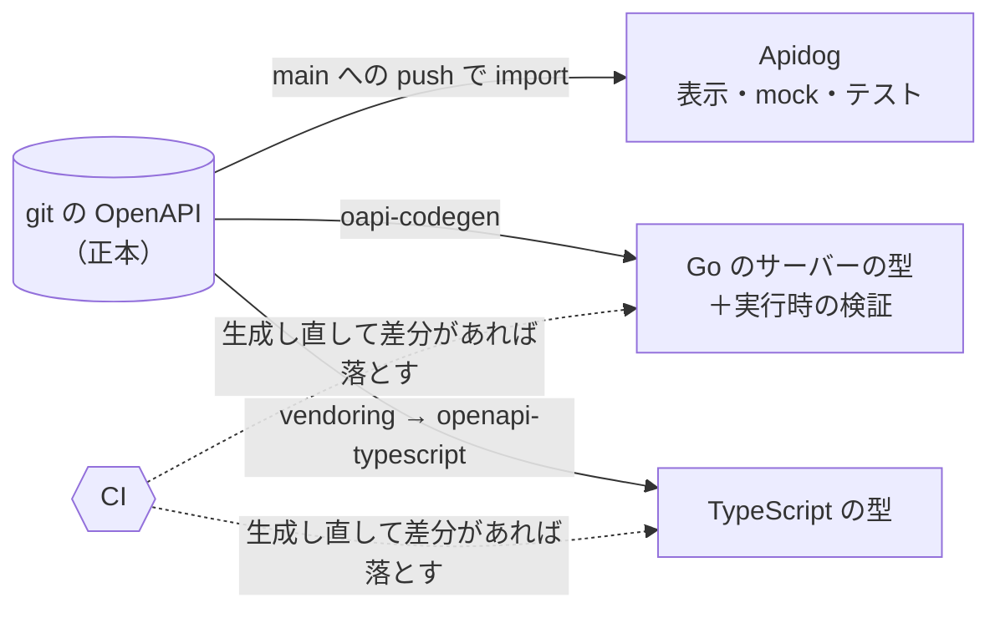

## TL;DR

- API の仕様を、**git にある OpenAPI ただ 1 つ**を正本にしました。Apidog の画面も、Go のサーバーの型も、TypeScript の型も、すべてそこから**生成**します
- 正本と派生物がずれたら、**CI が落とします**。人がレビューで照合しなくても、ずれようがない仕組みを狙いました
- Apidog へは、main への push で **API から押し込む**形にしました。Apidog に private リポジトリの読み取り権限を預けずに済みます
- Go は生成した型を handler が実装するので、仕様から外れると**コンパイルで落ちます**。同じ仕様を埋め込み、**実行時のリクエストも検証**します
- 落とし穴もありました。API の接頭辞をルーターと検証の片方だけで変えると、**検証が全リクエストで素通り**します。応答は 200 なので気付けません

## この記事の対象読者

- API の仕様を Apidog や Postman、Swagger UI など別のツールでも持っていて、コードとずれて困っている方
- 1 つの OpenAPI から、Go のサーバーと TypeScript のクライアントの両方を生成したい方
- 「仕様とコードを一致させる」を、人の注意ではなく仕組みで担保したい方

## 環境

- OpenAPI 3.1（分割した YAML を redocly で lint・bundle）
- Go：oapi-codegen（サーバーの型の生成）、kin-openapi（実行時のリクエスト検証）
- TypeScript：openapi-typescript（型の生成）
- Apidog（API の表示・mock・テスト）
- GitHub Actions
- 規模：パス 27、操作 32。分割した YAML は 102 ファイル

## 背景：仕様書とクライアントを、コードから離れていかないようにしたかった

API の仕様は、放っておくと 3 か所に分かれます。仕様を見せるツール（私の場合は Apidog）、サーバーのコード、フロントエンドの型です。一般に、別々のツールで持った仕様は、人が手で直すたびに、直し忘れた所からずれていきます。

このプロジェクトでは、まだずれは起きていませんでした。それでも、新しい API を作るにあたって、最初から**ずれようがない仕組み**にしておきたいと考えました。仕様書（Apidog）とクライアント（フロントエンドの型）が、アプリのコードから離れていかないことを、人の注意ではなく仕組みで保証したかったのです。

ずれを防ぐ方法は 2 つあります。1 つは、3 か所を突き合わせる**照合**です。もう 1 つは、1 か所だけを手で直し、残りを**生成**する方法です。

照合は、レビューする人の注意力に頼ります。生成なら、ずれは仕組みの上で起きにくくなり、起きても機械で検知できます。そこで、**正本を 1 つに決めて、残りはすべて生成する**ことにしました。



## 正本を 1 つに決める

正本は、backend のリポジトリにある OpenAPI です。1 つのファイルにすると巨大になるので、パス・スキーマ・パラメータ・レスポンスごとに YAML を分けています。

分けた YAML は redocly で lint し、1 つのファイルに bundle します。**bundle したファイルもコミット**します。後で書くとおり、Apidog・Go・TypeScript のすべてがこの bundle を入力にするからです。

```makefile
openapi-lint:   ## 分割した spec を lint する
	npx --yes @redocly/cli@$(REDOCLY_VERSION) lint

openapi-bundle: ## 分割した spec を 1 つにまとめる（bundle はコミットする）
	npx --yes @redocly/cli@$(REDOCLY_VERSION) bundle myapp -o openapi/inbound/myapp.bundled.yaml
```

Apidog は正本ではありません。**表示と mock とテストの場所**です。仕様を変えたいときは、Apidog ではなく git の OpenAPI を PR で直します。

## OpenAPI → Apidog は「押し込む」

### pull 型ではなく push 型にした

Apidog には、Git リポジトリと接続して仕様を取り込む機能（pull 型）があります。使えば設定は楽ですが、**private リポジトリの読み取り権限を Apidog に預ける**ことになります。

そこで、GitHub Actions から Apidog の Open API を呼んで押し込む形（push 型）にしました。main に push されたら、bundle を Apidog の `import-openapi` に POST します。

```yaml
on:
  push:
    branches: [main]
    paths: [openapi/**]

# 連続してマージしたときに、古い bundle が後から届いて上書きしないよう直列にする
concurrency:
  group: apidog-sync
  cancel-in-progress: false
```

```bash
jq -n --rawfile spec "$BUNDLE" '{
  input: $spec,
  options: {
    endpointOverwriteBehavior: "AUTO_MERGE",
    schemaOverwriteBehavior: "AUTO_MERGE",
    deleteUnmatchedResources: true
  }
}' > /tmp/body.json

curl -sS -X POST "https://api.apidog.com/v1/projects/${APIDOG_PROJECT_ID}/import-openapi" \
  -H "Authorization: Bearer ${APIDOG_ACCESS_TOKEN}" \
  -H "X-Apidog-Api-Version: 2024-03-28" \
  -H "Content-Type: application/json" \
  --data @/tmp/body.json -o /tmp/response.json
```

オプションは 2 つが要です。

- **`AUTO_MERGE`**：Apidog にしか無い情報（mock・テストケース・表示上の補足）を残したまま、定義だけを更新します
- **`deleteUnmatchedResources`**：仕様から消えたエンドポイントやスキーマを、Apidog 側でも消します。消し忘れが、ずれの元として残らないようにするためです

### 何が仕様の持ち物で、何が Apidog の持ち物か

`AUTO_MERGE` で両方が混ざるので、どちらの持ち物かを表で決めました。判断の基準は「**コードの生成に現れるか**」です。

| 区分 | 例 | Apidog で手で直してよいか |
| --- | --- | --- |
| 仕様の持ち物（git が正） | パス・メソッド・operationId、パラメータ、リクエストとレスポンスのスキーマ（型・`required`・enum・nullable）、ステータスコード、認証方式 | **直さない**。git の OpenAPI を PR で直す |
| Apidog の持ち物 | mock のルール、テストシナリオ、表示上の補足、フォルダ、example、環境と変数 | 直してよい |

仕様の持ち物を Apidog で手で直しても、次の同期で git の内容に戻ります。直したつもりが消える、という事故を避けるための線引きです。

## Apidog 同期のハマりどころ

### servers を同期すると、環境が増え続ける

最初は、OpenAPI の `servers`（ベース URL）も同期しようとしました。ところが、取り込みのたびに Apidog の環境が**更新されずに新しく追加される**ことを、実際に試して確かめました。CI で毎回流すと、環境が増え続けます。

`servers` は同期の対象から外し、ベース URL を変えるときは Apidog の環境設定を手で直すことにしました。同期するのは、エンドポイントとスキーマの定義だけです。

### HTTP 200 でも、一部が失敗していることがある

`import-openapi` は、一部のエンドポイントの取り込みに失敗しても、HTTP 200 を返すことがあります。失敗は、応答の本文の `errors` と、`endpointFailed` などのカウンタに出ます。

ステータスコードだけを見ると、失敗が黙って成功扱いになります。本文を `jq` で調べて、失敗があれば落とすようにしました。

```bash
# HTTP 200 でも部分失敗がありうる。黙らせずに落とす
jq -e '((.data.errors // []) | length) == 0' /tmp/response.json > /dev/null \
  || { echo "Apidog の import が errors を返しました"; exit 1; }
jq -e '([.data.counters.endpointFailed, .data.counters.schemaFailed,
         .data.counters.endpointFolderFailed, .data.counters.schemaFolderFailed]
        | map(. // 0) | add) == 0' /tmp/response.json > /dev/null \
  || { echo "Apidog の import に失敗した項目があります"; exit 1; }
```

### bundle は CI で作り直さない

同期では、CI で bundle を作り直さず、**コミット済みの bundle をそのまま送ります**。redocly の版が手元と CI で違うと、同じ分割の spec からでも、わずかに違う bundle ができることがあるためです。Go と TypeScript の生成も同じ bundle を入力にしているので、送るものを 1 つにそろえています。

### AI エージェントからは読み取り専用で参照する

Apidog には MCP サーバーもあります。AI エージェントは、この MCP で API の仕様を**読むだけ**です。仕様を変えるときは、人と同じく git の OpenAPI を直します。MCP の権限の決め方は、[MCP の許可リストの記事](https://qiita.com/zucky-quest/items/9e13814f80ade2fa1f71)で詳しく書いています。

## OpenAPI → Go：コンパイルと実行時の 2 段で守る

### 生成した型を handler が実装する

oapi-codegen で、bundle からサーバーの型（インターフェース）を生成します。handler はそのインターフェースを実装します。仕様のパスやパラメータが変わると、handler が実装を満たさなくなり、**コンパイルで落ちます**。

```makefile
# 生成物はコミットする（handler が実装する＝仕様から外れるとコンパイルで落ちる）
openapi-gen: openapi-bundle
	go run github.com/oapi-codegen/oapi-codegen/v2/cmd/oapi-codegen@$(OAPI_CODEGEN_VERSION) \
		-config internal/myapp/httpapi/oapi/oapi-codegen.yaml openapi/inbound/myapp.bundled.yaml
	# 仕様は実行時にも使う。go:embed は親ディレクトリを辿れないので、パッケージの下へ複製する
	cp openapi/inbound/myapp.bundled.yaml internal/myapp/httpapi/oapi/myapp.bundled.yaml
```

生成し忘れは、CI で落とします。CI で生成し直し、コミット済みのものと差分があれば失敗にします。

```yaml
- name: OpenAPI の生成物のドリフト検知
  run: |
    make openapi-gen
    git diff --exit-code -- internal/myapp/httpapi/oapi/oapi_gen.go \
        internal/myapp/httpapi/oapi/myapp.bundled.yaml \
      || { echo "生成物が仕様とずれています。make openapi-gen を実行してコミットしてください"; exit 1; }
```

### 同じ仕様で、実行時のリクエストも検証する

コンパイルで守れるのは、型の形だけです。「文字数の上限」「数値の範囲」「enum の値」のような制約は、型には現れません。

そこで bundle を `go:embed` でバイナリに埋め込み、kin-openapi でリクエストを実行時に検証しています。仕様に書いた制約が、そのまま入口の検証になります。

小ネタですが、`go:embed` は**親のディレクトリを辿れません**。bundle はリポジトリの上の方にあるので、Makefile でパッケージの下へ複製しています。複製も生成物として扱い、上の CI の差分検知の対象に含めています。

## 失敗談：接頭辞を片方だけ変えると、検証が全リクエストで素通りする

API のパスの接頭辞 `/api/v1` は、OpenAPI の `paths` ではなく、`servers.url` に置いています。`paths` にはリソースの構造だけを書き、接頭辞は配信の都合として分けたかったからです。

ここに落とし穴がありました。接頭辞は、ルーターと実行時の検証の両方で使います。ルーターは接頭辞付きのパスでリクエストを受け、検証は同じ接頭辞で仕様の中の経路を探します。**片方だけ接頭辞を変えると、検証が仕様の中に該当する経路を見つけられず、全リクエストが検証をすり抜けます**。

しかも、すり抜けたリクエストは handler で普通に処理されるので、**応答は 200** です。テストを流しても、画面を触っても、気付けません。

対策として、Go のコードに接頭辞を文字列で書くのをやめました。仕様の `servers.url` から接頭辞を 1 つの値として取り出し、ルーターと検証の両方に渡しています。

```go
// 仕様の servers.url から接頭辞を取り出し、ルーターと検証の両方に同じ値を渡す（説明用に簡略化）
prefix, err := specPathPrefix(doc.Servers)
if err != nil {
	return err
}
doc.Servers = nil
if prefix != "" {
	doc.Servers = openapi3.Servers{{URL: prefix}}
}
```

**同じ値を 2 か所に書くと、いつか片方だけ変わる。** 仕様を正本にするなら、接頭辞のような小さな値も、正本から取り出して配るのが安全です。

## OpenAPI → TypeScript：型の一致は CI、取り込みはレビュー

### backend の bundle を取り込み、取得元を記録する

フロントエンドは別のリポジトリです。backend の bundle をスクリプトで取り込み（vendoring）、**どのコミットから取り込んだか**をファイルに記録します。

```bash
pnpm gen:api:vendor   # backend の bundle を取り込み、取得元のコミットを記録してから型を生成する
pnpm gen:api          # bundle から TypeScript の型を生成する
pnpm gen:api:check    # 生成済みの型が bundle と一致するかを差分で確かめる
```

`gen:api:check` は、CI の check の一部として、全 PR で走ります。取り込んだ仕様から型を作り直し忘れていれば、CI が落とします。

### 正直に書く：取り込みの遅れは CI では検知しない

この仕組みには、残っている穴が 1 つあります。

CI が保証するのは「**取り込んだ仕様と、生成した型が一致していること**」だけです。backend の仕様が更新されたのに、フロントエンドが古い仕様を取り込んだままになっていても、CI は落ちません。

取り込みが遅れていないかは、記録した取得元のコミットを、PR のレビューで見比べて確かめる運用にしています。ここだけは、まだ人の目に頼っています。

## required と null を書き分ける

生成を前提にすると、仕様の書き方がそのまま型の使い勝手になります。特に効いたのが `required` と `null` の書き分けです。

| 書き方 | 意味 | 生成される型 |
| --- | --- | --- |
| `required` に入れる | レスポンスに、キーが必ずある | Go は値型、TypeScript は必須のプロパティ |
| `type: [string, 'null']` | キーはあるが、値が null になりうる | Go はポインタ、TypeScript は `string \| null` |
| どちらも書かない | キーが無いこともある | Go はポインタ、TypeScript は省略可能（`?`） |

`required` を書かずにおくと、oapi-codegen では全フィールドがポインタになり、openapi-typescript では全部が省略可能になります。使う側は、毎回 nil や undefined の確認を書くことになります。キーが必ずあるものは `required` に入れ、値が無いことがあるものだけを null 許可にする、と決めました。

## 破壊的変更の検知は warn から始める

仕様の破壊的な変更（必須のフィールドの削除など）は、oasdiff で PR ごとに検知しています。ただし、今は **warn にとどめ**、PR を落としていません。

理由は 2 つです。1 つは、新しい API へ切り替える前なので、破壊的な変更そのものが正当な作業であること。もう 1 つは、oasdiff の OpenAPI 3.1 への対応がまだ beta であることです。既知の破壊的変更を含む PR で検知できることを確かめてから、落とす設定に切り替えます。

## 成果：仕組みが保証していること

導入前にずれが起きていたわけではないので、前後の比較はできません。代わりに、今の仕組みが何を保証していて、何を保証していないかを書きます。

**保証していること**

| 変更 | 何が起きるか |
| --- | --- |
| 仕様から外れた handler を書く | Go のコンパイルで落ちる |
| 仕様を変えて、Go の生成し直しを忘れる | CI の差分検知で落ちる |
| 仕様にない形のリクエストが届く | 実行時の検証で弾く |
| 仕様を変えて main にマージする | Apidog が自動で追随する。仕様から消したエンドポイントは Apidog からも消える |
| Apidog への取り込みが一部だけ失敗する | HTTP 200 でも CI が落ちる |
| 取り込んだ仕様から、TypeScript の型を作り直し忘れる | CI の差分検知で落ちる |

**保証していないこと**

| 状況 | 今の扱い |
| --- | --- |
| backend の仕様が更新されたのに、フロントエンドが古い仕様を取り込んだまま | CI では検知しない。取得元のコミットを PR のレビューで見比べる |
| 仕様の破壊的な変更 | oasdiff で検知するが、今は warn にとどめている |
| Apidog の環境（ベース URL） | 同期しない。手で直す |

## まとめ

| 派生物 | 生成のしかた | ずれを落とす仕組み |
| --- | --- | --- |
| Apidog | main への push で import（push 型・AUTO_MERGE・未マッチ削除） | 部分失敗を jq で落とす。直列化で後勝ちを防ぐ |
| Go のサーバーの型 | oapi-codegen | 実装はコンパイルで、生成し忘れは CI の差分検知で落とす |
| Go の実行時の検証 | bundle を go:embed して kin-openapi で検証 | 接頭辞を仕様から 1 つの値として取り出す |
| TypeScript の型 | vendoring → openapi-typescript | 型の一致は CI。取り込みの遅れはレビュー |

学びは 3 つです。

1. **同期は「照合」ではなく「生成と CI」で担保する。** 正本以外を手で直さなければ、ずれは仕組みの上で起きにくくなり、起きても機械で検知できます
2. **同じ値を 2 か所に持たない。** 接頭辞のような小さな値ほど、片方だけ変わったときに静かに壊れます。正本から取り出して配ります
3. **残っている穴も書いておく。** フロントエンドの取り込みは、まだ人の目に頼っています。どこが仕組みで、どこが運用かを分けて書くと、次に何を自動化すべきかが見えます

同じ「正本と生成物と CI の差分検知」の型は、AI エージェントの設定の管理にも使っています。[Claude Code と Codex の設定を 1 つの SSOT に統一する記事](https://qiita.com/zucky-quest/items/bd0ed671749574f4df98)で書きました。

一方で、上流の API の仕様が管理されていないときに、あえてコードの生成を見送った判断もあります。生成した型は「仕様と一致していること」しか保証せず、仕様が実物と一致していることは保証しないためです。その話は、[リポジトリの切り出しの記事](https://qiita.com/zucky-quest/items/f4ab6b817deadece322d)で書いています。生成が効くのは、正本をきちんと管理しているときだけです。

## 参考

- [OpenAPI Specification 3.1: Server Object](https://spec.openapis.org/oas/v3.1.0#server-object)
- [Redocly CLI](https://redocly.com/docs/cli/)
- [oapi-codegen](https://github.com/oapi-codegen/oapi-codegen)
- [kin-openapi](https://github.com/getkin/kin-openapi)
- [openapi-typescript](https://openapi-ts.dev/)
- [oasdiff](https://github.com/oasdiff/oasdiff)
- [Apidog Open API](https://openapi.apidog.io/)
