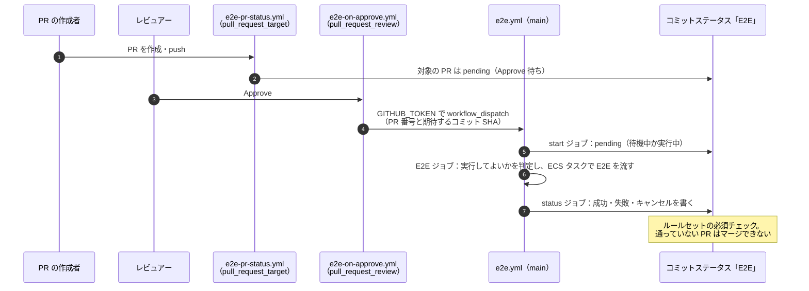
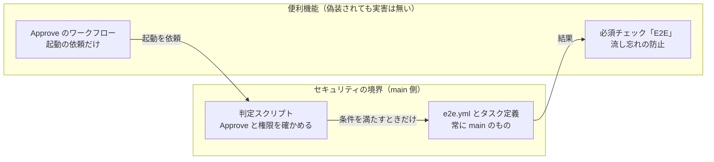

## TL;DR

- 検証環境の資格情報を使う E2E を、**レビュー済みのコードにだけ**流したい。そのため PR の Approve を承認ゲートにしました
- GitHub 公式の答えは Environments の **required reviewers** です。しかし Team / Pro / Free プランでは、**public リポジトリでしか使えません**
- 代わりに、Approve をきっかけに `main` のワークフローを起動し、結果をコミットステータスにして必須チェックにしました。Approve の後に手で起動する手間と、起動漏れが無くなりました
- **セキュリティの境界は「main 側の判定」** で、必須チェックは「流し忘れ防止」にすぎません。必須チェックは PR 側から偽装できるからです。この線引きを明文化しました
- レビューで見つかった穴の多くは、**別のコンテキストのレビュー**から出ました。同じコンテキストのセルフレビューでは出ませんでした

## この記事の対象読者

- GitHub Team / Pro / Free プランの private リポジトリで、デプロイやテストに承認ゲートを付けたい方
- `pull_request_target` や `workflow_dispatch` の安全な使い方を知りたい方
- 必須チェックを「セキュリティの境界」として使ってよいか迷っている方

## 環境

- GitHub Team プラン、private リポジトリ
- GitHub Actions（OIDC で AWS に入る）
- ルールセットの必須チェック

## 背景：Approve の後に、手で起動していた

[前編](https://qiita.com/zucky-quest/items/615b446b2d93a2214a13)で書いたとおり、E2E は GitHub Actions から VPC 内の ECS タスクで流しています。AWS の CI ロールを引き受けられるのは `main` ブランチからの実行だけです。PR のコードを流すときは、`main` のワークフローに PR 番号を渡して手で起動していました。

E2E のタスクは検証環境の DB の資格情報を読めます。そこで、**レビュー済みのコードにだけ流す**と決めています。`main` の判定スクリプトが、次のどちらかを満たすときだけ流します。

- 起動した人が、リポジトリの maintain か admin の権限を持つ
- PR の最新コミットに、PR の作成者以外で write 以上の権限を持つ人の Approve がある

判定の仕組みはうまく動いていました。課題は運用です。Approve された後に誰かが手で起動しなければならず、**起動を忘れたままマージされる**ことがありえました。

## 公式の答えは、プランの壁で使えなかった

「承認されたら流す」の公式の答えは、GitHub Actions の **Environments の required reviewers** です。ジョブに environment を指定すると、指定したレビュアーが承認するまでジョブが止まります。

ところが GitHub のドキュメントには、こう書かれています。

> If you are on a GitHub Free, GitHub Pro, or GitHub Team plan, required reviewers are only available for public repositories.

Team プランの private リポジトリでも、environment 自体は作れます。しかし使えるのは、デプロイできるブランチの制限、secrets、変数だけです。**ジョブを止める機能が使えません**。管理者による bypass も同じく public リポジトリ限定で、しかも対象は admin だけで maintain は含まれません。

正直に書くと、最初は environment の required reviewers で設計を進めていました。プランの制約を確かめておらず、チームへの相談文を書いている途中で気付いて差し替えています。**よく紹介される機能ほど、自分のプランで使えるかを先に確かめるべき**でした。同じ組織の Terraform リポジトリでも、本番 apply の承認を自作のチェックボックス方式にしていたのは、同じ理由です。

## 採用した構成：3 つのワークフロー

### 1. Approve をきっかけに、GITHUB_TOKEN で workflow_dispatch する

`pull_request_review`（submitted・approved）で動くワークフローが、`main` の `e2e.yml` を `workflow_dispatch` で起動します。入力には PR 番号と、期待するコミットの SHA を渡します。

ここで使えるのが、`GITHUB_TOKEN` の例外です。`GITHUB_TOKEN` で起こしたイベントは、通常は新しいワークフローを起動しません。無限ループを防ぐためです。ただし **`workflow_dispatch` と `repository_dispatch` は例外**で、`GITHUB_TOKEN` からでも起動できます。PAT や GitHub App を用意せずに済みました。

起動しないのは次のときです。

- E2E の結果に影響しないファイルしか変えていない PR のとき
- Approve したコミットが、PR の最新コミットでないとき
- 判定の条件を満たさないとき
- 同じコミットの E2E が、待機中・実行中・成功済みのとき
- `main` を流す実行（リリース前の確認を含む）が、待機中・実行中のとき
- ほかの実行が待機中のとき（後述）

### 2. 結果をコミットステータスに書き、必須チェックにする

E2E の結果は、PR の最新コミットにコミットステータス `E2E` として書きます。ルールセットでこれを必須チェックにしたので、E2E を通していない PR はマージできません。

### 3. ステータスの付与は pull_request_target で、PR のコードは実行しない

PR を作ったときや push したときに、最初のステータス（pending や「対象外」）を付ける必要があります。ここでは `pull_request_target` を使います。

`pull_request_target` は `main` の定義で動き、書き込み権限のトークンを持てます。その代わり、**PR のコードを checkout して実行すると危険**なイベントです。このワークフローは `main` のコミットだけを checkout し、PR の変更ファイルは API で読みます。PR のコードは一切実行しません。

E2E の結果に影響しないファイル（ドキュメントなど）しか変えていない PR には、success（対象外）を付けます。E2E を無効にしている間は、どの PR にも success（E2E が無効のため対象外）を付けます。**流せない間に、全 PR のマージが止まらない**ようにするためです。

## セキュリティの境界はどこか

この構成で一番大事なのは、**どこが境界で、どこが境界でないか**をはっきりさせることでした。

### Approve のワークフローは、PR 側で書き換えられる

`pull_request_review` のワークフローは、PR のマージコミットの定義で動きます。つまり、PR の中で `e2e-on-approve.yml` を書き換えると、その PR への Approve では**書き換えた定義が動きます**。

それでも安全なのは、次の 2 つがあるからです。

- **実行してよいかを決めるのは、`main` の `e2e.yml` と判定スクリプト**です。Approve のワークフローは「起動を依頼する」だけで、判定はしません
- **自動起動には bypass を使わせません。** maintain や admin の権限による bypass は人が手で起動したときだけで、Approve からの自動起動（`github-actions[bot]`）は必ず Approve の条件で判定されます

また、同じリポジトリのブランチから PR を作れるのは write 権限のメンバーです。そのメンバーは、`pull_request` のワークフローでも同じ権限のトークンを得られます。書き換えられたところで、**権限は広がりません**。

### 必須チェックは境界ではない

一方、必須チェックの `E2E` は**セキュリティの境界ではありません**。PR 側のワークフローに `statuses: write` を足せば、同じ名前のステータスを書けてしまうからです。

必須チェックの役割は、あくまで「流し忘れの防止」です。悪意のある書き換えは、ワークフローの変更に対するコードオーナーのレビューで止めます。

**境界は信頼できる `main` 側のコードに置き、便利機能は偽装されても実害が無い位置づけにする。** この線引きを設計書に明文化しました。

## レビューで潰したハマりどころ

### 1. 実行一覧を branch で絞らないと、成功済みに偽装できる

「同じコミットの E2E が成功済みなら起動しない」判定では、ワークフローの実行一覧を実行名で探していました。ところが、**別のブランチで `e2e.yml` を書き換え、同じ実行名の実行を作る**だけで、「成功済み」に見せかけられることが分かりました。

`main` から起動した実行だけ（`branch=main`）に絞って探すように直しました。

### 2. pending を書く処理と、結果を書く処理が競合する

最初は、Approve のワークフローが「起動した後に pending を書く」作りでした。E2E が速く終わると、`e2e.yml` が書いた結果を、後から来た pending が上書きすることがありえます。

`e2e.yml` の先頭に `start` ジョブを置き、そこで pending を書くようにしました。結果を書く `status` ジョブは `start` と E2E のジョブの後に動くので、`needs` で順序が保証されます。

### 3. concurrency の待機は 1 件だけ

GitHub の `concurrency` は、待機できる実行がグループごとに 1 件だけです。さらに新しい実行が来ると、**待機中の実行が取り消されます**。Approve が重なると、先に Approve した PR の実行が、後から来た実行に押し出されます。

先着を優先することにしました。ほかの実行が待機中なら起動を見送り、PR にその旨をコメントします。数えるのは「実行全体」ではなく、**E2E のジョブがまだ終わっていない実行**です。E2E が終わって結果を書いているだけの実行は、検証環境も待機の枠も使わないからです。

### 4. 待機中に取り消されたときも、結果を書きたい

concurrency をワークフロー単位で指定していると、待機中に取り消された実行は、どのジョブも動きません。ステータスは pending のまま残ります。

concurrency を E2E のジョブ単位に移し、結果を書く `status` ジョブは `always()` で動かすようにしました。待機中に取り消されたときに `always()` の後続ジョブが動くかは、公式の資料に明記がありませんでした。そこで、実際の記録で確かめました。

ある PR の実行で、E2E のジョブが待機中に取り消されたことがあります。ジョブにはランナーが割り当てられず、ステップも 1 つも動いていません。取り消しの理由は「Canceling since a higher priority waiting request ... exists」でした。それでも `always()` の `status` ジョブは動き、コミットステータスに「キャンセル（Approve し直すと再実行します）」を書いています。**待機中に取り消されても、`always()` の後続ジョブは動きました**。

### 5. E2E を無効にしている間に、全 PR が止まる

E2E の基盤を止めている間も、必須チェックは残ります。何もしないと、全 PR がマージできなくなります。無効のときは success（対象外）を付けるようにしました。

ただし、有効に戻した後もこのステータスは残り、E2E を通さずにマージできてしまいます。有効に戻したら、開いている PR は push するか、閉じて開き直してステータスを付け直す、という手順を残しています。

## AI と協働して作った

この仕組みは、AI のコーディングエージェントと一緒に作りました。工夫したのは、**レビューを別のコンテキストに任せた**ことです。

- 実装のセッションと、設計書を書くセッションを分けました
- セルフレビューは、別のコンテキストのサブエージェントと、別のセッションの 2 者で行いました。4 巡して、must から nits まで指摘が 0 件になってから PR を作っています

前述のハマりどころのうち、実行名での偽装（1）とステータスの競合（2）は、**同じコンテキストのセルフレビューでは出てきませんでした**。別の目から出た指摘です。実装したコンテキストは、自分が置いた前提を疑いにくいのだと思います。

## 成果

Approve での自動起動を始めてから約 2 週間（2026-10-16〜10-31）の、実行記録の数字です。

| 指標 | 値 |
| --- | --- |
| Approve で自動起動した E2E の実行 | 21 回（成功 19・失敗 1・待機中の取り消し 1） |
| 自動起動から結果が出るまで（成功した 19 回） | 中央値 約 18 分（最短 約 11 分・最長 約 23 分） |
| maintain 以上の権限で、手で起動・再実行した PR の実行 | 9 回（うち再実行 1） |

Approve すると、人が何もしなくても約 18 分で結果がコミットステータスに返ります。以前は、Approve の後に誰かが PR 番号を入れて起動する必要がありました。

起動漏れの件数は数えていません。E2E のステータスを必須チェックにしているので、E2E を通さない限り、対象の PR はマージできない作りだからです。手で起動する経路も残していて、maintain 以上の権限があれば、Approve を待たずに流せます。表の 9 回は、この経路で流した実行です。

## まとめ

| 課題 | やったこと |
| --- | --- |
| required reviewers が private リポで使えない | Approve をきっかけに main のワークフローを起動する |
| PAT や App を用意したくない | GITHUB_TOKEN による workflow_dispatch の例外を使う |
| 流し忘れたままマージされる | 結果をコミットステータスにし、必須チェックにする |
| ステータスの付与で PR のコードを実行したくない | pull_request_target は main だけを checkout し、変更ファイルは API で読む |
| Approve のワークフローは PR 側で書き換えられる | 実行の判定は main 側に置き、自動起動に bypass させない |
| 必須チェックは偽装できる | 境界ではなく「流し忘れ防止」と位置づけ、明文化する |

学びは 3 つです。

1. **よく紹介される機能も、自分のプランで使えるかを先に確かめる。** 設計を進めてから気付くと、相談の前提から作り直すことになります
2. **境界と便利機能を分けて設計する。** 境界は信頼できる側のコードに置き、便利機能は偽装されても実害が無い位置づけにすると、どちらも安心して使えます
3. **レビューは別のコンテキストに任せる。** 人でも AI でも、自分が置いた前提は疑いにくいものです

## 参考

- [Managing environments for deployment（required reviewers の対象プラン）](https://docs.github.com/en/actions/managing-workflow-runs-and-deployments/managing-deployments/managing-environments-for-deployment)
- [Triggering a workflow from a workflow（GITHUB_TOKEN の例外）](https://docs.github.com/en/actions/using-workflows/triggering-a-workflow#triggering-a-workflow-from-a-workflow)
- [Events that trigger workflows: pull_request_target](https://docs.github.com/en/actions/writing-workflows/choosing-when-your-workflow-runs/events-that-trigger-workflows#pull_request_target)
- [Using concurrency](https://docs.github.com/en/actions/using-jobs/using-concurrency)
