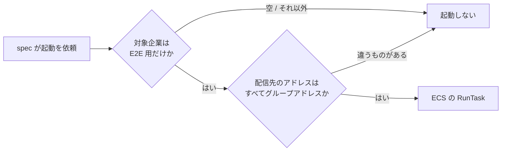

## TL;DR

- 利用企業ごとに条件を判定し、担当者へメールを送る通知バッチを、E2E で自動テストにしました。**送信を止める仕組み（dry-run）は、バッチにありません**
- 送信を止めるのは諦め、**実際に送ったまま**テストします。安全は「どこに届くか」「どの企業を対象にするか」「どの実行で送るか」の 3 つを絞って確保しました
- 安全弁は三重です。対象企業を E2E 用に**限定しないと起動しない**。宛先のアドレスを**起動前に DB で検査**する。IAM で縛れない部分は、**タスクで動くコードを限る**ことで抑える
- 検証環境で毎日決まった時刻に動く定期の起動と、E2E の起動がぶつからないよう、テストの対象を **30 日後の未来の日付**に置き、判定時刻を固定して起動します
- 結果、手動テストの 15 件のうち 10 件を「E2E で確認済み」にでき、毎回手で確かめるのは 1 件だけになりました
- メールに限らず、外部 API への書き込みや決済など、**止められない副作用を持つバッチ**にも使える考え方です

## この記事の対象読者

- メールや通知を送るバッチを、E2E で自動テストしたい方
- テストのために本番のコードへ dry-run を足せず、実際の副作用とどう付き合うか悩んでいる方
- 手動のテストケースと自動テストの分担を、どう決めるか考えている方

## 環境

- Playwright（TypeScript）。E2E は、VPC 内で起動する使い捨ての ECS タスクの中で動く（前作の構成）
- 通知バッチは Go で書かれた ECS の単体タスク。検証環境（stg）では、平日 10:00 に EventBridge Scheduler が起動する
- GitHub Actions（E2E の起動と、実行の種別の受け渡し）

## 前作の「これから」に答える

[前作](https://qiita.com/zucky-quest/items/615b446b2d93a2214a13)では、DB を直接引く Playwright の E2E を、GitHub Actions から VPC 内の ECS タスク 1 つで回す構成を書きました。最後の節では、バッチまで E2E を広げるには 2 つ要る、と書いています。

- **対象日・時刻の注入**：テストから「いつの分として動かすか」を渡せること
- **単体で起動する手段**：テストからバッチだけを起動できる入口

通知バッチは、この 2 つを最初から持っていました。ECS の単体タスクとして起動でき、環境変数の上書き（`overrides`）で次の値を渡せます。

| 環境変数（一般化した名前） | 役割 |
| --- | --- |
| `NOTIFY_COMPANY_IDS` | 処理する企業を、指定した企業だけに限る |
| `NOTIFY_AS_OF` | 配信期限の判定時刻を上書きする（RFC 3339） |
| `MAIL_API_ENDPOINT` | メールを送る API の接続先を上書きする |

ただ、1 つだけ無いものがありました。**送信を止める仕組み**です。バッチのコードを調べ、送らずに動かす手段は無いと確かめました。

## 送信を止めるのは諦め、絞ることにした

そこで、送信を止めるのは諦め、送っても困らない状態を作ることにしました。送ったまま流せば、E2E は本番と同じ経路を通ります。絞ったのは 3 つです。

| 絞ったもの | やったこと |
| --- | --- |
| 届き先 | 検証環境の E2E 用アカウントの宛先を、すべてチームのグループアドレスに `+suffix` を付けたものにした |
| 対象 | 起動するときは、必ず E2E 用の企業だけに限る |
| 頻度 | 実際に送るケースは、週次の実行とリリース前の実行でだけ流す |

宛先がチームのグループアドレスなら、届いても困る人はいません。チームのメンバーが受け取るだけです。チームの E2E の規約には「メールは実送信しない」とありましたが、この spec だけは例外として規約に書き足しました。

## 安全弁を三重にした

宛先をグループアドレスに寄せただけでは、まだ足りません。起動を間違えれば、検証環境のほかの企業にもメールが届くからです。そこで、起動までに 3 つの安全弁を置きました。



### (a) 対象企業を限定しないと、起動しない

通知バッチは、対象企業を渡さないと、通知が有効な**すべての企業**を処理します。E2E がこれを付け忘れると、検証環境のすべての企業に通知が飛びます。

そこで、起動の関数で対象企業を必須にし、E2E が書き換えてよい企業以外が入っていたら止めます。

```typescript
// 説明用に簡略化したコード
export async function runNotificationTask(options: { companyIds: number[]; asOf: string }) {
  const allowed = [e2eCompanyId(), e2eSecondCompanyId()];
  if (options.companyIds.length === 0) {
    throw new Error('対象企業が空です。対象企業を限定せずに起動することはできません');
  }
  const unexpected = options.companyIds.filter((id) => !allowed.includes(id));
  if (unexpected.length > 0) {
    throw new Error(`E2E が書き換えてよい企業以外が含まれます: ${unexpected.join(', ')}`);
  }
  return runBatchTask({
    environment: [
      { name: 'NOTIFY_COMPANY_IDS', value: options.companyIds.join(',') },
      { name: 'NOTIFY_AS_OF', value: options.asOf },
    ],
  });
}
```

### (b) 起動の前に、配信先のアドレスを DB で検査する

対象企業を限っても、その企業の配信先に、誰かが実在のアドレスの従業員を足しているかもしれません。そこで起動の直前に、配信先（個別に指定した従業員と、ロールの所属者）のアドレスを DB から引き、正規表現で検査します。

```typescript
// 説明用に簡略化したコード（アドレスは例の値）
const SAFE_EMAIL = /^team-group(\+[a-z0-9.-]+)?@example\.com$/;

for (const row of recipients) {
  if (row.email !== '' && !SAFE_EMAIL.test(row.email)) {
    // アドレスそのものはログに出さない（個人のアドレスの可能性がある）
    unsafe.push(`社員番号 ${row.code}`);
  }
}
if (unsafe.length > 0) throw new Error(`グループアドレスでない配信先があるため起動しません: ${unsafe.join(', ')}`);
```

1 件でも合わないものがあれば、起動しません。エラーにはアドレスではなく社員番号だけを出し、ログに個人のアドレスを残さないようにしています。

### (c) IAM で縛れない部分は、動くコードを限って抑える

E2E のタスクロールには、通知タスクの `ecs:RunTask` を許可しました。許可は、通知タスクのタスク定義とクラスターに絞っています。

ただし、**IAM では「対象企業を限定して起動すること」までは強制できません**。環境変数の上書きの中身は、IAM の条件で縛れないためです。タスクロールを使えるコードが対象企業を付けずに起動すれば、すべての企業が処理されます。

この残るリスクは、**タスクで動くコードを限る**ことで抑えました。E2E のタスクで動くのは、`main` のコードか、レビューで承認された PR のコードだけです。(a) の検査を外すコードは、レビューを通らない限り動きません。

## 毎日の定期の起動と、ぶつからないようにする

検証環境の通知バッチは、平日 10:00 に Scheduler から起動されます。こちらは対象企業を限定せず、その時点で配信期限を迎えた分を配ります。E2E の起動とぶつかると、2 つの問題が起きます。

1. E2E が用意したデータを、毎日の起動が先に配ってしまう
2. 企業単位のロックを取り合い、片方の起動がその企業を飛ばす

### テストの対象を 30 日後に置く

1 つ目は、日付をずらして避けました。E2E が用意するデータの実施日を「**実行日 + 30 日**」の未来の日付にし、判定時刻をその日の 10:00 に固定して起動します。

```typescript
// 説明用に簡略化したコード
const scheduledDate = addDaysJst(new Date(), 30); // 例: 2026-11-25
const asOf = `${scheduledDate}T10:00:00+09:00`;   // 配信期限ちょうどで判定させる
```

毎日の起動は、現在の時刻で配信期限を判定します。実施日が 30 日後のデータは、まだ期限を迎えていないので拾いません。一方 E2E の起動は、判定時刻を 30 日後の 10:00 に上書きしているので、このデータを配ります。

もう 1 つ効果がありました。対象企業や判定時刻を上書きした起動では、バッチは監視用のメトリクス（ハートビートや監査の数値）を送りません。E2E の起動が、毎日の起動の監視に混ざることもありません。

### ロックの取り合いは、時間帯で避ける

2 つ目のロックの取り合いは、日付をずらしても残ります。毎日の起動は、E2E 用の企業も含めて、企業ごとにロックを取るためです。

これは、時間帯で避けました。

- E2E は、**09:55〜10:15 の間は通知タスクを起動せず、抜けるまで待つ**
- 週次の E2E の定期実行を、**09:45 から 10:30 に移した**。週次の実行の中の通知の spec が、毎日の起動とロックを取り合わないようにするため

## 実行の種別で、流すケースを出し分ける

実際に送るケースを、すべての実行で流すわけにはいきません。1 回の実行で、10 通前後のメールが届くためです。そこで、GitHub Actions から E2E のタスクへ「実行の種別」を渡し、spec がケースを出し分けます。

| 実行の種別 | いつ動くか | 送らないケース | 送るケース（7 本） | 送信失敗のケース |
| --- | --- | :---: | :---: | :---: |
| `pr` | PR を流す実行 | ✓ | skip | skip |
| `main` | main の手動起動（入力なし） | ✓ | skip | skip |
| `weekly` | 週次の定期実行 | ✓ | ✓ | skip |
| `gate` | リリース前の手動起動（入力 `gate=true`） | ✓ | ✓ | ✓ |

```typescript
// 説明用に簡略化したコード
export function e2eRunKind(): 'pr' | 'main' | 'weekly' | 'gate' {
  const value = process.env.E2E_RUN_KIND ?? 'pr';
  // 未設定や想定外の値は、送らない側（pr）に倒す
  return value === 'main' || value === 'weekly' || value === 'gate' ? value : 'pr';
}

const SENDS_MAIL = e2eRunKind() === 'weekly' || e2eRunKind() === 'gate';

test('送るケース', async () => {
  test.skip(!SENDS_MAIL, '実メールを送るケースは、週次とリリース前の実行でだけ流す');
  // ...
});
```

ポイントは 2 つです。

- **未設定や想定外の値は、送らない側に倒す。** 種別を渡し忘れても、メールが増える事故にはなりません
- **送信失敗のケースは、リリース前の実行だけ。** 失敗を起こすと、チームの Slack に `@channel` 付きの通知が鳴ります。毎週鳴らさないよう、ここまで絞りました

もう 1 つ工夫したのが、**実行名を分けた**ことです。リリース前の実行も、入力なしの手動起動も、どちらも `main` を流します。入力を付け忘れると、送るケースを流さないまま、リリース前の確認が「成功」で終わってしまいます。そこで、実行名を `E2E (main)` と `E2E (main, gate)` に分け、リリースの判断には後者の結果を見る、と決めました。

## 判定は配送記録と終了コードで行い、ログと受信箱は見ない

E2E が「通知が正しく動いた」と判定する材料は、2 つだけです。

- **配送記録の状態**：企業 × データごとに 1 行あり、`sent`（送った）/ `no_target`（対象者がいなかった）/ `failed`（送信に失敗した）のどれかになる
- **タスクの終了コード**：送信に失敗した企業があれば 1 になる

```typescript
const result = await launch([primary]);
expect(result.exitCode, '通知タスクの終了コード').toBe(0);
expect(await fixture.delivery(primary), '配送記録').toMatchObject({ status: 'sent' });
```

バッチのログは見ません。ログは共有のログ基盤（S3）へ非同期に書き出されるため、テストからログの到着を待ち合わせると、不安定の元になります。短いバッチのログ転送では、過去に不具合があったこともあります。配送記録なら、タスクが終わった時点で確定しています。

送信失敗のケースは、メールを送る API の接続先を、到達できないアドレスに上書きして起こします。終了コードが 1、配送記録が `failed` になることを確かめた後、上書きなしで起動し直し、`sent` に変わることまで確かめます。

## 「一部」を「済」に上げた考え方

チームには、手動テストのケース一覧があります。各ケースには「E2E」の列があり、次の値を付けます。

| 値 | 意味 |
| --- | --- |
| 済 | E2E が期待結果をすべて確かめている。手動の実施を省ける |
| 一部 | E2E が一部だけ確かめている。手動の実施は残る |

手動を省けるのは「済」だけです。E2E を書いただけでは、多くのケースが「一部」に留まりました。受信箱を見ないので、「メールが届く」「本文が正しい」を E2E で確かめられないためです。

そこで、期待結果そのものを見直しました。

- **単体テストで担保済みの確認は、期待結果から外した。** 「対象者がいなければメールが送信されない」「対象外の企業には送信されない」は、バッチの単体テストで確かめています。チームには「単体テストで担保済みの確認は、手動のケースに書かない」という方針があり、それに沿って外しました
- **本文の確認は、代表のケースに任せた。** 条件だけが違うケースでも、メールの本文は条件によらず同じです。本文の確認は代表の 1 ケースで毎回行い、ほかのケースは配送記録で判定する形に絞りました

結果、15 件のうち 10 件が「済」になりました。手動に残ったのは、次の 5 件です。

| 頻度 | 件数 | 手で確かめること |
| --- | ---: | --- |
| 毎回 | 1 | 本文と、実際に届くこと |
| 関係する実装を変えたとき | 4 | 誰に何通届いたか（3 件）、エラーログ（1 件） |

「誰に何通届いたか」は、受信者ごとの記録が DB に残らないため、E2E からは見えません。宛先の決め方が変わりうる実装の箇所を書き出し、そこを変えたリリースでだけ手で確かめることにしました。

## 見送ったこと

### 受信箱を E2E から読む

受信箱を読めれば、「一部」のケースの多くを「済」にできます。ただ、チームのアドレスはグループのアドレスなので、E2E からは直接読めません。E2E から読めるメールボックスを、別に申請する必要があります。

権限と認証情報の管理も含めて費用が大きいわりに、毎回手で確かめるのは 1 件だけです。今回は見送り、手動の負担が問題になったときに見直すことにしました。

### ログの自動確認

ログを E2E から確かめるには、ログ基盤を読む権限を足す必要があります。前述のとおり、非同期の書き出しを待つことになり、不安定さの元になります。これも見送りました。

## 踏んだこと

### 送信失敗のケースは、Slack の通知が 2 種類鳴る

送信失敗のケースを流すと、ERROR のログからログ基盤が Slack へ通知します。これは想定していました。初回のリリース前の実行で分かったのは、もう 1 つ、**ECS タスクの失敗を検知する監視アラーム（Critical）も必ず鳴る**ことです。終了コード 1 で終わるので、当然ではあります。手順書に、両方が鳴ることと、意図した失敗だとスレッドに書き残すことを足しました。

### E2E が作ったデータは、実施日が空だった

E2E の準備では、取り込みバッチを動かしてデータを作ります。ところが、作ったデータの実施日は空（NULL）でした。取り込みの起動で、実施日を渡す環境変数を渡していなかったためです。実施日が空のデータは、通知の候補になりません。spec の開始時に実施日（30 日後）を書き込み、終了時に戻すようにしました。

### 2 社目の宛先は、手で作った

複数の企業へ通知するケースには、2 社目にも宛先の従業員が要ります。既存のテスト用の従業員は、ほかのテストで役割が決まっていて使い回せませんでした。2 社目には、宛先専用の従業員を手で 1 人作りました。

## 結果

初回のリリース前の実行（2026-10-26）の結果です。

| 項目 | 値 |
| --- | --- |
| 成功 / 失敗 / skip（E2E 全体） | 171 / 0 / 91 |
| 実行全体の所要時間 | 約 28 分 |
| PR の実行で skip される通知のケース | 8 本（送るケース 7 本と、送信失敗のケース） |
| 手動の 15 件のうち「済」 | 10 件 |
| 毎回手で確かめるケース | 1 件 |

skip の 91 件には、通知以外の spec の skip も含みます。

## まとめ

| 決めたこと | 理由 |
| --- | --- |
| 送信を止めるのは諦め、実送信のままテストする | バッチに送信を止める仕組みが無い。送ったままなら本番と同じ経路を通る |
| 宛先をチームのグループアドレスに寄せた | 届いても困る人がいない |
| 対象企業の限定を必須にし、宛先も起動前に検査した | 付け忘れと、配信先の想定外の変更を止める |
| IAM で縛れない部分は、動くコードを限って抑えた | 環境変数の中身は IAM で強制できない |
| テストの対象を 30 日後に置き、判定時刻を固定した | 毎日の起動に先に配られない |
| 09:55〜10:15 は起動を待ち、週次を 10:30 へ移した | 企業単位のロックを取り合わない |
| 実行の種別で、送るケースを出し分けた | メールの通数と `@channel` を必要な実行に限る |
| 判定は配送記録と終了コードだけ | ログの遅れに引きずられない |
| 単体テストで担保済みの確認を外し、本文は代表に任せた | 「済」を増やし、手動を減らす |

学びは 2 つです。

1. **副作用を止められないなら、副作用の届く範囲を絞る。** 送信を止める仕組みが無くても、届き先・対象・頻度を絞れば、実送信のまま安全に回せます。絞り方は 1 つに頼らず、起動の前に重ねて検査するのが大事でした。外部 API への書き込みのような、メール以外の副作用でも同じです
2. **自動化の効果は、手動のケースの書き方で決まる。** E2E を書いただけでは「一部」が残ります。期待結果のうち、単体テストや代表のケースに任せられるものを外して初めて、手動の実施を減らせました

## 参考

- [前作：DB を直接引く Playwright E2E を、GitHub Actions から VPC 内の使い捨て ECS タスク 1 つで回す](https://qiita.com/zucky-quest/items/615b446b2d93a2214a13)
- [Amazon ECS: RunTask（containerOverrides）](https://docs.aws.amazon.com/AmazonECS/latest/APIReference/API_RunTask.html)
- [Playwright: test.skip](https://playwright.dev/docs/api/class-test#test-skip)
- [GitHub Actions: run-name](https://docs.github.com/en/actions/writing-workflows/workflow-syntax-for-github-actions#run-name)
