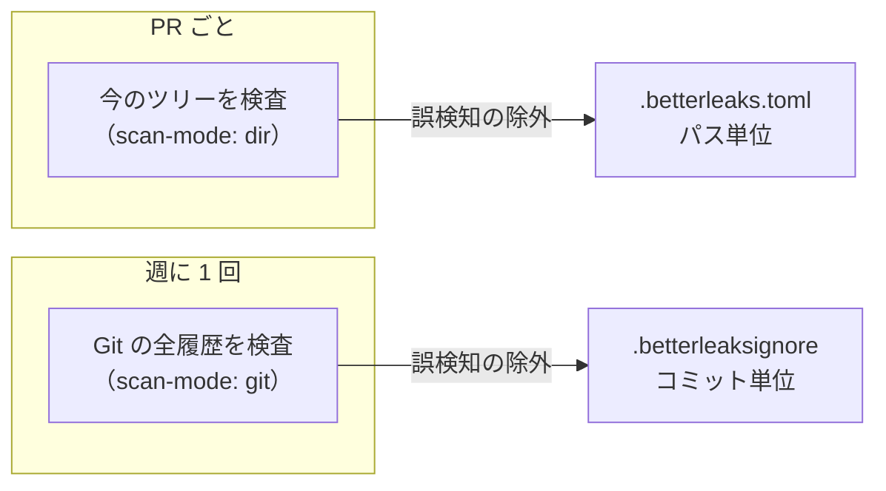

## TL;DR

- リポジトリに秘密情報（パスワードや API キー）が混ざっていないかを検査するツールを、**gitleaks から betterleaks に移しました**
- gitleaks は機能の追加を終え、セキュリティパッチだけの保守になっています。検出ルールの改善は、後継の betterleaks に入ります
- 検査は 2 つに分けました。**PR ごとに今のツリー**を検査し、**週に 1 回、Git の全履歴**を検査します
- 誤検知の除外も 2 つに分けました。今のツリーは**パス単位**、履歴は**コミット単位**です。履歴のコミットは変わらないので、コミット単位なら除外が安定します
- 導入の手順とバージョンは、組織の**共通ワークフロー**にまとめ、各リポジトリはそれを呼ぶだけにしました

## この記事の対象読者

- gitleaks で秘密情報の検査をしていて、後継への移行を考えている方
- 秘密情報の検査を、PR と定期実行のどちらで回すか迷っている方
- 誤検知の除外が増えて、管理が雑になりかけている方

## 環境

- betterleaks（gitleaks の後継。CLI は gitleaks と互換）
- GitHub Actions（組織の共通ワークフロー `workflow_call` を各リポジトリから呼ぶ）

## なぜ gitleaks から移したのか

gitleaks は、リポジトリに混ざった秘密情報を見つける定番のツールです。ただ、gitleaks は**機能の追加を終え**、今はセキュリティパッチだけの保守になっています。

秘密情報の検査で大事なのは、検出ルールが新しいサービスの鍵の形式に追いつくことです。そのルールの改善は、後継の betterleaks に入るようになりました。CLI は gitleaks と互換なので、移行の手間は小さく済みます。

## 検査を「PR ごとのツリー」と「週次の全履歴」に分けた

検査の対象は 2 種類あります。



| | PR ごとの検査 | 週次の検査 |
| --- | --- | --- |
| 対象 | 今のツリー（チェックアウトしたファイル） | Git の全履歴 |
| 目的 | 秘密情報が新しく入るのを、マージ前に止める | 今のツリーからは消えたが、過去のコミットに残っているものを拾う |
| ほかに拾えるもの | — | 検出ルールが更新されて、新しく見つかるようになったもの |

PR ごとの検査だけでは足りません。秘密情報をいったんコミットし、後のコミットで消した場合、今のツリーには残っていなくても、**履歴には残っています**。リポジトリをクローンした人は、履歴から取り出せます。

一方、全履歴の検査を PR ごとに回すと、毎回すべてのコミットを見ることになり、時間がかかります。そこで、マージ前に止める検査と、履歴を洗い直す検査を分け、それぞれに合った頻度で回すことにしました。

週次の検査には、もう 1 つ役割があります。betterleaks の検出ルールが更新されると、**昔のコミットにあった値が、新しく検出されるようになる**ことがあります。週に 1 回、全履歴を検査し直すことで、ルールの改善を過去の分にも当てられます。

## 誤検知の除外も、パスとコミットで分けた

秘密情報の検査には、誤検知が付きものです。ローカル開発やテストのための固定のパスワードも、形の上では秘密情報に見えます。除外の仕方も、検査の種類に合わせて 2 つに分けました。

### 今のツリーは、パス単位で除外する

今のツリーの誤検知は、`.betterleaks.toml` にパス単位で書きます。リポジトリの直下に置くと、betterleaks が自動で読み込みます。

```toml
# 既定のルールをそのまま使い、誤検知だけを個別に除外する
[extend]
useDefault = true

# .env.example はローカル・テスト専用の固定値で、実際の秘密情報ではない。
# パスワード系の汎用ルール（generic-password）だけを除外し、API キーなど他のルールは引き続き検査する
[[allowlists]]
description = ".env.example のローカル・テスト専用の固定値"
targetRules = ["generic-password"]
paths = ['''^\.env\.example$''']
```

ポイントは、**ファイルを丸ごと除外しない**ことです。`.env.example` を除外するのは、パスワード系の汎用ルール 1 つだけにしています。誰かが `.env.example` に本物の API キーを書いてしまったら、それは引き続き検出されます。

### 履歴は、コミット単位で除外する

履歴の誤検知は、`.betterleaksignore` にコミット単位で書きます。1 行が 1 つの検出で、形式は `<コミット>:<ファイル>:<ルール>:<行番号>` です。

```text
# 週次の全履歴の検査が対象。履歴のコミットは変わらないため、コミット単位で安定して除外できる。
# 新たに検出された場合は、本物の秘密情報でないことを確かめ（本物なら失効・再発行してから）追記する。

# --- ローカル・テスト用の固定値（実際の秘密情報ではない）
0123456789abcdef0123456789abcdef01234567:ci/old-pipeline.yml:generic-password:29
```

（コミットハッシュとファイル名は例の値です）

履歴に対してパス単位の除外を使うと、そのパスに**これから入る**秘密情報まで見逃してしまいます。過去のコミットは書き換わらないので、「このコミットの、このファイルの、この行の、このルールの検出」と特定して除外する方が、安全で安定しています。

## 新しく検出されたときの運用

検出されたら、すぐに除外に足すのではなく、次の順に進めます。

1. **本物の秘密情報かを確かめる**
2. **本物なら、失効させて再発行する**。それが済んでから、除外に足す
3. **本物でなければ（テスト用の固定値など）、理由を書いて除外に足す**

除外を足すことは「この値は問題ない」と宣言することです。本物の秘密情報を確かめずに除外すると、検査の仕組みそのものが、漏れた値を見逃す仕組みになってしまいます。失効と再発行を先に済ませる順番にしているのは、そのためです。

## 導入の手順は、組織の共通ワークフローにまとめた

betterleaks の導入の手順とバージョンは、組織の共通ワークフロー（`workflow_call` で呼べる再利用可能なワークフロー）にまとめました。各リポジトリは、それを呼ぶだけです。

```yaml
# PR ごと（ci.yml）
jobs:
  secret-scan:
    uses: my-org/shared-workflows/.github/workflows/secret-scan.yml@<コミット SHA> # v0.0.3
    with:
      scan-mode: dir
```

```yaml
# 週次（weekly-maintenance.yml）
on:
  schedule:
    - cron: "30 0 * * 1" # 毎週月曜（UTC）
jobs:
  secret-scan:
    uses: my-org/shared-workflows/.github/workflows/secret-scan.yml@<コミット SHA> # v0.0.3
    with:
      scan-mode: git
```

まとめたことで、2 つの利点がありました。

- **バージョンの更新が 1 か所で済む。** betterleaks の版を上げるときは、共通ワークフローを直せば、呼んでいる全リポジトリに届きます
- **各リポジトリの設定が短くなる。** 各リポジトリが持つのは、検査の種類（`dir` か `git`）と、除外の 2 つのファイルだけです

共通ワークフローの呼び出しも、タグではなくコミット SHA で固定しています。共通ワークフローは秘密情報の検査そのものなので、中身が知らないうちに変わらないようにするためです。

## まとめ

| 決めたこと | 理由 |
| --- | --- |
| gitleaks から betterleaks へ移した | gitleaks は保守だけになり、検出ルールの改善は後継に入る |
| PR ごとに今のツリーを検査する | 秘密情報が新しく入るのを、マージ前に止める |
| 週に 1 回、全履歴を検査する | 消したつもりで履歴に残っているものと、ルールの更新で見つかるものを拾う |
| 今のツリーの除外はパス単位、履歴の除外はコミット単位 | 履歴はコミットが変わらないので、特定して除外する方が安全 |
| 除外はルールを絞って書く | ファイル丸ごとの除外は、本物の混入まで見逃す |
| 検出されたら、確かめて、本物なら失効させてから除外する | 除外は「問題ない」という宣言だから |
| 導入の手順を共通ワークフローにまとめた | 更新が 1 か所で済み、各リポジトリの設定が短くなる |

学びは 2 つです。

1. **検査は「止める検査」と「洗い直す検査」に分ける。** マージ前に止める検査は速さが要り、履歴を洗い直す検査は網羅が要ります。1 つの検査に両方を求めると、どちらも中途半端になります
2. **除外は、検査と同じくらい慎重に書く。** 除外を広く書くと、検査が効いている範囲が知らないうちに狭まります。ルールとパス、またはコミットまで特定して書きます

## 参考

- [betterleaks](https://github.com/betterleaks/betterleaks)
- [gitleaks](https://github.com/gitleaks/gitleaks)
- [GitHub Actions: Reusing workflows](https://docs.github.com/en/actions/sharing-automations/reusing-workflows)
