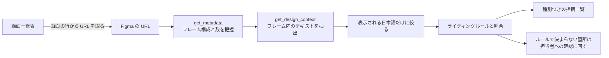

## TL;DR

- 以前は、リポジトリからデザインデータ（Figma）へ辿る導線がありませんでした。どこにデザインがあるのかは、知っている人に聞くしかありませんでした
- そこで、リポジトリの画面一覧表に「仕様書・デザイン・テスト・実装」の列を並べ、各画面の Figma のセクションへ直接リンクしました。URL は表の下の 1 か所に集めています
- 同じリポジトリに Figma の MCP サーバーを設定として配りました。参照系のツールだけを自動許可し、書き込み系は毎回確認にしています
- これで、AI エージェントがリポジトリから Figma の該当画面まで辿れます。画面を新しいフロントエンドへ移植するリアーキテクチャでは、エージェントがデザインを直接参照しながら実装し、レイアウト崩れが激減しました
- Figma の URL を渡すだけで、画面の UI 文言をまとめてレビューするスキルも作れました
- 学びは「人が辿れる導線は、エージェントにも辿れる」です。導線をドキュメントに書くことが、そのままエージェントの文脈になります

## この記事の対象読者

- Figma でデザインを管理していて、開発側のリポジトリとのつながりが弱いと感じている方
- Claude Code などの AI エージェントに、デザインを踏まえた作業をさせたい方
- UI 文言（ボタン・エラーメッセージなど）のレビューを、画面単位で効率よく回したい方

## 環境

- AI エージェント: Claude Code（MCP の設定は APM で宣言して `.mcp.json` を生成し、権限は `.claude/settings.json` に書く）
- Figma MCP: Figma が提供するホスト型のリモート MCP サーバー（`https://mcp.figma.com/mcp`）
- 対象: 業務系 SaaS の Web 画面（4 画面と、全画面共通のヘッダーなどの枠）

## リポジトリからデザインへ辿る導線がなかった

私が関わっているプロジェクトでは、デザインはデザインチームが Figma のマスターファイルで管理しています。画面の項目定義は、別途ドライブ上の画面設計書にあります。

開発側のリポジトリには、そのどちらへのリンクもありませんでした。新しく入ったメンバーは、デザインがどこにあるのかを人に聞いて回る必要がありました。

AI エージェントにとっては、状況はもっと厳しくなります。エージェントは「知っている人に聞く」ことができません。リポジトリに書かれていない場所は、エージェントにとって存在しないのと同じです。

## 画面一覧表に「仕様書・デザイン・テスト・実装」を並べた

最初にやったのは、リポジトリのドキュメントにある画面一覧表の拡張です。画面ごとに、仕様書・デザイン・テストシナリオ・実装の 4 つへのリンクを 1 行に並べました。

```markdown
| 画面 | 仕様書 | テストシナリオ | 実装 |
| --- | --- | --- | --- |
| ダッシュボード | [画面設計書][drive] ／ [Figma][figma-dashboard] | `TC-DASH-*`: [初期表示](../test-scenarios/dashboard/01-initial-display.md) / … | [`ui/DashboardPage.tsx`][fe-dash-page] |
| 一覧 | [画面設計書][drive] ／ [Figma][figma-list] | `TC-LIST-*`: … | [`ui/ListPage.tsx`][fe-list-page] |
| 共通の枠（ヘッダー・権限） | [画面設計書][drive] ／ [Figma][figma-shell] | `TC-COMMON-*`: … | [`shared/shell/`][fe-shell] |
```

Figma のリンクはファイル全体ではなく、`node-id` 付きで各画面のセクションを指します。ファイル全体へのリンクでは、開いた人もエージェントも、どのフレームが対象かを探すところから始めることになるからです。

この表の価値は、1 行が「画面」という単位で閉じていることにあります。ある画面について作業するとき、仕様もデザインもテストも実装も、この 1 行から辿れます。

## Figma の URL は表の下の 1 か所に集める

表の中には URL を直接書かず、Markdown の参照形式のリンクを使っています。実体の URL は、ファイル末尾の定義にまとめました。

```markdown
[figma]: https://www.figma.com/design/<fileKey>/<FileName>
[figma-dashboard]: https://www.figma.com/design/<fileKey>/<FileName>?node-id=<id>
[figma-list]: https://www.figma.com/design/<fileKey>/<FileName>?node-id=<id>
[figma-shell]: https://www.figma.com/design/<fileKey>/<FileName>?node-id=<id>
```

最初は、別のドキュメントにも Figma の URL を直接書いていました。これを、画面一覧表の 1 か所だけに集約しました。権限申請の手順など、ほかのドキュメントからは「URL は画面一覧表を見る」とだけ書いて参照させています。

集約が効いたのは、共通の枠のリンクでした。当初、共通の枠には単体のフレームがなく、リンクはファイル全体を指していました。その後、デザインチームが共通の項目のセクションを新設したので、リンクをそこへ差し替えました。URL の定義が 1 か所なので、変更は定義の 1 行の追加と、表の参照名の書き換えで済みました。

デザインは開発と別のチームが育てるものです。セクションの新設や整理は、開発側の都合と関係なく起こります。URL が散らばっていると、そのたびに探して直す作業が発生します。

## Figma MCP をリポジトリの設定として配る

導線ができても、エージェントが Figma の中身を読めなければ意味がありません。そこで、Figma の MCP サーバーをリポジトリの設定として配りました。統合リポジトリ（ドキュメントと AI エージェントの設定を置くリポジトリ）と、フロントエンドのリポジトリの両方です。

MCP の設定は、APM（Agent Package Manager）の `apm.yml` で宣言しています。

```yaml
dependencies:
  mcp:
    - name: figma
      registry: false
      transport: http
      url: https://mcp.figma.com/mcp
```

Claude Code が読む `.mcp.json` は、APM がこの宣言から生成します。直接は編集しません。APM でエージェントの設定をまとめて管理する方法は、[別の記事](https://qiita.com/zucky-quest/items/bd0ed671749574f4df98)で書いています。

ホスト型のリモート MCP なので、ローカルにサーバーを立てる必要はありません。初回だけ、ブラウザで OAuth 認証をします。

ツールの許可は、参照系と書き込み系で分けました。参照系はデザインを読むだけなので自動で許可します。canvas への生成など、Figma 側を変える書き込み系は毎回確認を挟みます。権限は APM では共有せず、Claude Code の `.claude/settings.json` に個別に書いています。

```json
{
  "permissions": {
    "allow": [
      "mcp__figma__get_design_context",
      "mcp__figma__get_metadata",
      "mcp__figma__get_screenshot",
      "mcp__figma__get_variable_defs",
      "mcp__figma__get_code_connect_map",
      "mcp__figma__get_libraries",
      "mcp__figma__search_design_system"
    ],
    "ask": [
      "mcp__figma__use_figma",
      "mcp__figma__create_new_file",
      "mcp__figma__generate_figma_design",
      "mcp__figma__upload_assets",
      "mcp__figma__add_code_connect_map"
    ]
  }
}
```

ツール名は完全一致で並べています。サーバー単位（`mcp__figma`）で許可すると、将来追加されるツールまで自動で許可されるためです。MCP の権限を allow・ask・deny で分ける方針と、完全一致で書く理由は、[MCP の許可リストの記事](https://qiita.com/zucky-quest/items/9e13814f80ade2fa1f71)で詳しく書いています。

## 権限はアカウントとファイルの 2 段階で要る

Figma MCP は、認証した本人の権限でデザインを読みます。エージェントだから特別に読めるわけではありません。

そのため、読むには 2 段階の権限が要ります。1 つは Figma のアカウントそのもの、もう 1 つは対象ファイルの閲覧権限です。アカウントがあっても、ファイルの権限がなければ読めません。ファイルの権限は、URL を開いて「アクセスをリクエスト」から申請し、ファイルのオーナーが承認します。

この 2 段階は、オンボーディングの手順書に明記しました。ここが抜けていると、MCP の設定は正しいのに読めない、という切り分けにくい状態になります。

## リアーキテクチャの移植で、レイアウト崩れが激減した

導線と MCP がそろって最初に効いたのは、リアーキテクチャでの画面の移植でした。既存の画面を、新しいフロントエンドの構成へ作り直す作業です。

移植では、見た目を移植元とそろえる必要があります。ところが、エージェントがコードだけを見て書き直すと、ページの枠やカードの余白、フィルタの幅、パンくずのような細部がずれがちです。コードには、デザイン上の意図までは書かれていないからです。

Figma MCP を入れてからは、エージェントが実装の前に該当画面のフレームを読めるようになりました。画面一覧表の 1 行から Figma のセクションを開き、レイアウトや余白を確かめてから書けます。結果として、移植で起きるレイアウト崩れは激減しました。

## Figma の URL を渡すだけで、画面の文言を一括レビューする

デザインを起点にした作業は、実装だけではありません。もう一つの例が、UI 文言のレビューです。

社内には、UI 文言のライティングルール（表記・文体・NG 表現など）があります。これを読み込ませた文言チェックのスキルを作り、Figma の URL を入力として受け取れるようにしました。



流れは次のとおりです。まず `get_metadata` でページとフレームの構成を取り、フレームの数を利用者に伝えます。フレームが多いときは、全件を見るか区切るかを先に確認します。黙って件数を絞ると、見ていない画面が見たことになってしまうからです。

次に `get_design_context` で、各フレームのテキストを抽出します。ここで一つ工夫が要りました。Figma 上のテキストには、装飾用のダミー文字や、英語のコンポーネント名も混ざっています。そのため、画面に表示される日本語の文言だけを対象にし、判断に迷うものは要確認に回すようにしました。

抽出した文言は画面ごとに束ねて、ルールと照らします。画面単位で見るので、1 件ずつの校正では見えない指摘も出せます。同じ NG 表記がいくつの箇所にあるか、同じ操作を指す言い回しが画面間で割れていないか、といった観点です。

指摘は、次の種別に分けて出します。

| 種別 | 中身 |
| --- | --- |
| 要修正 | ルールどおりに直すもの |
| 表記ゆれ | 同じものを指す言い回しが、画面の間で割れているもの |
| 実装とのズレ | 実装済みの文言と、言い回しがずれているもの |
| 要確認 | ルールで決まらないもの。ルールに定めが無い、解釈が分かれる、画面の文脈を踏まえる必要がある、という理由で分ける |

要確認は、省略せずにすべて残します。これはルールが足りていない箇所の記録にもなります。最終確認は人が行う前提で、要確認の指摘は UX ライティング担当への確認依頼にまとめて載せます。

## 人が辿れる導線は、エージェントにも辿れる

振り返ると、エージェントのために特別なことをしたわけではありません。やったのは、人のための導線をリポジトリに書くことでした。

画面一覧表は、もともと新メンバーのオンボーディングのために整えたものです。ところが、リポジトリに書いた導線は、そのままエージェントの文脈になりました。「この画面のデザインを見て」と頼めば、エージェントは一覧表から該当画面の Figma のリンクを見つけ、MCP で中身を読みにいきます。

逆に言えば、人に聞かないと分からない情報は、エージェントにも使えません。エージェントを活用したいなら、まず人が迷わない導線をリポジトリに置くのが近道です。

## まとめ

リポジトリの画面一覧表に、各画面の Figma のセクションへのリンクを並べました。URL は 1 か所に集め、デザイン側の整理にも 1 行の変更で追従できるようにしました。Figma MCP を参照系だけ自動許可で配ったことで、エージェントがリポジトリから Figma まで辿れるようになりました。リアーキテクチャでの画面の移植では、レイアウト崩れが激減しました。さらに、Figma の URL を渡すだけで画面の UI 文言をまとめてレビューする仕組みを載せています。

今後は、テストシナリオとデザインの突き合わせにも広げたいと考えています。画面一覧表の 1 行には、すでにテストシナリオへのリンクも並んでいます。デザインとテストの食い違いを、エージェントに見つけさせる余地があります。

## 参考

- [Figma MCP サーバーのドキュメント](https://help.figma.com/hc/en-us/articles/32132100833559)
- [Claude Code の権限設定](https://docs.anthropic.com/en/docs/claude-code/settings)
