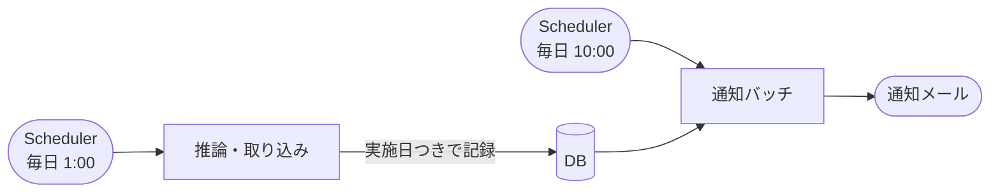

## TL;DR

- 日次の処理で一番気づきにくいのは、**失敗ではなく「何も起きなかった」こと**です。スケジュールが発火しない、ロールを引き受けられない。どれも失敗のイベントが出ません
- 監視は 3 層に分けました。**実行の失敗**はイベントで、**起動の失敗**は Scheduler の DLQ で、**何も起きなかったこと**はメトリクスで検知します
- 3 層目の観測点は、**毎日必ず動く通知バッチ自身**です。起動のたびに 3 つのメトリクスを送ります。監視のための別の処理は作っていません
- 「起動していない」は、イベントでは表せません。**メトリクスの欠損**を、CloudWatch のアラームで「しきい値超過」として扱って検知します
- 評価の範囲は 24 時間ではなく **25 時間**にしました。24 時間だと、毎日の評価の時点で当日の点がまだ届かず、誤って鳴るためです

## この記事の対象読者

- 日次のバッチを、EventBridge Scheduler や cron で動かしている方
- 「失敗したら通知」は作ったが、「動かなかった」ことに気づける自信が無い方
- CloudWatch のアラームの `treat_missing_data` を、どう設定するか迷っている方

## 環境

- Amazon EventBridge Scheduler（日次の起動）
- AWS Step Functions、Amazon ECS（Fargate）のバッチ
- Amazon CloudWatch（カスタムメトリクスとアラーム）、Amazon SQS（DLQ）
- Terraform

## 背景：日次の処理は、止まっても何も言わない

監視の対象は、次のような日次の処理です。推論バッチの結果を、テナントごとに通知メールで配っています。



推論と通知は、DB に記録した「実施日」だけでつながっています。通知バッチは、実施日の 10 時を迎えて、まだ配っていない結果を配ります。

この処理は、配信できなかった分を翌日以降に後送します。ただし、後送が働くのは「送れていない」ことに誰かが気づける場合だけです。そこで、止まったことに気づける仕組みを 3 層に分けて作りました。

## 3 層に分けた

| 層 | 何を検知するか | 仕組み |
| --- | --- | --- |
| 第 1 層 | 実行の失敗 | ステートマシンの失敗や、バッチの異常終了を、EventBridge のルールから Slack に通知する（既存の仕組み） |
| 第 2 層 | 起動の失敗 | Scheduler の再試行ポリシーと DLQ を明示的に設定し、DLQ の滞留をアラームにする |
| 第 3 層 | 何も起きなかったこと | 通知バッチが毎日カスタムメトリクスを送り、その欠損や値をアラームにする |

第 1 層と第 2 層は、何かが「起きた」ことを捉えます。失敗のイベントが出る、DLQ にメッセージが溜まる、という形です。

一番気づきにくいのが第 3 層です。たとえば、次のような状態はどれもイベントが出ません。

- スケジュールが無効になっていて、発火しない
- 処理は成功したが、対象のテナントが 1 つも選ばれていない
- 推論が失敗した日に、通知バッチは「配る結果が無い」だけで正常に終わる

## 毎日必ず動く通知バッチを、観測点にした

そこで、**通知バッチ自身を、毎日の観測点**にしました。通知バッチは起動のたびに、3 つのメトリクスを CloudWatch に送ります。

| メトリクス | 中身 | アラームが鳴ったとき分かること |
| --- | --- | --- |
| `BatchStarted` | 起動直後に 1 を送る | 直近 25 時間で 1 回も起動していない。発火・ロールの引き受け・タスクの起動のどこかで止まった |
| `OverdueDeliveries` | 配信期限を過ぎても終わっていない件数 | 配信の失敗が続いている |
| `MissingScheduledRuns` | 今日が実施日なのに、推論の結果が無いテナントの数 | 推論の日次起動か、対象の抽出に問題がある |

監視のための処理を、別に作らなかったのがポイントです。通知バッチは毎日 10 時に必ず起動します。その末尾で確かめれば、監視のための実行主体・スケジュール・DB の権限を、新しく用意する必要がありません。

### 0 件のときも 0 を送る

`OverdueDeliveries` と `MissingScheduledRuns` は、該当が無い日も 0 を送ります。グラフで「測って 0」と「測っていない」を見分けるためです。

### 手で流した起動は、メトリクスを送らない

通知バッチは、対象のテナントや判定の時刻を上書きして、手で起動することもあります。テストや検証のためです。こうした起動では、メトリクスを送らないようにしました。手で流した起動が、毎日の起動の監視に混ざらないようにするためです。

## 「起動していない」は、欠損を超過として扱う

`BatchStarted` のアラームは、こう設定しました（説明用に簡略化しています）。

```hcl
resource "aws_cloudwatch_metric_alarm" "heartbeat_missing" {
  namespace   = "MyApp/Notification"
  metric_name = "BatchStarted"
  statistic   = "Sum"
  period      = 3600 # 1 時間

  comparison_operator = "LessThanThreshold"
  threshold           = 1
  evaluation_periods  = 25 # 評価の範囲は 25 時間
  datapoints_to_alarm = 25 # 範囲のすべての期間が「1 未満」のときだけ鳴る

  # 欠損が「起動していない」そのものなので、超過として扱う
  treat_missing_data = "breaching"
}
```

ポイントは 3 つです。

**1. 欠損を「しきい値超過」として扱う（`breaching`）。** 「起動していない」はイベントでは表せず、**メトリクスの欠損でしか表せません**。欠損を「正常」や「判定しない」として扱うと、まさに検知したい状態で鳴りません。

**2. 範囲のすべての期間がそろったときだけ鳴らす。** CloudWatch のアラームは、評価する期間の数 `evaluation_periods`（N）のうち、`datapoints_to_alarm`（M）個が超過していれば鳴ります。メトリクスは 1 日 1 点で、期間は 1 時間です。点のある 1 時間以外は、毎日欠損します。M と N を同じ 25 にすると、25 時間すべてが欠損したときだけ鳴ります。

**3. 評価の範囲は 24 時間ではなく 25 時間にする。** 24 時間だと、10 時台を評価した時点で、当日の点がまだ届いていないことがあります。通知バッチは起動から数十秒後に送るためです。そのとき前日の 10 時台の点は範囲から外れていて、すべての期間が欠損になり、誤って鳴ります。1 時間の余裕で、起動のずれと CloudWatch の評価の遅れを吸収します。

Scheduler 自体のメトリクスを使わなかったのは、スケジュールのグループ単位でしか見られず、届き方もベストエフォートだからです。欠損していても、「発火しなかった」とは読めません。

### 平日だけ動く環境は、範囲を広げた

検証環境の通知バッチは、平日だけ起動します。25 時間のままだと、毎週土曜の 11 時ごろに鳴り、月曜に戻ってしまいます。

そこで、検証環境の範囲は、金曜 10 時から月曜 10 時までの 72 時間に 1 時間を足した、**73 時間**にしました。代わりに、平日に止まったときの検知は、最大で 2 日遅れます。検証環境なので、この遅れは許容しています。

## 件数のアラームは、欠損を正常として扱う

`OverdueDeliveries` と `MissingScheduledRuns` は、考え方が逆です。

| | `BatchStarted` | `OverdueDeliveries` / `MissingScheduledRuns` |
| --- | --- | --- |
| 何で鳴らすか | 欠損 | 値が 0 を超えること |
| 統計 | `Sum` | `Maximum` |
| 欠損の扱い | `breaching`（超過） | `notBreaching`（正常） |
| 鳴る条件 | 25 時間すべてが欠損 | 25 時間に 1 点でも 0 を超える |

件数のメトリクスも 1 日 1 点なので、点の無い期間は判定に使わず、正常として扱います。起動していないことの検知は、`BatchStarted` のアラームに任せています。

この 2 本は、平日だけ動く環境でも範囲を広げていません。0 を超える点が範囲に残っている間は、アラームが鳴ったままになります。範囲を 73 時間に広げると、直った後も最大 3 日、鳴ったままになってしまいます。

### アラームの説明に、次に見る場所を書く

鳴ったときに迷わないよう、アラームの説明文に、確かめる場所と復旧の手順を書いています。たとえば「推論が実施されていない」のアラームには、次のことを書きました。

- 推論のステートマシンの、今日の実行を見る
- 実行が無いか失敗していれば、スケジュールの状態と DLQ を確かめる
- 復旧は、実施日を指定して推論を手で起動する。取り込みが終われば、次の 10 時の起動で配信される

## 実例：推論が落ちた日に、アラームが鳴った

新しい方式が動き始めた検証環境で、早速「何も起きなかった」日がありました。

ある日の 1 時に起動した推論が、開始から 4 秒で失敗しました。推論の前に検証用の DB を復元する処理があり、復元元の DB が停止していたためです。

推論が失敗すると、その実施日の結果は作られません。10 時に起動した通知バッチにとっては、配るべき結果が無いだけで、エラーにはなりません。ステートマシンの失敗の通知（第 1 層）は出ますが、それだけでは「どのテナントの配信に穴が開いたか」までは分かりません。

今回は、通知バッチが 10 時に送った `MissingScheduledRuns` が 1 になり、11 時台に「推論が実施されていない」のアラームが鳴りました。第 1 層とは別に、第 3 層が「今日が実施日なのに結果が無いテナントがある」ことを捉えた形です。

ここから分かったこともあります。遅れても送る仕組みが救えるのは、結果はあるのに 10 時の送信に失敗した場合と、10 時より後に結果ができた場合だけです。**推論そのものが失敗した日は、自動では救われません。** 人が実施日を指定してリランして初めて結果ができ、次の 10 時の起動で配信されます。だからこそ、推論の失敗を見逃さない監視が要ります。

## まとめ

| 決めたこと | 理由 |
| --- | --- |
| 監視を「実行の失敗」「起動の失敗」「何も起きなかった」の 3 層に分けた | 3 つ目は、イベントが出ないので別の仕組みが要る |
| 毎日必ず動く通知バッチを、観測点にした | 監視のための実行主体・スケジュール・権限を増やさずに済む |
| 起動の心拍は、欠損を超過として扱った | 「起動していない」は欠損でしか表せない |
| 評価の範囲を 25 時間にし、すべての期間がそろったときだけ鳴らした | 1 日 1 点のメトリクスで、誤って鳴らさない |
| 件数のメトリクスは 0 のときも送り、欠損は正常として扱った | 「測って 0」と「測っていない」を見分け、起動の検知は心拍に任せる |
| 手で流した起動は、メトリクスを送らない | 毎日の起動の監視に混ぜない |

学びは 2 つです。

1. **「何も起きなかった」は、別の層で検知する。** 失敗のイベントは、起動されなかった処理からは出ません。毎日必ず動く処理に観測点を持たせると、仕組みを増やさずに検知できます
2. **欠損の扱いは、メトリクスの意味で決める。** 心拍のように「来ないこと」自体が異常なら超過、件数のように「来た値」で判断するなら正常として扱います。同じ 1 日 1 点のメトリクスでも、設定は逆になります

## 参考

- [Amazon CloudWatch: Configuring how CloudWatch alarms treat missing data](https://docs.aws.amazon.com/AmazonCloudWatch/latest/monitoring/alarms-and-missing-data.html)
- [Configuring a dead-letter queue（EventBridge Scheduler ドキュメント）](https://docs.aws.amazon.com/scheduler/latest/UserGuide/configuring-schedule-dlq.html)
- [Amazon CloudWatch: Publishing custom metrics](https://docs.aws.amazon.com/AmazonCloudWatch/latest/monitoring/publishingMetrics.html)
