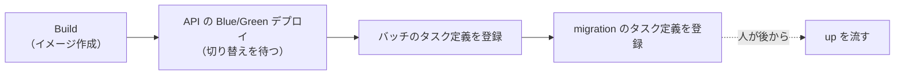
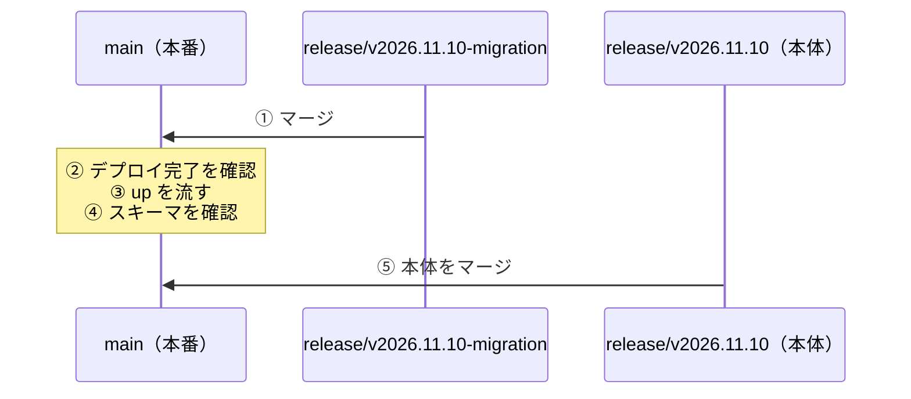

## TL;DR

- 列やテーブルを**足す** migration を、アプリのコードと**同じリリース**に入れると落ちます。デプロイと `up`（migration の適用）の間に時間差があり、その間「コードは新スキーマ前提・DB は旧スキーマ」になるためです
- 落ちるのは書き込みです。ORM の `Find` は `SELECT *` なので、読みは新しい列が無くても通ります。一方 `Create` は構造体の全フィールドを `INSERT` に入れるので、`Unknown column` で失敗します
- しかも、DB の疎通しか見ないヘルスチェックでは検知できず、Blue/Green の自動ロールバックも働きません
- そこで、**追加の migration だけを別のリリースブランチに分け、本体と同じ日に先に本番へ出す**ことにしました。`up` を流してから本体を出します（同日 2 回マージ）
- 削除（DROP）は逆に、参照をやめたxコードを出し、切り戻せる時間（bake time）が過ぎてから流します。これは Parallel Change（expand / contract）と同じ形です

## この記事の対象読者

- migration とアプリのコードを、同じリポジトリ・同じリリースで管理している方
- Blue/Green デプロイを使っていて、スキーマ変更との順番に迷っている方
- Parallel Change（expand / contract）の考え方を、ブランチ運用まで落とし込みたい方

## 環境

- Go と GORM（MySQL）
- migration は goose をライブラリとして組み込み、人が起動して流す
- Amazon ECS（Blue/Green。bake time 5 分、circuit breaker あり）
- GitHub Flow ＋ 版別のリリースブランチ（`release/vYYYY.MM.DD` を `main` へマージしてリリース。`develop`・`staging` は環境のテスト用）

## 背景：デプロイと `up` の間に時間差がある

このリポジトリでは、migration の適用を CI/CD から自動では行っていません。DDL の権限を持つ認証情報を CI/CD に置かず、適用の実行者と権限を migration 用の DB ユーザーに集めるためです。適用は、運用者が手で起動して行います。

デプロイパイプラインが行うのは、その migration タスクの定義の登録までです。パイプラインは、次の順に進みます。



migration の SQL は、コンテナのイメージに焼き込んでいます。そのため、新しい migration を流せるのは、パイプラインが migration のタスク定義を登録した**後**です。そしてその時点で、API はもう新しいコードに切り替わっています。

つまり、migration とコードを同じリリースに入れると、**API の切り替えから `up` までの間、コードは新スキーマ前提・DB は旧スキーマ**になります。

実際に障害が起きたわけではありません。この時間差の間に何が起きるかを仕組みから追い、落ちる前に順番を決めました。

## 時間差の間に、何が落ちるのか

この間に何が起きるかは、読みと書きで違います。

| 操作 | 新しい列が DB に無いとき |
| --- | --- |
| 読み（GORM の `Find`） | 通る。`SELECT *` なので、DB にある列だけが返る。構造体の新しいフィールドはゼロ値のまま |
| 書き（GORM の `Create`） | **落ちる**。構造体の新しいフィールドが `INSERT` の列に入るので、`Unknown column` になる |

たとえば、既存のテーブルに列を 1 つ足し、構造体にもフィールドを足したとします。

```go
// 説明用に簡略化したコード
type Setting struct {
	ID        int64
	CompanyID int64
	Name      string
	Note      *string // 今回追加した列
}

db.Create(&Setting{CompanyID: 1, Name: "default"})
// INSERT INTO settings (company_id, name, note) VALUES (...)
// → Error 1054: Unknown column 'note' in 'field list'
```

怖いのは、**新機能だけでなく、そのテーブルへ書く既存の機能も巻き込まれる**ことです。新しい列を使うかどうかに関係なく、構造体にフィールドがあれば `INSERT` に入ります。

### ヘルスチェックでは止まらない

さらに、このときデプロイは止まりません。ロードバランサーのヘルスチェック（`/health`）は、DB への疎通（`PingContext`）しか見ていないからです。

- 新しいタスクは、ヘルスチェックに合格する
- Blue/Green の切り替えは、そのまま進む
- circuit breaker（タスクの起動失敗やヘルスチェックの不合格で自動ロールバックする仕組み）も働かない

結果として、書き込みだけが `Unknown column` で失敗し続ける状態が、`up` を流すまで続きます。

## 決めたこと：変更の種類で、順番を変える

スキーマを常に「新旧どちらのコードでも動く」状態を経由させる、というのが基本の考え方です。変更の種類ごとに、次のように決めました。

| 変更 | 順番 |
| --- | --- |
| 追加（列・テーブル） | migration を**先に**本番へ出して `up` → その後で本体のコードを出す |
| 削除（DROP） | 参照をやめたコードを**先に**出す → bake time が過ぎてから `up` |
| リネーム・型変更 | 追加 → 参照の移行 → 旧列の削除の 3 段階を、別々のリリースにする |
| 追加する列の制約 | NULL 許容か DEFAULT 付きにする |

### 追加は、別のリリースブランチで同じ日に先に出す

追加の migration だけを、`release/vYYYY.MM.DD-migration` という別のリリースブランチに入れます。日付は本体のリリースにそろえ、同じ日に本体より先に `main` へマージします。



ポイントは、**`-migration` を本体ではなく `main` の最新から作る**ことです。本体から作ると、① の時点で本体のコードまで本番へ出てしまいます。migration の作業ブランチも、`-migration` から切ってそこへ PR を出します。

`main` を本体のリリースブランチへ取り込む手順は設けていません。⑤ で本体を `main` へマージした時点で、migration と本体のコードは `main` に揃うからです。

① の時点で本番へ出るのは、`main` と migration のファイルだけです。旧コードは足した列を知りませんが、読みは `SELECT *` で無視でき、書きは新しい列を `INSERT` に含めないので、そのまま動きます。

検証環境と開発環境、ローカルでも、同じ順番で行います。

### 削除は、切り戻せる時間が過ぎてから流す

削除は、追加と逆です。参照をやめるコードと DROP の migration を同じリリースに入れ、**bake time（5 分）が終わってから** `up` を流します。

bake time の間は、旧タスクが残っていて、トラフィックを戻すだけで切り戻せます。その間に DROP していると、切り戻した旧コードが消えた列を参照して落ちます。このリポジトリの migration には `down` が無いので、DROP した列は戻せません。

bake time の後も、1 つ前のリビジョンへのロールバックはできます。そのため、DROP は「旧コードへ戻す必要が無い」と判断できてから流すことにしています。

### 追加する列は NULL 許容か DEFAULT 付きにする

NOT NULL で DEFAULT の無い列を足すと、その列を知らない旧コードの `INSERT` が、MySQL の strict mode で失敗します。先に migration を出す以上、旧コードが新しい列を知らないまま書く時間が必ずあります。NOT NULL にしたいときは、全行が埋まった後に別の migration で行います。

## 運用の副作用も先に潰した

「同日 2 回マージ」は、既存のブランチ運用とぶつかる箇所がいくつかありました。

### 開発環境のブランチを上書きすると、migration が消える

開発環境のブランチ（`develop`）は、リリースのたびに直近のリリースブランチで上書きしています。ところが、本体のリリースブランチには、次回分の migration が**意図的に入っていません**。上書きのたびに `develop` からそのファイルが消え、開発環境の DB には適用済みのまま残ります。

そこで、進行中の `-migration` があれば、上書きの後に `develop` へマージし直すことにしました。`-migration` の中身は `main` と migration だけなので、マージし直しても本体のコードは混ざりません。

### version sort で、`-migration` が本体より先に並ぶことがある

上書きに使う「直近のリリースブランチ」は、git の version sort で日付が最も早いものを選んでいました。ところが version sort は、`versionsort.suffix` の設定しだいで `-migration` を本体より先に並べます。

並び順には頼らず、`-migration` を選択から外しました。

```bash
# -migration を除いて、日付が最も早いリリースブランチを選ぶ
REL=$(git for-each-ref --sort=version:refname --format='%(refname:short)' \
  'refs/remotes/origin/release/v*' | grep -v -- '-migration$' | head -n 1)
```

### 依存の自動更新を、`-migration` の作成で起動しない

依存を自動で更新するツール（Renovate）は、リリースブランチの作成をきっかけに起動していました。`-migration` の作成でも起動すると、未マージの依存更新の PR が、`-migration` を base に付け替えられてしまいます。GitHub Actions の起動条件で、`-migration` で終わるブランチを除外しました。

```yaml
if: >-
  startsWith(github.ref_name, 'release/')
  && !endsWith(github.ref_name, '-migration')
  && (github.event_name == 'workflow_dispatch' || github.event.created)
```

### 夜間のマスキングとの順番

本番の DB は、毎晩スナップショットから個人情報をマスクした複製を作り、分析用のツールに公開しています（別チームの管理）。マスクの定義はこのリポジトリの外にあり、migration とは連動しません。

個人情報が入る列を足すときは、マスクの定義も足す必要があります。定義の反映が `up` より先になり、その間に夜間のマスキングが走ると、まだ無い列への `UPDATE` で失敗します。定義の反映は「`up` の後、その夜のマスキングの前」にそろえます。追加なら、本体のリリースを待たずに、`-migration` の `up` の後から依頼できます。

## 最初のリリースで回してみた

この運用で、最初のリリースを出しました。題材は、既存のテーブルに列を 1 つ足す migration です。

- 同じ日に、migration だけのリリースブランチを先に `main` へマージし、`up` を流しました
- 約 1 時間 20 分後に、本体のリリースを `main` へマージしました
- 手順どおりに進み、問題なく出せました

回してみて、手順を 2 つ減らしています。

- **`main` を本体へ取り込む手順をやめた。** 当初は、本体を出す前に `main` を本体のリリースブランチへ取り込む手順を置いていました。ただ、取り込むと本体の PR の承認が外れ、その日のうちにもらい直す必要があります。本体を `main` へマージした時点で両方が揃うので、省いても順番（追加が先）は崩れません
- **migration 側のリリースにはタグを付けない。** すぐ後に本体のリリースのタグを付けるので、migration だけのタグは付けないことにしました

## Parallel Change と同じ形になった

振り返ると、この順番は **Parallel Change**（expand → migrate → contract）そのものです。

| 段階 | Parallel Change | この運用 |
| --- | --- | --- |
| expand | 新しい構造を足す。旧い構造は残す | `-migration` で列を足し、先に `up` |
| migrate | 利用側を新しい構造へ移す | 本体のコードを出す |
| contract | 旧い構造を消す | 参照をやめたコードを出し、bake time の後に DROP |

DORA も、既存のオブジェクトを変えずに新しい構造を足し、スキーマの変更をアプリより先に出してデプロイと切り離すことを勧めています。

一般論としては知られた形ですが、実際に運用へ落とすと、「なぜ同じリリースだと落ちるのか」を自分たちの仕組みで説明できることと、ブランチ運用の細部まで決めることの両方が要りました。

## まとめ

| 決めたこと | 理由 |
| --- | --- |
| 追加の migration は別のリリースブランチで、同じ日に先に出す | デプロイから `up` までの間、新コードの `INSERT` が `Unknown column` で落ちる |
| `-migration` は `main` の最新から作る | 本体から作ると、本体のコードまで先に出てしまう |
| DROP は bake time が過ぎてから流す | 切り戻した旧コードが、消えた列を参照して落ちる |
| リネーム・型変更は 3 段階を別のリリースにする | 1 本の `ALTER` では、新旧どちらかが無い列を参照する |
| 追加する列は NULL 許容か DEFAULT 付き | 旧コードの `INSERT` が strict mode で落ちない |
| 開発環境の上書き・version sort・依存の自動更新・夜間のマスキングとの順番も決めた | 同日 2 回マージが、既存の運用とぶつかる |
| 回してみて、`main` の取り込みと migration 側のタグを省いた | 本体を `main` へマージすれば揃い、承認のもらい直しの手間に見合わない。タグは本体のものだけで足りる |

学びは 2 つです。

1. **スキーマ変更の順番は、「デプロイと適用の間に何が起きるか」から決める。** 読みと書きで壊れ方が違い、ヘルスチェックでは気づけません。自分たちの ORM とデプロイの仕組みで、時間差の間を具体的に追うと、守るべき順番が決まります
2. **運用ルールを足すときは、既存の運用とのぶつかりを先に洗う。** ブランチを 1 本足すだけでも、上書き・並び順・自動化のきっかけと、ぶつかる箇所がいくつもありました

## 参考

- [Martin Fowler: ParallelChange](https://martinfowler.com/bliki/ParallelChange.html)
- [DORA: Database change management](https://dora.dev/capabilities/database-change-management/)
- [GORM: Create](https://gorm.io/docs/create.html)
- [goose](https://github.com/pressly/goose)
- [Amazon ECS: Blue/green deployments](https://docs.aws.amazon.com/AmazonECS/latest/developerguide/deployment-type-blue-green.html)
