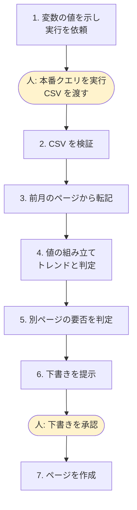

## TL;DR

- プロダクト KPI の月次レポートを、Claude Code のスキルにしました。BI ツールのクエリ結果から、Wiki に月ごとのページを作るまでの手順です
- いきなりスキルにはしませんでした。**最初の 2 回は手で回し**、手順と落とし穴が固まってからスキル化しています
- スキルには**手順と、実データで踏んだ落とし穴だけ**を書きます。指標の定義や判定の基準は設計書が正本で、スキルには写しません
- 本番データへのクエリは人が実行し、エージェントは手順の案内・検証・下書きまでを担います
- 完成したスキルを別のエージェントに空実行させたところ、値は手作業と一致しました。同時に、**12 件の曖昧さ**が見つかりました
- レポートの作成は、手作業で**約 3 時間**かかっていたのが、スキルで**約 20 分**になりました

## この記事の対象読者

- 定型の業務を Claude Code などの AI エージェントに任せたい方
- スキル（エージェントに渡す手順書）をどう書けば崩れないか悩んでいる方
- 本番データを扱う作業で、エージェントにどこまで任せるか線を引きたい方

## 環境

- Claude Code（スキル機能）
- BI ツール: Metabase（保存済みクエリ）
- Wiki: Confluence
- 指標の定義は Git 管理の設計書（Markdown）に置いている

## 背景：毎月同じ作業なのに、毎回どこかで間違える

月次レポートでは、利用状況とサービス品質の 2 ページを毎月作ります。

このレポートは、スプリントレビューで使います。私たちは 1 週間のスプリントで開発しており、月に 1 回のスプリントレビューで、チームと PdM（プロダクトマネージャー）、PD（プロダクトデザイナー）がこのレポートを見ます。利用状況の推移を見て、次のスプリントで改善する機能を決めるためです。値が間違っていると、どの機能を改善するかの判断そのものを誤ります。

作り方は毎月同じです。

1. BI ツールで本番データのクエリを実行し、CSV を取る
2. 前月のページから、推移を出すための値を転記する
3. 値を組み立て、前月からの増減（トレンド）と、目標の達成・未達を判定する
4. Wiki にページを作る

手順は単純です。それでも、毎回どこかで小さく間違えます。こういう作業こそエージェントに任せたいところです。

ただ、最初からスキルを書くことはしませんでした。

## なぜ 2 回手で回してからにしたのか

**1 回目で分かるのは手順、2 回目で分かるのは落とし穴**だからです。

| 回 | やったこと | 分かったこと |
| --- | --- | --- |
| 1 回目 | 指標の設計を作りながら、手作業でレポートを作った | 手順の骨格。どのクエリを流し、どの値をどこに書くか |
| 2 回目 | SQL を BI ツールの保存済みクエリにし、期間を変数にした。実行は人が行い、CSV をエージェントに渡した | 実データでしか踏まない落とし穴 |
| スキル化 | 2 回分の手順と落とし穴をスキルに書いた | |

1 回目の時点でスキルを書くと、まだ揺れている手順を固めてしまいます。2 回目は、同じ手順をなぞりながら「どこで間違えるか」を集める回でした。

2 回目で期間を変数にしたことも効いています。変数は 3 つで、当月の初日、翌月の初日、推移の起点になる前々月の初日です。クエリの本文を毎月書き換える必要がなくなり、スキルは「変数に何を入れるか」だけを示せばよくなりました。

## 2 回目で踏んだ落とし穴

実データで踏んだものを、そのままスキルに書きました。

| 落とし穴 | 何が起きたか |
| --- | --- |
| 変数の入れ間違い | 推移の起点に、前々月ではなく当月の初日を入れた。推移の表から前々月の行が消えた |
| Wiki を Markdown で読む | 日付の要素が空になった。HTML で読む必要がある |
| CSV の数値の書式 | 3 桁区切りのカンマ入りで、引用符で囲まれている。日時はロケール表記 |
| ファイル名の時刻 | ダウンロードした CSV のファイル名は UTC。15 時以降に取ると、日本時間では翌日の日付になる |
| 前月の備考の写し残し | 前月のページの備考をそのまま写したら、すでに廃止したチケットの番号が残った |

どれも、手順書を机の上で書いているときには思いつきません。**実データに触った回数だけ、落とし穴は見つかります**。

## スキルの設計：手順と落とし穴だけを持つ

### 定義の正本は設計書に置く

一番大事にした方針です。スキルには**指標の定義・表記・判定の基準を書きません**。それらは設計書が正本で、スキルは設計書を参照します。

スキルに定義を写すと、設計書を直したときにスキルが古くなります。正本が 2 つになると、どちらが正しいか分からなくなります。スキルが持つのは「どう作るか」と「どこで間違えるか」だけです。

リポジトリには「**スキルには実データで検証した手順だけを書く**」という規律もあります。推測で書いた手順は、実データで踏むまで正しいか分かりません。

### ユーザー起動専用にする

スキルはユーザーが明示的に呼んだときだけ動くようにしました。エージェントが会話の流れで勝手に起動しないようにするためです。

```yaml
---
name: monthly-report
description: プロダクト KPI の月次レポートを、BI ツールの結果から Wiki に作成する
disable-model-invocation: true
argument-hint: "[対象月 YYYY-MM（省略時は前月）]"
---
```

### 7 つの手順と完了基準

手順は 7 つです。各手順に**完了基準**を書き、作業の最初にチェックリストを応答へコピーさせて、終わるたびに消し込ませます。

```text
月次レポート作成:
- [ ] 1. 対象月と変数の値を示し、BI ツールでの実行を依頼する
- [ ] 2. CSV を検証する
- [ ] 3. 前月のページから転記元を読む
- [ ] 4. 値を組み立て、トレンドと判定を決める
- [ ] 5. 別テーマのページを作るかを判定する
- [ ] 6. 下書きを示して確認を得る
- [ ] 7. ページを作成する
```

完了基準は「何をしたか」ではなく「何が揃ったか」で書きます。たとえば手順 1 は「全クエリ分の CSV のパスを受け取った」、手順 6 は「ユーザーが下書きを承認した」です。エージェントが「たぶん終わった」で次へ進むのを防げます。



### 正本は APM に置き、Codex でも使えるようにする

スキルの正本は、Claude Code の設定フォルダではなく、APM（Agent Package Manager）の `.apm/skills/` に置いています。APM がそこから Claude Code 用と Codex 用のスキルを生成するので、同じ手順書をどちらのエージェントでも使えます。手順や落とし穴を直すときも、正本の 1 か所を直すだけです。

APM でエージェントの設定をまとめて管理する方法は、別の記事「[Claude Code と Codex の設定を 1 つの SSOT に統一する](https://qiita.com/zucky-quest/items/bd0ed671749574f4df98)」で書いています。

### 人とエージェントの責務を分ける

本番データを扱うので、任せる範囲をはっきり決めました。

| 作業 | 担当 | 理由 |
| --- | --- | --- |
| 本番データのクエリ実行 | 人 | 本番データにエージェントを直接触れさせない（エージェントが受け取るのはマスク済み環境の集計値だけ） |
| 変数の値の提示、CSV の検証、値の組み立て | エージェント | 定型で、間違いを機械的に検出できる |
| サマリと特記事項 | エージェントは下書きまで | 解釈を含むので、人が確かめる |
| ページの作成 | エージェント（人の承認後） | 承認された内容をそのまま書くだけ |
| 過去の月のページ | 編集しない | 過去のレポートは記録として固定する |

エージェントが受け取る CSV にも、個人情報は含まれません。クエリを実行する BI ツールは、本番 DB の複製から個人情報の列をマスクした環境です。氏名や自由記述の本文は置き換えられ、マスクされていない個人情報が見つかった表は、そもそも BI ツールから見えなくなります。さらにクエリは件数や社数などの集計値だけを返す形にしてあり、個人を特定できる列は出しません。

## 検証：別のエージェントに空実行させる

スキルを書いたら、**別のインスタンスのエージェント**に実データで空実行させました。ページの作成だけは禁止しています。

スキルを書いたエージェントは、スキルに書いていない前提を無意識に補ってしまいます。別のエージェントなら、書かれていることしか知りません。手順書のレビューを、新しく入ったメンバーに実際にやってもらうのと同じ発想です。

結果は 2 つありました。

1. **値・トレンド・判定は、手作業の結果と一致した。** スキルの手順で、正しいレポートが作れることを確かめられた
2. **12 件の曖昧さが見つかった。** 一致はしたが、解釈が割れうる箇所が残っていた

見つかった曖昧さの例です。

- 実行日時点の値を取る指標で、対象を取りこぼしうる書き方になっていた
- CSV のどの列をどう読むかが、書かれていなかった
- 割合の丸め方（どの桁で、どう丸めるか）が決まっていなかった
- 同じ月のページがすでにあるかを、確かめる手順がなかった
- 前月の文面を写すとき、古い記述が残りうることへの注意がなかった

12 件をスキルに反映した後、差分レビューを 2 回まわし、指摘がなくなるまで直しました。最後に人がレビューし、丸めの規則はスキルではなく設計書側へ移しました。丸めは「どう作るか」ではなく「指標の定義」に属するからです。

## 成果：約 3 時間が約 20 分に

| | 手作業 | スキル |
| --- | --- | --- |
| 1 回のレポート作成にかかる時間 | 約 3 時間 | 約 20 分 |

スキルの約 20 分には、人が本番データのクエリを実行する時間も含みます。

## これから：計測前の指標は、手を止めて相談させる

画面と API の指標は、計測の仕組みを入れたばかりで、まだ 1 か月分のデータが揃っていません。そこでスキルでは「計測前」と表記させ、値を推測で埋めさせないようにしています。

計測の仕組みは、別の記事「[New Relic の Events to Metrics で、8 日で消えるイベントから SLI を 13 ヶ月残す](https://qiita.com/zucky-quest/items/3e6efda07e067ffb4ac4)」で書いています。計測できる月が来たら、本番の監視基盤への照会を、承認制で手順に足す予定です。それまでは、想定外の状況に出会ったら**手を止めて相談する**作りにしています。

人が実行している BI ツールのクエリも、MCP（Model Context Protocol）でエージェントから呼べないか検討しています。その場合も、マスク済みの環境で集計値だけを返すクエリに限り、実行の前に人が承認する形を前提にします。

## まとめ

| 方針 | 理由 |
| --- | --- |
| 2 回手で回してからスキルにする | 1 回目で手順、2 回目で落とし穴が分かる |
| スキルは手順と落とし穴だけを持つ | 定義の正本を 2 つにしない |
| 完了基準を「揃ったもの」で書く | 「たぶん終わった」で進ませない |
| 本番クエリは人が実行する | 本番データにエージェントを直接触れさせない |
| 別のエージェントに空実行させる | 書いた側には見えない曖昧さを見つける |

一番の学びは、**スキルは書いた時点では完成していない**ということです。実データで回し、別の目で空実行して、ようやく曖昧さが見えました。手順書を人に渡すときと、やるべきことは変わりません。

## 参考

- [Claude Code のスキル（Agent Skills）](https://docs.claude.com/en/docs/claude-code/skills)
- [Metabase: Saved questions and SQL variables](https://www.metabase.com/docs/latest/questions/native-editor/sql-parameters)
