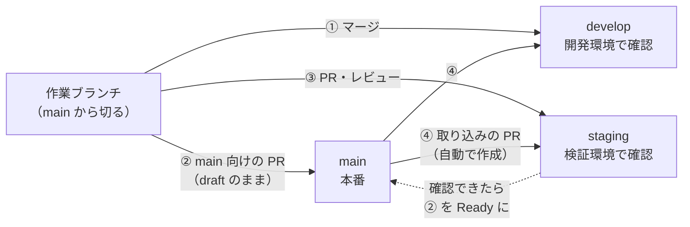

## TL;DR

- 4 つのリポジトリで、毎週火曜にまとめて出す release ブランチの運用をやめ、**GitHub Flow ＋ 環境ブランチ（develop・staging）**に移りました。レビューを通った変更から順に本番へ出します
- 変更のリードタイム（最初のコミット → 本番）の中央値は、移行の前後のスプリントで**約 6.8 日 → 約 1.8 日**になりました。完了したストーリーポイントは変わっていません
- 一番手こずったのは、**必須チェックと「docs だけの変更では重いジョブを飛ばす」の両立**です。飛ばすと必須チェックが待機中のまま残ったり、チェックの名前が変わったりします。結果をまとめるジョブを 1 つだけ必須にして解きました
- **draft の PR が飛ばしたチェックが、ほかの PR の本当の結果を上書きして隠す**、という落とし穴も踏みました
- docs だけの変更では、デプロイのパイプラインを起動しないようにしました。本番の承認待ちで、後続のデプロイを止めないためです

## この記事の対象読者

- 定期リリースをやめて、変更ごとに本番へ出したいと考えている方
- GitHub Actions の必須チェックと、パスによるジョブの出し分けを両立させたい方
- AWS CodePipeline で、デプロイに関係しない変更ではパイプラインを動かしたくない方

## 環境

- GitHub（ルールセットの必須ステータスチェック）、GitHub Actions（共有ワークフローを含む）
- AWS CodePipeline（V2 型、push の trigger）。本番は手動承認あり
- 4 つのアプリのリポジトリ（Go の backend、React の frontend、Python の ML、Terraform の infra）

## 背景：待ち時間の大半が「火曜を待つ時間」だった

以前は、毎週火曜に release ブランチを `main` へマージして、まとめて本番へ出していました。

チームの振り返りで変更のリードタイムを測ると、移行を検討したときのスプリントでは、中央値が **262 時間**（約 11 日）、1 回のリリースに入る変更は **64 件**でした。待ち時間の大半は、レビューでも確認でもなく、**次の火曜を待つ時間**でした。

そこで、チームで合意したうえで、レビューを通った変更から順に本番へ出す形に移りました。

## 移行後のフロー

ブランチと環境の対応は、以前と変わりません。

| ブランチ | 環境 | 役割 |
| --- | --- | --- |
| `main` | 本番 | マージすると本番へ反映される |
| `staging` | 検証環境 | 本番前の確認と、他チームとの結合確認 |
| `develop` | 開発環境 | 開発中の確認。複数の作業が混在してよい |
| `feature/*` など | - | 作業ブランチ。`main` から切る |

変わったのは、作業ブランチの流れです。



1. 作業ブランチを `develop` へマージし、開発環境で確かめる
2. 作業ブランチから `main` へ、**draft の PR** を作っておく
3. 作業ブランチから `staging` へ PR を作り、ここで主なレビューを受ける。検証環境で確かめる
4. 確認できたら、2 の PR を Ready にし、`main` へマージする（本番へ反映）
5. `main` を `staging` と `develop` へ取り込む。`main` への push で、取り込みの PR が自動で作られる

## 必須チェックと「ジョブを飛ばす」を両立させる

`main` へのマージが増えると、ドキュメントだけの変更も頻繁にマージされます。そのたびに、ビルドやテストのような重いジョブを流すのは無駄です。一方で、`main` には CI の通過を必須にしています。

この 2 つを両立させようとして、2 つの壁に当たりました。

### 壁 1：paths-ignore で絞ると、必須チェックが待機中のまま残る

ワークフローを `paths-ignore` で起動しないようにすると、ジョブそのものが作られません。必須チェックの結果が届かないので、PR は「待機中」のまま、マージできなくなります。

### 壁 2：共有ワークフローを呼ぶジョブは、飛ばすとチェックの名前が変わる

ジョブの `if` で飛ばす方法もあります。ところが、共有ワークフロー（reusable workflow）を呼ぶジョブは、動いたときのチェックの名前が「`呼び出し元のジョブ / 呼び出し先のジョブ`」になります。飛ばしたときは、呼び出し元のジョブの名前だけになります。名前が変わると、必須チェックとしては別物です。

### 解決：結果をまとめるジョブを 1 つだけ必須にする

ワークフローの先頭に「変更の判定」のジョブを置き、最後に全ジョブの結果をまとめる「CI 結果」のジョブを置きました。必須チェックにするのは、**この「CI 結果」だけ**です。

```yaml
# 説明用に簡略化したコード
jobs:
  changes:
    name: 変更の判定
    # docs・APM の設定だけの変更なら code=false を出す

  build-lint-test: # 毎回、成功が要るジョブ
  sast:            # 重いジョブ。docs だけのときは飛ばす
    needs: changes
    if: needs.changes.outputs.code == 'true'

  ci-result:
    name: CI 結果
    if: always()
    needs: [changes, build-lint-test, sast]
    steps:
      - name: 結果の判定
        run: |
          # 毎回要るジョブは success だけを許す
          # 重いジョブは success か、「docs だけ（code=false）のときの skipped」だけを許す
          # それ以外の skipped・failure・cancelled は失敗にする
```

ポイントは 2 つです。

- **飛ばしてよい場合を、狭く決める。** 許すのは「docs だけの変更のときの、重いジョブの skip」だけです。それ以外の skip は、失敗として扱います。思わぬ理由でジョブが飛んだまま、マージされることを防ぐためです
- **`if` は `!cancelled()` ではなく `always()` にする。** 必須チェックは、skipped を成功として扱います。`!cancelled()` にすると、実行を取り消したときに「CI 結果」そのものが skipped になり、成功扱いでマージできてしまいます。`always()` なら取り消されても「CI 結果」が動き、取り消されたジョブを見つけて失敗にします

## 落とし穴：draft の PR の skip が、本当の結果を隠す

このフローでは、同じ作業ブランチから、`main` 向けの draft の PR と、`develop`・`staging` 向けの PR を出します。draft の間は CI を動かさない設定にしていました。

ところが、**チェックの結果は PR ではなくコミットに付きます**。同じコミットに対して、draft の PR が「skipped」を、ほかの PR が本当の結果を、同じ名前で付けます。後から付いた方が表示されるので、draft の skip で、`develop` 向けの PR の本当の結果が見えなくなっていました。このときの結果は成功でしたが、失敗していても気づけない状態です。

実際に、`staging` 向けの PR が GitHub 上だけでコンフリクト扱い（マージベースが複数）になり、自身の CI が動かず、draft の PR の skip だけが表示されたこともあります。

`main` の必須チェックは、同じ名前の最新の結果で判定されます。手順どおりなら起きませんが、`main` 向けの PR を Ready にした後に同じコミットで別の draft を開くと、失敗が skip で上書きされる余地があります。

対策は 2 つです。

- CI は、`main` と `staging` 向けの PR でだけ動かす（`develop` 向けでは動かさない）
- `develop`・`staging` 向けの PR は、draft にしない。draft にするのは `main` 向けの PR だけにする

## docs だけの変更では、パイプラインを起動しない

CI だけでなく、デプロイのパイプラインにも同じ問題がありました。docs だけのマージでも本番のパイプラインが動き、手動承認の段で止まります。承認されずに放置されると、**後続のデプロイが最大 7 日待たされます**。

そこで、CodePipeline の V2 型の **trigger の filePaths** で、除外するパスを決めました。

- 除外：`docs/**`、`.github/**`、AI エージェントの設定（`.apm/**` など）
- 除外に当たらないファイルが **1 つでもあれば起動する**

設定で気をつけた点は次のとおりです。

- trigger は V2 型だけの機能です。V1 型だったパイプラインは V2 型にしました。Terraform では作り直しではなく、更新（in-place）で済みました
- trigger を使うときは、Source アクションの `DetectChanges` を `false` にします
- `*.md` を一括では除外しません。Dockerfile が `README.md` をイメージに入れているリポジトリがあるためです
- 除外のパターンは 8 個までです。ルートのファイルは `{AGENTS.md,.mcp.json}` のようにまとめました
- 1 回の push で 100 ファイルを超えると、取得した 100 件だけで判定されます。その場合は手で実行します

開発環境・検証環境・本番の 3 つで、「docs や AI エージェントの設定だけのマージでは起動せず、除外に当たらないファイルが 1 つでもあれば起動する」ことを確かめました。

## 運用のルール

フローを変えると、周りの運用も変える必要がありました。主なものです。

| ルール | 理由 |
| --- | --- |
| `main` を `staging`・`develop` へ取り込む PR は、`main` への push で自動で作る | 取り込みを忘れると、環境ブランチが `main` に追いつかず、次の PR の差分に他人の変更が混ざる |
| docs だけの変更は、`main` 向けの PR だけで出してよい | 本番のデプロイが動かないので、環境での確認が要らない |
| `staging` を作業ブランチへ取り込まない | まだ本番に出ていない他人の作業まで、本番へ出てしまう |
| DB の変更とアプリの変更は、後方互換な PR に分けて、順に本番へ出す | 列の追加を先に出す（[migration の記事](https://qiita.com/zucky-quest/items/cad9639b837c69335e3b)の原則と同じ。単位がリリースから PR になった） |
| 本番へのマージはコアタイムの中で行う | 反映後の確認まで終えられるようにする |
| アプリのタグは、本番の確認を終えた人が打つ。名前は `vYYYY.MM.DD`、同じ日の 2 回目からは `-2`・`-3` | 日付のバージョンを続けつつ、1 日に何度でも出せるようにする |

## 計測も作り直した

チームの振り返りでは、デリバリーの 4 つの指標（Four Keys）を見ています。フローが変わると、そのままでは測れなくなる指標がありました。

- **リードタイムを区間に分けた。** `staging` 向けと `main` 向けの PR を組み合わせ、「レビュー待ち」「検証環境での確認」「本番反映まで」に分けて見ます。主なレビューは `staging` 向けの PR で受けるので、`main` 向けの PR だけでは最後の承認待ちしか測れないためです
- **デプロイが動かないマージを、本番反映から外した。** docs だけのマージを数えると、デプロイの回数が実態より多く見えます
- **「1 回のリリースあたりの変更数」を「本番反映日あたりの変更数」にした。** 移行後は、本番反映 1 回が変更 1 件になり、前の指標は意味を持たなくなります。移行の前後で同じ式で出せる指標にしました

## 成果：リードタイムの中央値 約 6.8 日 → 約 1.8 日

チームの振り返りで、移行前の最後のスプリントと、移行後の最初のスプリントを比べました。どちらも 1 週間のスプリントです。`main` へのマージを本番反映とみなし、bot と、docs などデプロイが動かない変更だけの PR は除いています。

| 指標 | 移行前の最後のスプリント | 移行後の最初のスプリント |
| --- | --- | --- |
| 変更のリードタイムの中央値 | **約 6.8 日（162.53 時間、33 件）** | **約 1.8 日（43.21 時間、20 件）** |
| 本番へ出した日数 | 1 日 | 4 日 |
| 本番へ出した日あたりの変更数 | 33 件 | 5 件 |
| 変更失敗率 | 0% | 0% |
| 完了したストーリーポイント | 84 | 84 |

移行前の値はスプリントによって幅があり、背景で挙げた移行を検討したときのスプリントでは 262 時間でした。ここでは、移行の直前と直後の 1 週間を比べています。

変更が「次の火曜」を待たずに、本番へ出るようになりました。本番へ出した日あたりの変更は、33 件から 5 件に減りました。完了したストーリーポイントは変わらず、変更失敗率も 0% のままでした。

移行後のリードタイムの平均は 125 時間で、中央値よりかなり大きくなっています。移行前から作っていて、移行後に本番へ出た変更が含まれるためです。移行の効果は、中央値で見ています。

移行後のリードタイムを区間に分けると、次のとおりです（中央値）。

| 区間 | 時間 |
| --- | ---: |
| レビュー待ち（staging 向けの PR のレビュー依頼 → 承認） | 1.35 時間 |
| 検証環境での確認（staging へのマージ → main 向けの PR を Ready に） | 4.5 時間 |
| 本番反映まで（Ready → main へのマージ） | 1.79 時間 |

### 増えたコスト：CI の利用量

一方で、GitHub Actions の利用量（課金される分数の近似）は、**2,895 分 → 4,177 分**と約 1.4 倍に増えました。1 つの変更を、`staging` 向けと `main` 向けの 2 本の PR で確かめるので、CI が動く回数が増えました（以前は release ブランチ向けの PR が中心でした）。作業の PR そのものも、46 件から 63 件に増えています。また、`staging`・`main` へのマージが変更ごとになったので、マージのたびに push で CI が動き、`main` から環境ブランチへの取り込みの PR でも CI が動きます。docs だけの変更で重いジョブを飛ばすのは、この増え方を抑えるためでもあります。

## まとめ

| 決めたこと | 理由 |
| --- | --- |
| 毎週のリリースをやめ、レビューを通った変更から順に出す | 待ち時間の大半が「火曜を待つ時間」だった |
| 必須チェックは「CI 結果」の 1 つだけにする | paths-ignore では待機中が残り、共有ワークフローは飛ばすと名前が変わる |
| 「CI 結果」は `always()` で動かし、飛ばしてよい場合を狭く決める | 取り消しや予期しない skip で、マージできてしまうのを防ぐ |
| draft にするのは `main` 向けの PR だけ。CI は `develop` 向けでは動かさない | チェックはコミットに付き、draft の skip がほかの結果を隠す |
| docs だけの変更では、パイプラインを起動しない | 本番の承認待ちで、後続のデプロイを止めない |
| 振り返りの指標を、新しいフローで測れる形にした | 前の指標（1 回のリリースあたりの変更数）は意味を持たなくなる |

学びは 2 つです。

1. **CI の「飛ばす」は、結果の判定とセットで設計する。** ジョブを飛ばすのは簡単ですが、必須チェックは skipped を成功として扱います。何を飛ばしてよいかを 1 か所で判定すると、安全に飛ばせます
2. **チェックは PR ではなくコミットに付く。** 同じコミットを複数の PR で使うフローでは、ある PR の結果が、別の PR の表示を上書きします。どの PR で CI を動かすかを、フローと一緒に決める必要がありました

移行の作業は、AI エージェントのセッションを使って、リポジトリをまたいで進めました。セッションの分け方は、[1 案件 4 セッションの記事](https://qiita.com/zucky-quest/items/74ed4d7fd676dd5f5556)に書いています。

## 参考

- [GitHub Docs: Troubleshooting required status checks（スキップされたジョブの扱い）](https://docs.github.com/en/pull-requests/collaborating-with-pull-requests/collaborating-on-repositories-with-code-quality-features/troubleshooting-required-status-checks)
- [GitHub Docs: Reusing workflows](https://docs.github.com/en/actions/sharing-automations/reusing-workflows)
- [AWS CodePipeline: Filter triggers on code push or pull requests](https://docs.aws.amazon.com/codepipeline/latest/userguide/pipelines-filter.html)
- [DORA: Software delivery performance metrics](https://dora.dev/guides/dora-metrics/)
