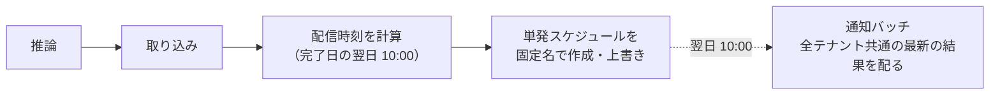
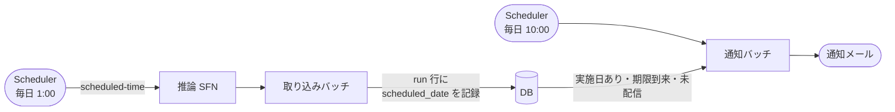

## TL;DR

- 推論バッチの結果を、テナントごとに通知メールで配っています。以前は、**推論が終わった時刻**をもとに配信日を決めていました
- そのせいで、処理が日付をまたぐと**配信が 1 日ずれました**。検証のために手で流した推論まで、利用企業にメールされる恐れもありました
- 作り直しの軸は 1 つです。EventBridge Scheduler の **`scheduled-time` を「実施日」として、推論から DB まで同じ値で運びます**
- 通知は推論から切り離し、毎日 10 時の固定 cron で起動します。配るのは「実施日があり、期限が来ていて、まだ配っていない」結果だけです
- 推論と通知は、**DB に記録した実施日だけでつながります**。時刻から推測する箇所は無くなりました

## この記事の対象読者

- バッチ処理の結果を、メールなどで利用者に配っている方
- Step Functions と EventBridge Scheduler で日次の処理を組んでいる方
- 「いつ動いたか」と「いつの分か」がずれて困った経験のある方

## 環境

- AWS Step Functions（JSONata）
- Amazon EventBridge Scheduler
- Amazon ECS（Fargate）のバッチ
- MySQL
- Terraform

## 背景：配信日が推論の所要時間で決まっていた

業務系の SaaS で、推論バッチがテナントごとにスコアを計算しています。条件に当てはまる結果があれば、そのテナントの担当者に通知メールを送ります。

以前の通知は、推論のステートマシンの**最後のステート**が発火させていました。推論が終わると、EventBridge Scheduler に「翌日 10 時に通知バッチを起動する」という単発の `at()` スケジュールを、固定の名前で作るか上書きします。



この作りには 3 つの問題がありました。

**1. 配信日が推論の所要時間に左右される。** 配信時刻は「推論が**完了した日**の翌日 10 時」です。処理が日本時間の 0 時をまたいだ瞬間に、配信が 1 日ずれます。

**2. どの結果を配るかを、時刻から推測している。** 通知バッチは「全テナント共通で一番新しい推論結果」を配ります。月の途中で検証のために推論を手で流すと、その結果が翌日 10 時に、利用企業への**本物の通知メールとして送られます**。

**3. 送れなかったことに気づけない。** 失敗はログに出るだけでした。

さらに、推論の実施日をテナントごとに設定できるようにする変更が控えていました。日ごとに違うテナントが推論されるので、「全テナント共通の最新結果を配る」作りはそもそも成り立ちません。

この記事では、1 と 2 を解いた設計を書きます。3 の「送れなかったことに気づく」仕組みは、別の記事「[「何も起きなかった」をメトリクスの欠損で検知する](https://qiita.com/zucky-quest/items/6f3f02c328480cf9ed5a)」にまとめました。

## 決定 1：「当日」は壁時計ではなく入力で決める

まず「その推論は、いつの分か」を定義し直しました。**実施日 = 定期起動の予定日**です。推論の開始時刻でも完了時刻でもありません。

EventBridge Scheduler には、スケジュールの予定時刻をターゲットへの入力に埋め込む**コンテキスト属性** `<aws.scheduler.scheduled-time>` があります。推論のステートマシンを起動するスケジュールで、これを入力に入れます。

```hcl
resource "aws_scheduler_schedule" "inference_daily" {
  schedule_expression          = "cron(0 1 * * ? *)"
  schedule_expression_timezone = "Asia/Tokyo"

  flexible_time_window {
    mode = "OFF"
  }

  target {
    arn      = aws_sfn_state_machine.inference.arn
    role_arn = aws_iam_role.scheduler.arn

    # jsonencode を使わない（後述）
    input = "{\"scheduledTime\": \"<aws.scheduler.scheduled-time>\"}"
    # retry_policy と dead_letter_config は省略
  }
}
```

`scheduled-time` は UTC の ISO 8601 です。ステートマシンの先頭に JSONata の Pass ステートを置き、日本時間の日付 `scheduledDate` に変換します。

```json
"Resolve Scheduled Date": {
  "Type": "Pass",
  "QueryLanguage": "JSONata",
  "Output": {
    "scheduledDate": ""
  },
  "Next": "Run Inference Task"
}
```

この式は 3 通りの起動を 1 つで扱います。

| 起動のしかた | 入力 | `scheduledDate` |
| --- | --- | --- |
| スケジュールからの定期起動 | `{"scheduledTime": "2026-10-09T16:00:00Z"}` | `2026-10-10`（日本時間に変換） |
| 失敗した日のリラン | `{"scheduledDate": "2026-10-10"}` | `2026-10-10`（そのまま） |
| コンソールからの手動起動 | `{}` | 空文字 |

あとは、推論・取り込みの各タスクに同じ `scheduledDate` を環境変数で渡します。

### 入力で決めると、後日のリランができる

壁時計ではなく入力で「当日」を決める一番の理由は、**復旧のため**です。

実施日 D の推論が失敗し、翌日 D+1 にリランするとします。推論処理が壁時計の「今日」で対象のテナントを選ぶと、D+1 が実施日のテナントが選ばれ、D のテナントは救えません。入力で決めていれば、`{"scheduledDate": "D"}` で起動し直すだけで、D のテナントを D の分として推論できます。

### 小ネタ：キーが無いと States.Runtime で落ちる

手動起動で入力が空のとき、`scheduledDate` を**空文字で必ず埋める**ようにしています。後続のタスクは `ContainerOverrides` で `"Value.$": "$.scheduledDate"` と参照しており、入力にキー自体が無いと `States.Runtime` エラーで落ちるためです。

## 決定 2：通知を推論から切り離し、毎日 10 時に固定で起動する

通知バッチの起動は、Terraform で宣言した固定の `cron(0 10 * * ? *)` に移しました。推論のステートマシンは、通知の発火に一切関与しません。



推論と通知は、スケジュールとしては独立しています。つながるのは、**DB に記録した実施日だけ**です。

分けたことで、3 つのことが言えるようになりました。

- **配信日時が Terraform の定義そのものになる。** 以前はスケジュールの中身が「最後に誰がいつ推論を回したか」で書き換わり続けていました。今は `terraform plan` で配信日時を確認できます
- **定刻の配信と遅れた分の後送を、同じ仕組みで扱える。** 10 時の起動は「期限が来ていて未配信の結果」を配るだけです。前日に配れなかった分も、追加の仕掛けなしに翌日拾われます
- **手で流した推論は、何も送らない。** 発火するのは 10 時の起動だけで、配るのは実施日が記録された結果だけだからです

なお、スケジュールが固定するのは**起動時刻**であって、メールの到達時刻ではありません。利用者には「実施日の 10 時から配信を開始します」と案内しています。

### 却下した案

推論の末尾で、テナントごとに単発の `at()` スケジュールを作る案は採りませんでした。以前の作りの問題をテナントの数だけ増やすうえ、設定変更や復旧のたびに AWS 側のスケジュールと DB の整合を取る必要が出ます。

推論の成功をきっかけに通知バッチを即時起動し、バッチ側で 10 時まで待つ案も採りませんでした。ECS タスクが最大で 1 日ぶら下がり、リランすると並走します。

## 決定 3：推測ではなく記録で判定する

通知バッチが答えるべき問いは 3 つです。

1. その推論結果は、**どの実施日の分**か
2. その推論結果は、**取り込みまで完成している**か
3. その推論結果は、**定期実行のもの**か

以前はどれも「推論を実行した時刻」から推測していました。今は、推論結果の単位（run）を表すテーブルに `scheduled_date` 列を足し、取り込みバッチが実施日を書き込みます。

| 問い | 答えるもの |
| --- | --- |
| どの実施日の分か | `scheduled_date` の値 |
| 完成しているか | run 行があること |
| 定期実行か | `scheduled_date` が NULL でないこと |

**手動起動の run は、`scheduled_date` が NULL になります。** 通知バッチの候補にそもそも現れません。時刻を比べて「手動っぽいか」を判定するのではなく、候補に出てこない形にしました。

### 「run 行がある = 取り込み完了」を守るために

2 つ目の問いに run 行の有無で答えるには、前提が 2 つ要ります。

1 つは、**run をテナント単位にする**ことです。取り込みはテナントごとに 1 トランザクションで、run 行とスコアを一緒にコミットします。run が全テナント共通のままだと、「run はあるが一部のテナントは未取り込み」という日が起こりえます。

もう 1 つは、**予測が 0 件のテナントにも、空の結果ファイルを出す**ことです。以前の推論処理は、0 件のテナントのファイルを作りませんでした。ファイルが無いと run 行も作られず、「推論できなかったテナント」と「推論したが対象がいなかったテナント」を区別できません。空のファイルを出すようにして、0 件のテナントにも件数 0 の run 行ができるようにしました。

## 決定 4：遅れても送る（at-least-once）

配信できなかったテナントは、翌日以降の 10 時の起動が拾い、**遅れてでも送ります**。その回を飛ばすことはしません。

ただし、二重送信の可能性はゼロにできませんでした。メール送信の API が重複を検知する手段を持たず、Scheduler 自身も at-least-once で起動するためです。保証の水準は **at-least-once** とし、「通常の運用では重複しない」ところまでを仕組みで担保しています。

- **テナント単位の失敗でループを止めない。** 以前は 1 テナントでエラーが起きると全体を打ち切っていました。今は失敗を記録して次のテナントへ進み、最後に失敗があれば終了コード 1 で終わります
- **1 テナント・1 実施日につき 1 通に絞る。** テナントごとの処理を MySQL の名前付きロック（`GET_LOCK`）で囲み、そのうえで配送記録の行に送信権のリースを取ります。リースは、ロックを持ったままプロセスが落ちたときの回復のために残しています
- **完了の記録は、リースの持ち主の一致を条件にする。** リースが切れた後に別のタスクが送信し、その後で元のタスクが復帰して「送信済み」を書く、という順序でも、元のタスクの書き込みは弾かれます
- **古い未配信分はまとめる。** 配信の失敗が続いた後に次の実施日の結果ができた場合は、最新の 1 件だけを配り、古い分は「superseded（新しい結果に置き換え済み）」として記録します。メールの本文は常に最新の結果へのリンクなので、古い分を別に送っても伝わる情報は増えません

`GET_LOCK` はセッション単位のロックです。取得から解放までを、接続プールから確保した**1 本の接続に固定**しないと、ロックが効かないか解放されません。ここは実装で気をつけた点です。

遅れても送る仕組みは、「送れていない」ことに誰かが気づける前提で成り立ちます。推論そのものが失敗した日は run 行ができないので、自動では救われません。この検知の仕組みは、[「何も起きなかった」をメトリクスの欠損で検知する](https://qiita.com/zucky-quest/items/6f3f02c328480cf9ed5a)にまとめました。

## ハマりどころ

### Terraform の jsonencode で、コンテキスト属性が置換されない

スケジュールの入力を Terraform の `jsonencode()` で書くと、`<` と `>` が `<` と `>` にエスケープされます。Scheduler のコンテキスト属性の置換は入力の**文字列そのもの**に対して行われるため、エスケープされると置換されません。冒頭の HCL で入力を文字列のまま書いているのはこのためです。

### UTC の日付のファイル名だと、早朝の結果が前日扱いになる

推論処理は、結果のファイル名に実行日時（UTC）の日付を付けていました。取り込みバッチは日本時間の当日分を探します。10 月 10 日 2 時（日本時間）の結果は `*_20261009.json` になり、取り込みから漏れます。

推論の起動時刻を 9 時以降にずらしても直せますが、それでは配信までの余裕が無くなります。**ファイル名の日付を日本時間にそろえる**ことで解消しました。

### 同じ日に通常実行とリランを流すと、結果が混ざる

同じ日に、通常の実行と前日分のリランを続けて流すと、両方の結果が同じ日付のファイルとして残ります。当日分をすべて列挙する取り込みは、通常実行のテナントまで拾い、リランの実施日を付けてしまいます。

ステートマシンの実行名（`$$.Execution.Name`）を推論と取り込みの両方に渡し、結果を**実行ごとのプレフィックス**（`results/{EXECUTION_ID}/`）に書くようにしました。取り込みは、その実行が作った結果だけを読みます。

## この設計で保証したこと

仕組みが何を保証し、何を保証しないかを整理しておきます。

| 保証していること | 保証していないこと |
| --- | --- |
| 配信日は実施日で決まり、処理が日付をまたいでもずれない | メールの到達時刻（固定するのは起動時刻） |
| 手で流した推論は、配信の候補に出ない | 二重送信が絶対に起きないこと（at-least-once） |
| 前日に配れなかった分は、翌日以降の 10 時に後送される | 推論そのものが失敗した日の自動復旧（人のリランが要る） |
| 失敗した日を、実施日を指定してリランできる | |

保証していないことは、仕組みで減らすか、別の層で気づけるようにしています。二重送信はロックとリースで通常の運用では起きないようにし、推論の失敗は監視で検知します。

## まとめ

| 以前 | 今 |
| --- | --- |
| 配信日は推論の完了時刻で決まる | 配信日は実施日（Scheduler の予定日）で決まる |
| 推論の最後に単発スケジュールを作る | 通知は毎日 10 時の固定 cron |
| 全テナント共通の最新結果を配る | テナントごとに「実施日あり・期限到来・未配信」の結果を配る |
| 手で流した推論も配られうる | 実施日が無い結果は候補に出ない |
| 1 テナントの失敗で全体が止まる | 失敗を記録して続行し、翌日以降に後送する |

学びは 2 つです。

1. **時刻は「いつ動いたか」ではなく「いつの分か」を入力として運ぶ。** 壁時計で決めると、日付境界・リラン・遅延のたびにずれます。予定日を入力にすれば、リランも同じ値で流せます
2. **つなぎ目は推測ではなく記録にする。** 「最新」「直近」「時刻が近い」で選ぶ処理は、手動の実行や部分的な失敗で必ず間違えます。DB に記録した値で判定すれば、間違えようがなくなります

## 参考

- [Using context attributes（EventBridge Scheduler ドキュメント）](https://docs.aws.amazon.com/scheduler/latest/UserGuide/managing-schedule-context-attributes.html)
- [Transforming data with JSONata in Step Functions](https://docs.aws.amazon.com/step-functions/latest/dg/transforming-data.html)
- [MySQL: Locking Functions（GET_LOCK）](https://dev.mysql.com/doc/refman/8.0/en/locking-functions.html)
